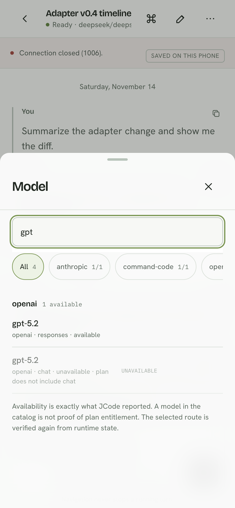

<p align="center">
  
</p>

<p align="center"><sub><code>JCODE MOBILE / STILLNESS 12 / 0.6.0</code></sub></p>

<h1 align="center">Leave the desk. Keep the thread.</h1>

<p align="center">
  <strong>Your server runs JCode. The phone is the return surface.</strong><br />
  <sub>A Tauri 2 client for <a href="https://github.com/1jehuang/jcode">JCode</a> on your own Linux server.</sub>
</p>

<p align="center">
  <a href="https://github.com/ddawnlll/jcode-mobile/releases/latest"></a>
  <a href="https://github.com/ddawnlll/jcode-mobile/actions/workflows/check.yml"></a>
  <a href="docs/ADAPTER_V4.md"></a>
  <br />
  <a href="https://ddawnlll.github.io/jcode-mobile/"><strong>Explore the site</strong></a>
</p>

<table>
  <tr>
    <td width="33%" align="center" valign="top">
      <sub><code>ANDROID / 0.6.0 / 12.14 MiB</code></sub><br /><br />
      <a href="https://github.com/ddawnlll/jcode-mobile/releases/latest"><strong>Download the APK</strong></a><br />
      <sub>Debug-signed sideload. No Play Store listing.</sub>
    </td>
    <td width="33%" align="center" valign="top">
      <sub><code>SERVER / JCODE + ADAPTER V4</code></sub><br /><br />
      <a href="docs/GETTING_STARTED.md"><strong>Run the adapter</strong></a><br />
      <sub>One pairing code. Then a device token.</sub>
    </td>
    <td width="33%" align="center" valign="top">
      <sub><code>SOURCE / TAURI 2 + RUST</code></sub><br /><br />
      <a href="docs/DEVELOPMENT.md"><strong>Build from source</strong></a><br />
      <sub>Android, native Linux, and a browser verification surface.</sub>
    </td>
  </tr>
</table>

> **0.6.0 is a development preview.** It ships Adapter v4, source-backed tool
> intent, structured command/file evidence, semantic motion and the native
> Android bridge. The Android APK is debug-signed for sideloading. The native
> Linux shell builds from source. There is no iOS artifact and no Play Store
> listing.

## What 0.6.0 is

JCode Mobile is two processes:

1. **Adapter v4** is one Rust binary on your server. It opens bounded native
   JCode session links, applies the exact model/provider/API route, keeps the
   durable SQLite event journal, and exposes an authenticated mobile WebSocket.
   Protocol 4, minimum 2: a v2 phone still pairs and never receives a v4 frame.
2. **Stillness 12** is the Tauri 2 client. It paints the cached session before
   the handshake, applies stream updates once per animation frame, reconciles
   through journal replay or an authoritative snapshot, and restores the exact
   server and session you left.

0.6.0 makes the transcript explain what actually happened. JCode's required
model-supplied `intent` is the primary tool label; file tools are filename-first;
commands show the exact shell text, output and only source-reported exit codes;
file mutations show requested input and JCode's authoritative diff. Motion is
event-driven and replay-safe: active tools animate, settled history does not,
and System/Full/Subtle/Off preferences are honored. The opening JavaScript
bundle is 129.12 kB gzip, still below the 0.5.0-era 166.37 kB baseline.

The previous 0.5.0 release added per-session native links, exact route
selection, live runtime and swarm state, delta coalescing, bounded binary
WebSocket packages, deferred Markdown and paged long output. 0.6.0 keeps that
transport, journal, image attachments, push registration and Android shell.

Nothing above is inferred from the browser surface: native Android evidence is
tracked separately in [`docs/ANDROID_NATIVE.md`](docs/ANDROID_NATIVE.md).

The phone never runs the agent. Prompts, tools, files, and long turns stay on
the server. Navigation, backgrounding, socket close, and app kill never send
Cancel. Only the explicit **Stop** control targets the current turn.

| Surface | State |
| --- | --- |
| Android | Tauri 2 APK, `arm64-v8a` and `armeabi-v7a`, minSdk 24 |
| Native Linux | Tauri 2 release binary, Secret Service credentials |
| Web | Verification surface only; browser token in `localStorage` |
| iOS | Not built on this host; no IPA |

## Verified for 0.6.0

The 0.6.0 candidate was built and tested against the
pinned JCode daemon `0abff12c`. The full stack (daemon, harness bridge, native
link, Adapter v3 and v4, and the web UI) ran end to end on macOS with a
deterministic local Responses fixture. The fixture is not a model and makes no
network calls, so the transport and UI numbers do not depend on a provider.

The Android candidate was installed on an API 36 arm64 emulator at 360 dp and
exercised with a real provider turn, Stop recovery, adapter-loss reconnect and
drawer/system-back navigation. Physical-device, TalkBack, 10k/1 MB Android and
120 Hz checks remain `NOT_RUN` and are listed in the
[0.6.0 release notes](docs/V0_6_0_RELEASE_NOTES.md).

| Check | Result |
| --- | --- |
| Adapter v4 Rust tests | PASS, 96 tests (42 core + 10 protocol + 25 server lib + 19 integration) |
| Rust formatting and clippy | PASS, `cargo fmt --check` and `cargo clippy -D warnings` |
| Legacy JavaScript tests | PASS, 14 suites / 139 tests |
| Stillness UX checks | PASS, 23/23 |
| Controller reconciliation | PASS, 16/16 |
| TypeScript and ESLint | PASS |
| Stillness production build | PASS, 129.12 kB gzip initial JavaScript / 13.09 kB gzip CSS |
| Stream coalescing | PASS, 12,009 frames / 6,595,348 B to 745 frames / 780,810 B on the same 384,000-byte response |
| Large UTF-8 payload | PASS, one descriptor + four binary frames, 200,514 B reassembled to valid JSON and UTF-8 across a 64 KiB boundary |
| Full stack on the pinned daemon | PASS, isolated daemon + harness bridge + native link + Adapter v3/v4 |
| Pairing and session browser e2e | PASS, 5 passed / 3 skipped against isolated Adapter v4 |
| Android release APK static verification | PASS, versionCode 6000, versionName 0.6.0, v2 + v3 signatures |
| Android emulator install and real provider tool turn | PASS, API 36 arm64, 360 dp, gpt-5.6-luna |
| Android Stop recovery and adapter-loss reconnect | PASS with documented delay; composer recovered |
| Android drawer tap, system back and focus restore | PASS |
| Android emulator frame timing | MEASURED, p50 53 ms / p95 69 ms / p99 85 ms on software-rendered emulator; not a physical-device claim |
| Physical Android device, TalkBack, 10k/1 MB Android, 120 Hz | NOT_RUN |
| FCM delivery | PARTIAL, registration only; `not_configured`, no Firebase credentials |
| Battery and physical-device cold start | NOT_RUN; emulator cold start 579 ms |

The 0.4.0 on-device captures remain in
[`docs/evidence/v0.4.0/README.md`](docs/evidence/v0.4.0/README.md). They are
0.4.0 evidence and are not presented as a 0.6.0 device run. The full 0.5.0
benchmark remains in [`docs/evidence/v0.5.0/benchmark/REPORT.md`](docs/evidence/v0.5.0/benchmark/REPORT.md).

## The transcript is fenced

The transcript is fenced by `session_id`, `epoch`, `seq`, `turn_id`, and
`operation_id`. A slow answer cannot overwrite newer work. A journal gap or
epoch mismatch triggers an authoritative snapshot instead of a guessed patch.
Drafts, reading positions, favorites, and pending sends are scoped to the
server and session.

## Command Code, in the route list

<p align="center">
  
</p>

The pinned JCode fork exposes Command Code as a native provider. The adapter
lists routes from `ListModels` and `GetRuntimeInfo`. It does not infer
entitlement from a catalog, invent a provider key, or proxy a credential.
Reasoning effort is sent as the discrete value the server accepts.

## The desktop shell

The same build runs as a three-pane Tauri window on Linux. The sidebar, central
session, and inspector read one shared connection. The inspector exposes only
what the server reported: plan, context, activity, runtime, and provider.

## Install the Android APK

```text
jcode-mobile-0.6.0-android-release.apk
12,726,721 bytes (12.14 MiB)
SHA-256 2d76b6793960df4070c21cd3960d3dc374e38c9821102a32565d8a4e3c0f3941
package dev.jcode.stillness
versionCode 6000, versionName 0.6.0
minSdk 24, targetSdk 37, compileSdk 37
arm64-v8a + armeabi-v7a
APK Signature Scheme v2 and v3, Android Debug certificate
```

```sh
adb install -r jcode-mobile-0.6.0-android-release.apk
```

The package identifier and signing key are unchanged from 0.4.0, so the app
updates in place and keeps its device token. The APK and its `.sha256` are built
to `artifacts/` and attached to the GitHub release once it is published.

## Run the server side

```sh
git clone https://github.com/ddawnlll/jcode-mobile.git
cd jcode-mobile
cargo build --release -p adapter-server --bin jcode-adapter-v4

JCODE_ADAPTER_ALLOWED_ROOTS="$HOME/src" \
JCODE_ADAPTER_BIND=127.0.0.1:7646 \
./target/release/jcode-adapter-v4
```

`jcode-adapter-v3` and `jcode-adapter-v2` are rollback aliases that run the same
versioned server, so existing service units keep working. The adapter prints its
pairing code and the roots it will expose. It discovers the JCode harness socket
from `JCODE_API_SOCKET` or the platform runtime directory. Adapter v4 also opens
the native `JCODE_SOCKET` for the same runtime. Data lives in
`~/.local/share/jcode-mobile-adapter-v2` unless `JCODE_ADAPTER_DATA_DIR` is set;
the directory name is retained from v2 and its schema is extended in place.

For a remote phone, terminate TLS at a reverse proxy and keep the adapter on
loopback:

```caddyfile
dawnll.example.com {
    reverse_proxy 127.0.0.1:7646
}
```

Then enter `https://dawnll.example.com` in the app. The adapter does not ship a
TLS terminator, VPN client, or SSH client for the phone.

Full setup, environment variables, troubleshooting, and local staging:
[`docs/GETTING_STARTED.md`](docs/GETTING_STARTED.md). Upgrade, rollback, and
the v4 contract: [`docs/ADAPTER_V4.md`](docs/ADAPTER_V4.md).

## Build from source

```sh
bun install --frozen-lockfile
cd apps/stillness && bun install --frozen-lockfile && cd ../..

cargo test --workspace
cargo fmt --all -- --check
cargo clippy --workspace --all-targets -- -D warnings
bun run typecheck
bun run lint
bun run test

cd apps/stillness && bun run build
cd ../..
bash scripts/build-android-release.sh   # JDK + Android SDK
bash scripts/build-tauri-linux.sh       # GTK 3 + WebKitGTK 4.1
```

The Android release script builds, zipaligns, signs, verifies, and writes a
`.sha256` beside the APK. The Linux script accepts a user-space `TAURI_SYSROOT`
when the host has no system GTK/WebKit development packages.

## Limits

- The Android APK is debug-signed and sideload-only. There is no Play Store
  release, release keystore, auto-update channel, or signed iOS build.
- The 0.5.0 candidate was exercised with a deterministic local provider on
  macOS. A real provider/model turn and on-device install, turn timing, battery,
  and frame pacing are `NOT_RUN` for 0.5.0.
- The release APK is ARM-only. The 0.4.0 Android runtime checks used the
  arm64-v8a API 36 emulator on macOS. 0.5.0 on-device validation is `NOT_RUN`.
- FCM delivery is `not_configured` without `JCODE_FCM_PROJECT_ID` and
  `JCODE_FCM_ACCESS_TOKEN`. Payloads contain no transcript content.
- The scheduled background check is an unauthenticated `GET /health`. It reports
  reachability, not authenticated session reconciliation.
- `sessions.delete` is refused because the daemon has no delete operation.
  Archive is the supported alternative.
- JCode's curated API exposes aggregate edit statistics, not a verified per-file
  diff. The Changes screen says so.
- Upstream cancellation is session-scoped. The adapter verifies the expected
  turn before stopping and reports `atomic_turn_scope: false`.
- The adapter journal stores event payloads with bounded retention. It is not an
  unbounded transcript archive; authoritative history comes from the daemon.
- Attachments accept four inline images per message, 4 MiB each. Provider
  credentials are not implemented in the mobile composer.
- A human screen-reader pass, battery measurement, frame pacing, and native
  cold-start measurements remain `NOT_RUN` for 0.5.0.

## Documentation

| Read | Why |
| --- | --- |
| [Getting started](docs/GETTING_STARTED.md) | Adapter, TLS, pairing, Android, Linux, troubleshooting |
| [Adapter v4](docs/ADAPTER_V4.md) | Native links, exact routes, coalescing, binary transport, migration, verification |
| [Adapter contract](docs/ADAPTER_CONTRACT.md) | Source evidence, operation states, security boundaries |
| [Android native](docs/ANDROID_NATIVE.md) | Kotlin bridge, commands, permission and capability matrix |
| [Migration](docs/ADAPTER_V4.md) | 0.4.x → 0.5.0 adapter and phone upgrade, rollback |
| [Tool presentation](docs/TOOL_PRESENTATION.md) | Source intent, files, commands, diff and output provenance |
| [Motion](docs/MOTION.md) | Animation ownership, tokens, replay rules and bundle impact |
| [Accessibility](docs/ACCESSIBILITY.md) | Motion preferences, focus, live regions and TalkBack status |
| [Audit](docs/V0_4_0_AUDIT.md) | Battery, privacy, permissions, accessibility and startup history |
| [Development](docs/DEVELOPMENT.md) | Repository layout, commands, tests, release builds |
| [Verification](docs/VERIFICATION.md) | The 0.3.1 matrix, kept as history; 0.4.0 and 0.5.0 evidence are in the release notes |
| [Build state](docs/BUILD_STATE.md) | Versions, artifacts, checksums, resumption point |
| [Release notes](docs/V0_6_0_RELEASE_NOTES.md) | 0.6.0 scope, Android evidence, artifact and known limits |

Historical release notes remain in `docs/`, including
[0.5.0](docs/V0_5_0_RELEASE_NOTES.md),
[0.4.0](docs/V0_4_0_RELEASE_NOTES.md),
[0.3.1](docs/V0_3_1_RELEASE_NOTES.md), and
[0.3.0](docs/V0_3_0_RELEASE_NOTES.md).

---

<p align="center">
  <sub><strong>JCODE MOBILE</strong> / Stillness 12 / Work in orbit.</sub><br />
  <sub>An independent companion for <a href="https://github.com/1jehuang/jcode">JCode</a>. Not an official JCode release.</sub><br />
  <sub>JCode, Bricolage Grotesque, Hanken Grotesk, IBM Plex Mono, and Lucide keep their own licenses. See <a href="THIRD_PARTY_NOTICES.md">THIRD_PARTY_NOTICES.md</a>.</sub>
</p>

## Ziran 0.7.0

A native Android client for jcode, built with Kotlin and Jetpack Compose. The
phone stays a client; the daemon owns execution. Ziran lives in
[`apps/android/`](apps/android/) as a standalone Gradle project. Application
id `dev.ziran.android`, version 0.7.0, compile and target SDK 37, min SDK 26.

See [`docs/V0_7_0_RELEASE_NOTES.md`](docs/V0_7_0_RELEASE_NOTES.md).
