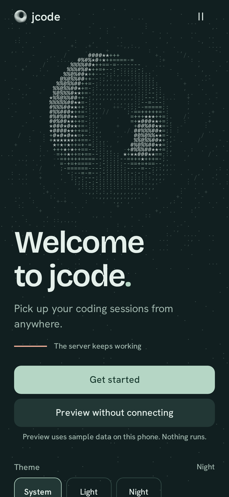
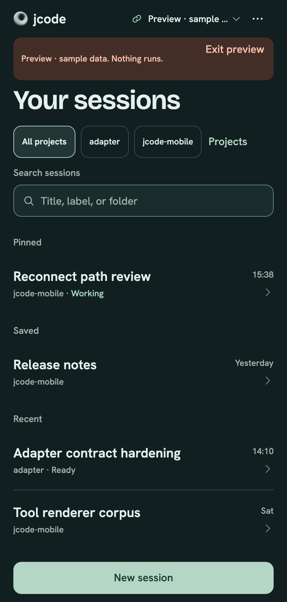
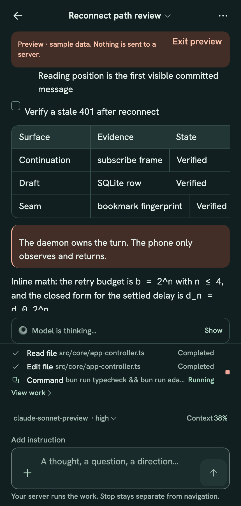
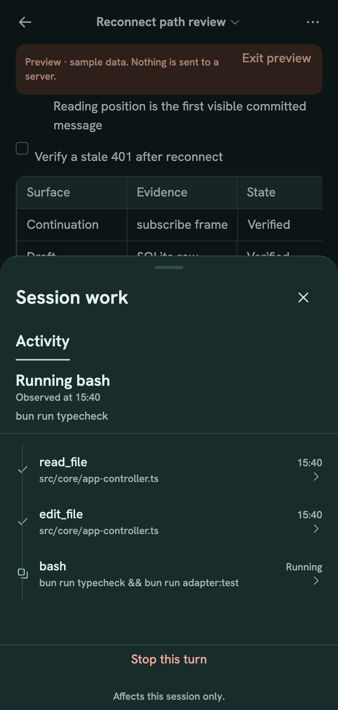

<p align="center">
  
</p>

<p align="center"><sub><code>JCODE MOBILE / WORK IN ORBIT</code></sub></p>

<h1 align="center">Leave the desk. Keep the thread.</h1>

<p align="center">
  <strong>Your phone directs. Your server executes. The exact thread waits for your return.</strong><br />
  <sub>A native iOS and Android companion for <a href="https://github.com/1jehuang/jcode">JCode</a>.</sub>
</p>

<p align="center">
  <a href="https://github.com/ddawnlll/jcode-mobile/releases/tag/v0.2.2"></a>
  <a href="https://github.com/ddawnlll/jcode-mobile/actions/workflows/check.yml"></a>
  <br />
  <a href="https://ddawnlll.github.io/jcode-mobile/"><strong>Explore the live site</strong></a>
</p>

<table>
  <tr>
    <td width="50%" align="center" valign="top">
      <sub><code>ANDROID / 0.2.2 / 63 MiB</code></sub><br /><br />
      <a href="https://github.com/ddawnlll/jcode-mobile/releases/download/v0.2.2/jcode-mobile-0.2.2-android-release.apk"><strong>Download the APK</strong></a><br />
      <sub>Debug-signed sideload. No Play Store listing.</sub>
    </td>
    <td width="50%" align="center" valign="top">
      <sub><code>SERVER / JCODE + BUN</code></sub><br /><br />
      <a href="docs/GETTING_STARTED.md"><strong>Run the adapter</strong></a><br />
      <sub>TLS, one pairing code, five minutes.</sub>
    </td>
  </tr>
</table>

## A first launch, in motion

<p align="center">
  
</p>

<p align="center">
  <strong>v0.2.1 · SHIPPED WELCOME</strong><br />
  <sub>The first unpaired launch assembles the full screen from ASCII noise in 1.6 seconds, resolves the title silhouette into real type, then keeps the torus turning. Skip and Pause are always available. Reduce Motion paints one readable still frame.</sub>
</p>

## Work in orbit

Your JCode session lives on a server. The model, tools, files, and long turn stay there. This app gives that session a surface you can hold.

Send a prompt. Put the phone down. Come back to the same server, the same session, and a seam that says what changed. Only Stop stops a turn. Back, swipe, background, and force-quit never do.

<table>
  <tr>
    <td width="33%" align="center" valign="top">
      <br />
      <sub><strong>SESSIONS</strong><br />Find the work. See what is live.</sub>
    </td>
    <td width="33%" align="center" valign="top">
      <br />
      <sub><strong>CONVERSATION</strong><br />Read the reply. Keep the thread.</sub>
    </td>
    <td width="33%" align="center" valign="top">
      <br />
      <sub><strong>WORK</strong><br />Inspect the actual tool calls.</sub>
    </td>
  </tr>
</table>

<p align="center"><sub>Captured in the v0.2.0 Preview build with sample data. The session, conversation, and Work surfaces are unchanged in 0.2.1. Nothing runs in these captures.</sub></p>

## Three things worth holding

<table>
  <tr>
    <td width="33%" valign="top">
      <sub><code>RETURN</code></sub><br /><br />
      <strong>The server keeps working.</strong><br /><br />
      Leave mid-turn, lock it, force-quit. Reopen into the exact session<br />
      and a seam that counts the updates.
    </td>
    <td width="33%" valign="top">
      <sub><code>WORK</code></sub><br /><br />
      <strong>Nothing is inferred.</strong><br /><br />
      Real tool calls, the reported plan, confirmed changes, context use, Markdown, math, and images.
    </td>
    <td width="33%" valign="top">
      <sub><code>APPEARANCE</code></sub><br /><br />
      <strong>11 families. 22 palettes.</strong><br /><br />
      Light and Night for Tidal, Gruvbox, Catppuccin, Dracula, Nord, Tokyo Night,<br />
      Solarized, One, GitHub, Rosé Pine, and Monokai. Local drafts stay scoped<br />
      to the server and session.
    </td>
  </tr>
</table>

## Three moves to orbit

**1. Put the adapter on your server.** A small Bun process sits beside JCode and speaks to your
daemon. It does not run a second agent. [Setup guide](docs/GETTING_STARTED.md)

**2. Run `jcode pair`.** Six digits, valid for five minutes, exchanged once for a device token.

**3. Install and pair.** Sideload the APK, enter your server address and the six digits. The token
goes into Keychain or Keystore, never SQLite, logs, or the URL.

Full setup, TLS, iOS source builds, and staging: [`docs/GETTING_STARTED.md`](docs/GETTING_STARTED.md).

## For builders

| Read | Why |
| --- | --- |
| [Development](docs/DEVELOPMENT.md) | Architecture, invariants, commands, test surfaces, design system |
| [Adapter contract](docs/ADAPTER_CONTRACT.md) | Wire protocol, source evidence, explicit non-goals |
| [Verification](docs/VERIFICATION.md) | PASS, PARTIAL, NOT_RUN, and BLOCKED, with observed evidence |

```sh
bun install --frozen-lockfile
bun run check          # types, lint, Jest and RNTL
bun run adapter:test   # Bun contract tests
bun run e2e            # Playwright against isolated staging
```

Bun 1.4.4 only. The web target is a verification surface, not a second product. Live site: <https://ddawnlll.github.io/jcode-mobile/> · Source: [`website/`](website/).

## Availability and proof

Android 0.2.2 shipped on 10 November 2026. It is a release build with an embedded Hermes bundle,
debug-signed for sideloading. There is no Play Store listing, no App Store listing, and no signed
iPhone artifact. iOS builds from source with Xcode 26.1 or newer. The 0.2.2 iOS artifact
is a Release Simulator `.app` zip, not an IPA. Android release flows are verified against real JCode 0.99.1 staging,
as are continuation, daemon death, ambiguous delivery, reading position, and server switching.
Physical devices and a human screen-reader pass are not run. Full matrix:
[`docs/VERIFICATION.md`](docs/VERIFICATION.md).

---

<p align="center">
  <sub><strong>JCODE MOBILE</strong> / Work in orbit.</sub><br />
  <sub>An independent companion for <a href="https://github.com/1jehuang/jcode">JCode</a>. Not an official JCode release.</sub><br />
  <sub>JCode, Bricolage Grotesque, Hanken Grotesk, IBM Plex Mono, and Lucide keep their own licenses. See <a href="THIRD_PARTY_NOTICES.md">THIRD_PARTY_NOTICES.md</a>.</sub>
</p>
