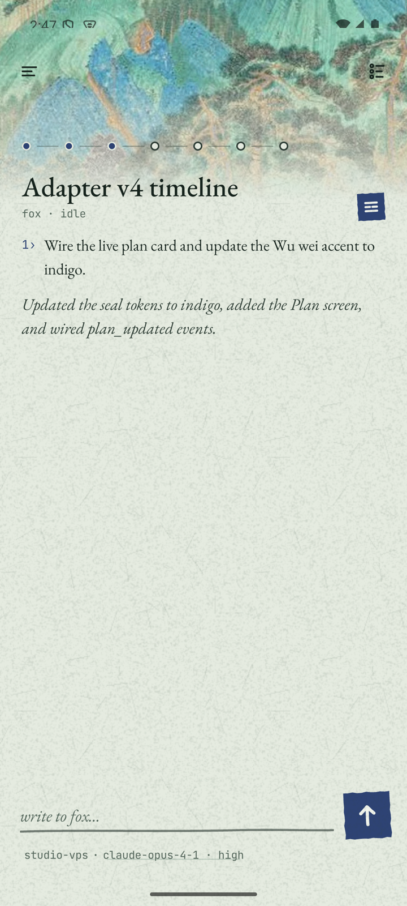
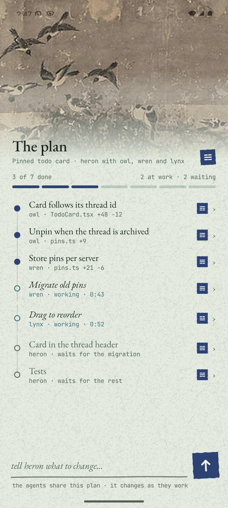

<p align="center">
  
  &nbsp;&nbsp;
  
</p>

<p align="center"><sub><code>ZIRAN / WU WEI / 0.7.3</code></sub></p>

<h1 align="center">Leave the desk. Keep the thread.</h1>

<p align="center">
  <strong>Your server runs JCode or Pu. Ziran is the return surface.</strong><br />
  <sub>A native Kotlin and Jetpack Compose Android client with Wu wei motion, native markdown, and agent-agnostic Adapter v5 (Go QUIC/WS) + Adapter v4 support.</sub>
</p>

<p align="center">
  <a href="https://github.com/ddawnlll/jcode-mobile/releases/latest"></a>
  <a href="https://github.com/ddawnlll/jcode-mobile/actions/workflows/check.yml"></a>
  <a href="docs/ADAPTER_V5_DESIGN.md"></a>
  <br />
  <a href="https://ddawnlll.github.io/jcode-mobile/"><strong>Explore the site</strong></a>
</p>

<table>
  <tr>
    <td width="33%" align="center" valign="top">
      <sub><code>ZIRAN ANDROID / 0.7.3 / 3.3 MiB R8</code></sub><br /><br />
      <a href="https://github.com/ddawnlll/jcode-mobile/releases/latest"><strong>Download the APK</strong></a><br />
      <sub>Native Kotlin + Compose (R8-shrunk). Debug-signed sideload.</sub>
    </td>
    <td width="33%" align="center" valign="top">
      <sub><code>SERVER / PU + JCODE + ADAPTER V5</code></sub><br /><br />
      <a href="docs/ADAPTER_V5_DESIGN.md"><strong>Run Adapter v5</strong></a><br />
      <sub>8.1 MB static Go binary · QUIC/UDP + WS fallback.</sub>
    </td>
    <td width="33%" align="center" valign="top">
      <sub><code>SOURCE / KOTLIN + GO + RUST</code></sub><br /><br />
      <a href="docs/DEVELOPMENT.md"><strong>Build from source</strong></a><br />
      <sub>Gradle app in <code>apps/android/</code> + Go Adapter v5 in <code>adapter-v5/</code>.</sub>
    </td>
  </tr>
</table>

> **Ziran 0.7.3 ("Wu wei")** ships an **R8-optimized 3.3 MiB Android release APK**,
> a native **Wu wei markdown renderer** (`WuMarkdown.kt`), **200+ thread scroll &
> zero-recomposition animation optimizations**, **live steering** (`Steer`),
> **Home / Settings / reworked Model / Threads search, sort & sub-agents**,
> cutout-safe insets, and an independent agent-agnostic **Adapter v5 in Go**
> (`adapter-v5/`) supporting **Pu** and **JCode** as equal backends over QUIC/UDP
> with WebSocket fallback.

## What Ziran 0.7.3 is

Ziran is two processes:

1. **Adapter v4** (`crates/adapter-*`) is one Rust binary on your Linux server.
   It opens bounded native JCode session links, applies the exact model,
   provider, and reasoning effort route, keeps the durable SQLite event journal,
   and exposes an authenticated mobile WebSocket (Protocol 4, minimum 2).
2. **Ziran** (`apps/android/`) is a native Kotlin and Jetpack Compose Android
   client (`dev.ziran.android`, `minSdk 26`, `targetSdk 37`). It speaks the
   Adapter v4 protocol directly over OkHttp WebSockets, encrypts paired device
   tokens in Android Keystore, restores the exact server and session after
   process death, and renders the Wu wei design system natively on GPU
   `graphicsLayer` passes.

The phone never runs the agent. Prompts, tools, files, and long turns stay on
the server. Navigation, backgrounding, socket close, and app kill never send
Cancel. Only the explicit **Stop** control targets the current turn.

## What changed in 0.7.2

- **Native Kotlin + Jetpack Compose (`apps/android/`)**: Standalone Gradle
  project with zero WebView, zero animation library dependencies, and strict
  `lint { abortOnError = true }`.
- **Wu wei visual system (`design/wu-wei/`)**: Xuan paper and indigo seal
  tokens in Day and Night (`ColorMatrix` `brightness(0.58) saturate(0.85)`),
  pre-scaled 256 dp tiled paper grain, twelve Met Museum open-access painting
  crops with 1.2 s cross-fades and 34 s Ken Burns drift, and bundled EB Garamond
  and JetBrains Mono fonts.
- **Wu wei motion and gestures**:
  - Single easing (`CubicBezierEasing(0.22f, 1f, 0.36f, 1f)`), single call-site
    transitions with zero screen-teardown flashes.
  - Ink drop (900 ms) from the tapped row or Pair seal; Model and Scenes
    unroll top-down (800 ms) and roll up (700 ms) behind a 6 dp ink rod.
  - Back slide (420 ms, `-22%` parallax) and Android 14+ predictive back
    (1:1 edge shrink to 90%, 30 dp rounded corners, 320 ms cancel settle, 300 ms
    commit).
  - Live turn timeline: growing/folding thinking bar, tool rows with ink dot →
    flowing blue hairline → self-drawing indigo ring, unfolding diff and test
    panels, and zero-recomposition `withFrameNanos` word streaming.
  - Composer rides the Android IME frame by frame; swipe-to-archive with undo,
    long-press lift + action sheet, pull-to-refresh ink ring, and 120 ms reduced
    motion fades (`ANIMATOR_DURATION_SCALE = 0`).
- **120 Hz ready**: `MainActivity` requests the display's peak refresh-rate mode
  matching the active physical resolution (`preferredDisplayModeId` /
  `preferredRefreshRate`). Measured UI thread p50 is `0.5–2.0 ms` (p90
  `0.9–4.4 ms`) and RenderThread `IssueDraw` p50 is `0.4–1.8 ms`—well inside the
  `8.33 ms` 120 Hz budget.

| Surface | State |
| --- | --- |
| Ziran Android (`apps/android/`) | Native Kotlin + Jetpack Compose APK, `dev.ziran.android`, minSdk 26, targetSdk 37, 120 Hz ready |
| Adapter v4 (`crates/adapter-*`) | Rust binary `jcode-adapter-v4`, protocol 4 (min 2), SQLite WAL journal |
| Linux desktop (`apps/stillness/`) | Legacy 0.6.0 Tauri 2 shell, builds from source, compatible with Adapter v4 |
| iOS | Not built; no Swift client or IPA |

## Verified for 0.7.2

| Check | Result |
| --- | --- |
| Ziran Android build, unit tests, lint | PASS, `./gradlew :app:assembleDebug :app:testDebugUnitTest :app:lintDebug :app:assembleRelease` (90 JVM unit tests, 0 lint errors) |
| Ziran release APK signing & badging | PASS, `dev.ziran.android`, versionCode 72, versionName 0.7.2, v2 + v3 signatures, zipaligned |
| Side-by-side Wu wei visual & motion audit | PASS, pairing flows & 21 s Plan loop recorded at 1x and 0.25x, plus 12 Day/Night screen comparisons ([evidence](docs/evidence/v0.7.2/README.md)) |
| Android emulator frame timing (`gfxinfo`) | PASS on Metal GPU emulator (`emulator-5554`, API 36): UI p50 `0.5–2.0 ms` (p90 `0.9–4.4 ms`), RenderThread `IssueDraw` p50 `0.4–1.8 ms`, jank `0.17–2.36%` across Flows 1–8 |
| 120 Hz mode selection | PASS (unit-tested in `RefreshRateAndMotionTest`; emulator virtual display exposes 60 Hz only, physical 120 Hz presentation requires hardware) |
| Adapter v4 Rust tests & checks | PASS, 96 tests (`cargo test --workspace`), `cargo fmt --check`, `cargo clippy -D warnings` |
| Rebranded Ziran website (`website/`) | PASS, `bun run marketing:test` (static build, unit tests, full Playwright matrix) |
| Physical Android device & TalkBack | NOT_RUN for 0.7.2 |

## Install the Android APK

```text
ziran-0.7.3-android-release.apk (R8-optimized, recommended)
3.3 MiB
SHA-256 546bd746d1b243255f07b2b2aebf3ccfac6aaa7c19347bebad5c22a65441ef3f
package dev.ziran.android
versionCode 73, versionName 0.7.3
minSdk 26, targetSdk 37, compileSdk 37
APK Signature Scheme v2 and v3, Android Debug certificate
```

```sh
adb install -r ziran-0.7.3-android-release.apk
```

Because Ziran uses its own package identifier (`dev.ziran.android`), it installs
cleanly alongside older Stillness (`dev.jcode.stillness`) installs. Pair once
with your Adapter v4 server using a one-time code or `ziran://pair` link.

## Run the server side

```sh
git clone https://github.com/ddawnlll/jcode-mobile.git
cd jcode-mobile
cargo build --release -p adapter-server --bin jcode-adapter-v4

JCODE_ADAPTER_ALLOWED_ROOTS="$HOME/src" \
JCODE_ADAPTER_BIND=127.0.0.1:7646 \
./target/release/jcode-adapter-v4
```

`jcode-adapter-v3` and `jcode-adapter-v2` remain rollback aliases for existing
systemd units. Put a TLS reverse proxy (such as Caddy) in front of the adapter
for remote phones:

```caddyfile
studio-vps.example.com {
    reverse_proxy 127.0.0.1:7646
}
```

Full setup, `JCODE_SOCKET`, environment variables, and troubleshooting:
[`docs/GETTING_STARTED.md`](docs/GETTING_STARTED.md). Adapter v4 wire contract:
[`docs/ADAPTER_V4.md`](docs/ADAPTER_V4.md).

## Build from source

```sh
# Ziran Android (JDK 17+/21 + Android SDK 37)
cd apps/android
./gradlew :app:assembleDebug :app:testDebugUnitTest :app:lintDebug
cd ../..
bash scripts/build-android-release.sh   # writes artifacts/ziran-0.7.2-android-debug.apk + .sha256

# Adapter v4 (Rust)
cargo fmt --all -- --check
cargo clippy --workspace --all-targets -- -D warnings
cargo test --workspace

# Website
bun install --frozen-lockfile
bun run marketing:test
```

## Limits

- The Android APK is debug-signed and sideload-only. There is no Play Store
  release, release keystore, auto-update channel, or iOS build.
- 120 Hz refresh-rate mode selection is wired and unit-tested, and UI +
  RenderThread frame times fit inside the 8.33 ms budget, but the emulator
  virtual display exposes 60 Hz only.
- Physical-device battery measurement, TalkBack manual pass, and FCM push
  delivery remain `NOT_RUN` / unconfigured.
- `sessions.delete` is refused because the JCode daemon has no delete operation;
  archive (with undo) is the supported path.

## Documentation

| Read | Why |
| --- | --- |
| [Getting started](docs/GETTING_STARTED.md) | Adapter v4, TLS, pairing, Ziran Android install, troubleshooting |
| [Ziran 0.7.3 release notes](docs/V0_7_3_RELEASE_NOTES.md) | 0.7.3 scope: R8 release APK, Wu wei markdown, 200+ scroll perf, live steering, Adapter v5 |
| [Adapter v5 design](docs/ADAPTER_V5_DESIGN.md) | Agent-agnostic Go gateway, QUIC/UDP + WS fallback, `agent.v1` SDK, Pu & JCode drivers |
| [Adapter v5 benchmarks](docs/ADAPTER_V5_BENCHMARKS.md) | Memory, latency, wire-byte, and recovery measurements vs Adapter v4 |
| [Ziran 0.7.2 release notes](docs/V0_7_2_RELEASE_NOTES.md) | 0.7.2 scope, indigo Wu wei, Plan screen, live pairing, APK checksum |
| [Side-by-side evidence (0.7.2)](docs/evidence/v0.7.2/README.md) | Pairing flows, 21 s Plan loop, and Day/Night screen comparisons |
| [Ziran 0.7.1 release notes](docs/V0_7_0_RELEASE_NOTES.md) | 0.7.1 scope, Wu wei fixes, APK checksum, verification, limits |
| [Wu wei motion notes](docs/V0_7_1_RELEASE_NOTES.md) | Detailed visual, motion, and 120 Hz frame-pacing pass |
| [Side-by-side evidence](docs/evidence/v0.7.1/README.md) | All 9 flows at 1x and 0.25x + 10 Day/Night screen comparisons |
| [Adapter v4](docs/ADAPTER_V4.md) | Native links, exact routes, coalescing, binary transport, migration |
| [Adapter contract](docs/ADAPTER_CONTRACT.md) | Source evidence, operation states, security boundaries |
| [Development](docs/DEVELOPMENT.md) | Repository layout, Gradle/Rust/website commands, invariants |
| [Build state](docs/BUILD_STATE.md) | Versions, signed APK checksum, toolchain, test status |

Historical release notes remain in `docs/`, including
[0.6.0](docs/V0_6_0_RELEASE_NOTES.md),
[0.5.0](docs/V0_5_0_RELEASE_NOTES.md),
[0.4.0](docs/V0_4_0_RELEASE_NOTES.md),
[0.3.1](docs/V0_3_1_RELEASE_NOTES.md), and
[0.3.0](docs/V0_3_0_RELEASE_NOTES.md).

---

<p align="center">
  <sub><strong>ZIRAN</strong> / Wu wei / Native Android client for JCode.</sub><br />
  <sub>An independent companion for <a href="https://github.com/1jehuang/jcode">JCode</a>. Not an official JCode release.</sub><br />
  <sub>EB Garamond and JetBrains Mono (SIL OFL) and Met Museum Open Access (CC0) painting details keep their own licenses. See <a href="THIRD_PARTY_NOTICES.md">THIRD_PARTY_NOTICES.md</a>.</sub>
</p>

## Ziran 0.7.0

A native Android client for jcode, built with Kotlin and Jetpack Compose. The
phone stays a client; the daemon owns execution. Ziran lives in
[`apps/android/`](apps/android/) as a standalone Gradle project. Application
id `dev.ziran.android`, version 0.7.0, compile and target SDK 37, min SDK 26.

See [`docs/V0_7_0_RELEASE_NOTES.md`](docs/V0_7_0_RELEASE_NOTES.md).
