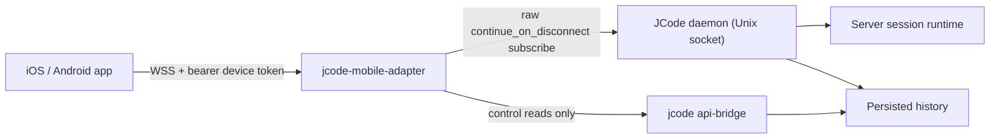

# JCode Mobile

A native React Native + TypeScript companion for [JCode](https://github.com/1jehuang/jcode) running on your own Linux VPS. The phone reads and directs conversations; the VPS owns agent execution. Closing, locking, or force-quitting the app never stops a remote turn.

> This is an independent companion application, not an official JCode release. The upstream mark and fonts retain their own licenses (see `THIRD_PARTY_NOTICES.md`).

## What is real here

| Area | State |
| --- | --- |
| Native iOS and Android app | Expo SDK 58 / React Native 0.88 / React 19.3 / strict TypeScript, Hermes, new architecture |
| Backend | A small authenticated adapter (`integration/jcode-adapter/`) over the JCode daemon's raw Unix-socket protocol |
| Continuation | Every attach sets `continue_on_disconnect: true`; proven with a force-quit test against a real staging daemon |
| Daemon death | Reattachment reports the source-backed interruption and recovery directive instead of claiming the turn is still running |
| Permissions, push, file upload | Not advertised; the UI says so rather than faking controls |

The curated `jcode api-bridge` is reused for inventory, archive/restore, todo state, peek, and bounded file reads. It is deliberately **not** used for session attachment because its create/attach translation omits the continuation flag (verified at `jcode@v0.99.1`, `crates/jcode-harness-api-server/src/translate.rs:603-655`).

## Architecture



The adapter has no agent engine, no second canonical transcript, and no provider calls. Its protocol is the curated envelope (`{v, id, req}` / `{v, reply_to?, ev}`) with additive mobile fields documented in [`docs/ADAPTER_CONTRACT.md`](docs/ADAPTER_CONTRACT.md).

## Requirements

- Node 22.12+ (pinned: 22.21.1, see `.nvmrc`), npm 10.9+
- Full Xcode with an iOS Simulator runtime for iOS builds
- JDK 17 and Android SDK 36 for Android builds
- A JCode daemon on the server you want to use
- The mobile adapter running on that server

## Install and run locally

```sh
npm ci
npm run typecheck
npm run lint
npm test

# iOS dev build in a Simulator
npx expo run:ios --device "iPhone 17 Pro"

# Android dev build (emulator or attached device)
npx expo run:android
```

`npm ci` runs a postinstall compatibility patch for `expo-modules-jsi@58.0.22`; see [`docs/TOOLCHAIN.md`](docs/TOOLCHAIN.md).

## Server setup

1. Build or install the adapter on the server (Node 22+, same host as the daemon):

   ```sh
   cd integration/jcode-adapter
   JCODE_ADAPTER_PORT=7643 \
   JCODE_ADAPTER_TLS_CERT=/etc/jcode-mobile/fullchain.pem \
   JCODE_ADAPTER_TLS_KEY=/etc/jcode-mobile/privkey.pem \
   node src/main.ts
   ```

   The adapter reads the daemon socket from `JCODE_SOCKET` (default `$JCODE_RUNTIME_DIR/jcode.sock`) and the device registry from `$JCODE_HOME/devices.json`. It will start a private `jcode api-bridge` if one is not already running on `JCODE_API_SOCKET`.

2. In a JCode session on that server, mint a pairing code:

   ```
   /remote pair
   ```

   or from a shell: `jcode pair`. The code is valid for five minutes and is written into the same device registry the adapter reads.

3. Open the app, enter `studio.example.net:7643` (TLS is the default), the six-digit code, a device name, and pair. The app stores a 64-hex bearer token in Keychain/Keystore only.

4. The adapter advertises `mobile_continuation` only because it actually sets the wire flag. If a server does not advertise it, the app stays read-only and says “This server needs mobile continuation support.”

### TLS

Remote deployment must use `wss://` with platform certificate validation. The adapter refuses to bind a non-loopback interface without a certificate unless `JCODE_ADAPTER_ALLOW_INSECURE_BIND=1` is explicitly set for an isolated development machine. A private tunnel (for example Tailscale) is a deployment option, not an in-app VPN.

### Local development exception

For Simulator/emulator work only, the adapter can run on `127.0.0.1` without TLS, and the app accepts a loopback `ws://` address (the Connect screen shows the exact scheme and host before pairing). Android release builds allow cleartext only for `127.0.0.1`/`localhost` via `plugins/withLocalCleartext.js`; `adb reverse tcp:7643 tcp:7643` is the supported local path. Remote hosts still require `wss://`.

## Development staging (real JCode, isolated)

```sh
bash scripts/staging-up.sh        # private JCODE_HOME + runtime dir
bash scripts/staging-adapter.sh   # adapter on 127.0.0.1:7643
bash scripts/staging-run.sh integration/jcode-adapter/test/continuity.ts
bash scripts/staging-run.sh integration/jcode-adapter/test/daemon-death.ts
node --test integration/jcode-adapter/test/attach-contract.test.ts
```

`staging-up.sh` copies `config.toml` and a local-only credential snapshot into the staging home. It never starts, stops, or attaches to the production daemon. Delete `$JCODE_SCRATCH_DIR/jcode-mobile-staging` to remove the snapshot.

The continuity test starts a deterministic six-step shell tool, terminates the phone transport, proves the tool finished while the phone was absent, then reattaches and reconciles the same session. The daemon-death test kills only the staging daemon, restarts it, and proves the reopened session reports a source-backed interruption.

## Artifacts

Built locally with embedded JS (no Metro dependency):

```sh
bash scripts/build-android-release.sh
bash scripts/build-ios-simulator.sh
```

- `artifacts/jcode-mobile-0.1.0-android-release.apk`
- `artifacts/jcode-mobile-0.1.0-ios-simulator.app.zip`
- `.sha256` files next to each artifact

```sh
# Android emulator or device (release build, debug-signed for local install)
adb install -r artifacts/jcode-mobile-0.1.0-android-release.apk

# iOS Simulator (Release configuration)
unzip -o artifacts/jcode-mobile-0.1.0-ios-simulator.app.zip -d /tmp/jcode-ios
xcrun simctl install booted /tmp/jcode-ios/JCodeMobile.app
xcrun simctl launch booted com.jcodemobile.app
```

Exact checksums are in [`docs/BUILD_STATE.md`](docs/BUILD_STATE.md); scenario results are in [`docs/VERIFICATION.md`](docs/VERIFICATION.md). Artifacts and native build caches are ignored by Git and attached to the private draft release.

## Behavior you can rely on

- **Navigation is not cancellation.** Unmount, Android Back, iOS edge-back, background, socket loss, and force-quit never send `cancel`/`clear`/`rewind`.
- **Return to the same session.** A missing target shows recovery, never a replacement session.
- **Cache is last-known evidence.** Cached history paints first and is labelled; only reconciliation claims Current/Ready.
- **Sending is honest.** `Draft saved → Sending… → Sent to server → Accepted`; a lost connection after write becomes “Delivery unconfirmed” and is never auto-resent. The adapter's delivery ledger can resolve it to Accepted when the daemon actually acked it.
- **Guidance is not Stop.** Instructions during a turn use soft interrupts with caller ids; “Added to this turn” appears only after the matching injection event.
- **Daemon death is not phone absence.** The reopened session shows saved history and the server's interruption/recovery directive.
- **Capabilities gate controls.** No plan tab without reported todos, no approvals, no push toggle, no file browser.

## Data and privacy

- Bearer tokens: Keychain/Keystore (`expo-secure-store`, `WHEN_UNLOCKED_THIS_DEVICE_ONLY`), never SQLite, URLs, logs, or screenshots.
- Transcript cache: SQLite, bounded to 32 MiB of text, 500 rows per session, LRU-evicting inactive sessions while protecting drafts and unresolved sends.
- Drafts: debounced 250 ms, force-written on navigation; scoped by server and session.
- App-switcher snapshots: hidden by default when the app is inactive.
- Clearing local data: server details → “Clear local transcript cache” keeps drafts, bookmarks, and unresolved sends; “Forget server” removes the token and all local rows after a specific confirmation. It does not revoke the token on the server.
- Diagnostics never include tokens, pairing codes, or transcript text.

## Testing

```sh
npm test          # 33 pure + RNTL tests
node --test integration/jcode-adapter/test/attach-contract.test.ts  # 2 contract tests
npm run check     # typecheck + lint + tests
```

Native evidence, accessibility checks, performance numbers, and remaining limitations are recorded in [`docs/VERIFICATION.md`](docs/VERIFICATION.md). Design decisions and implementation adjustments are in [`docs/DESIGN_DECISIONS.md`](docs/DESIGN_DECISIONS.md).

## Repository layout

```
src/design/          locked tokens, fonts, theme, controls, icons, sheet
src/core/protocol/   validated frames, capabilities, identity fencing
src/core/connection/ WebSocket transport, endpoint parsing, backoff
src/core/persistence/SecureStore credentials, SQLite migrations, caches
src/core/session/    seam derivation, grouping, formatters
src/core/state/      zustand store and controller-facing state
src/core/            app-controller (connection, inventory, conversation)
src/features/        sessions, conversation, work, connect, new session, server
src/shell/           app root and native stack
integration/jcode-adapter/  authenticated adapter + contract/continuity tests
scripts/             staging, builds, toolchain, dev helpers
docs/                contract, toolchain, build state, verification, decisions
design/reference/    unchanged handoff (docs, fonts, captures, licenses)
```

## Changing the app identity

`app.config.ts` uses the provisional identifier `com.jcodemobile.app` and scheme `jcodemobile`. Change `ios.bundleIdentifier`, `android.package`, `scheme`, `name`, and `slug` before distribution, then run `npx expo prebuild --clean`. No Apple team or organization details are invented here.

## Known limitations

- The live VPS was unreachable from this environment; all real-JCode evidence comes from an isolated local staging daemon with the same installed JCode `0.99.1` and provider route. See the live-VPS gate in `docs/VERIFICATION.md`.
- No physical iPhone or Samsung A34 was attached, so physical-device performance, battery, and manual VoiceOver/TalkBack checks are NOT_RUN.
- Tool results are bounded in the adapter (64 KiB) and the UI previews 24 lines/8 KiB. A larger window requires an explicit request that is not yet implemented.
- Unattached-session inventory does not expose authoritative per-session turn state in the daemon API at this version; the app therefore shows Working only for sessions it has actually observed live.
- Push notifications, structured permission approvals, and arbitrary file upload are not implemented because the verified server surface does not support them.
