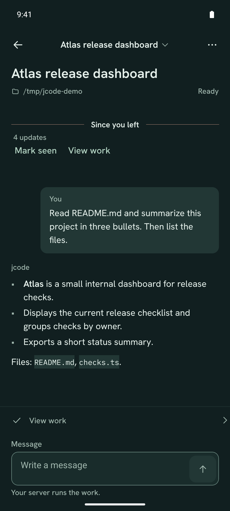
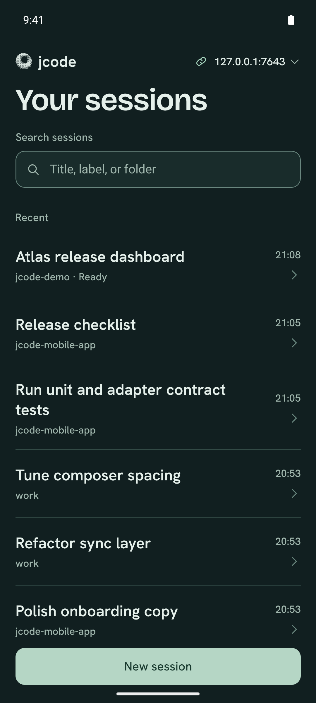
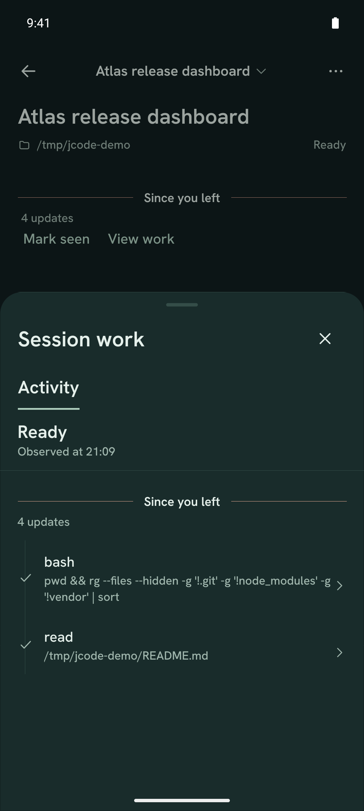
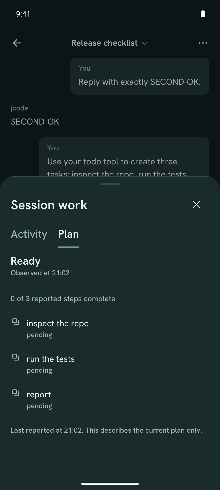
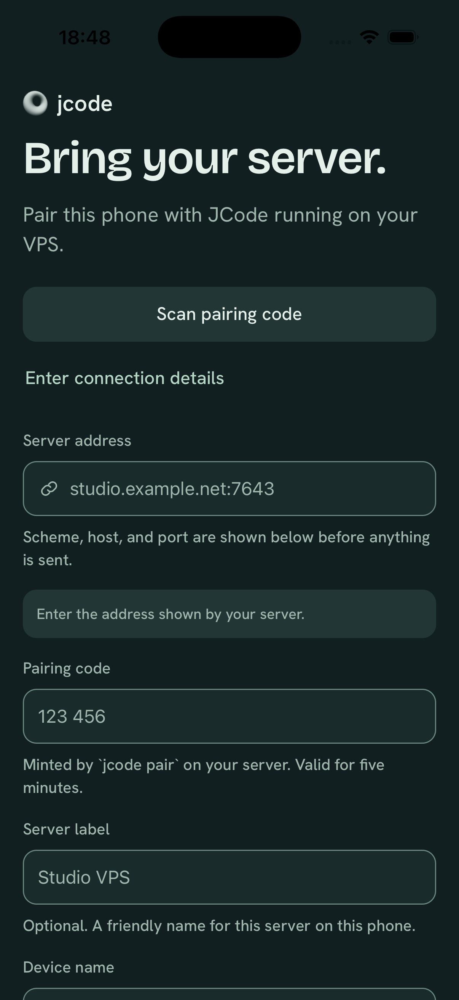
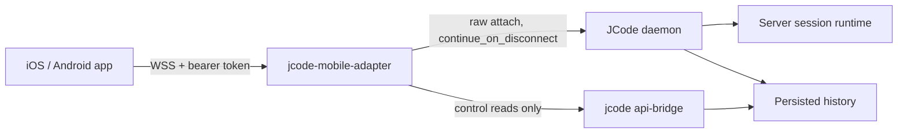

<p align="center">
  
</p>

<h1 align="center">JCode Mobile</h1>

<p align="center">
  A native iOS and Android companion for <a href="https://github.com/1jehuang/jcode">JCode</a>.<br/>
  Your phone reads and directs the conversation. Your VPS runs the agent.
</p>

<p align="center">
  <a href="https://github.com/ddawnlll/jcode-mobile/actions/workflows/check.yml"></a>
  <a href="https://github.com/ddawnlll/jcode-mobile/releases/latest"></a>
</p>

---

## What it feels like

| Sessions | Conversation |
|:---:|:---:|
|  |  |
| Find a session by title, folder, or label. | Send a prompt, watch the reply stream in, then inspect the work. |

| Work | Plan |
|:---:|:---:|
|  |  |
| See the exact tool calls the server made. | Read the plan the agent reported, with honest progress. |

<p align="center">
  <br/>
  <sub>Pair once. The phone stays signed in until you forget the server.</sub>
</p>

## Try it in five minutes

You need a Linux VPS with JCode and Node 22, plus an Android phone or emulator. The iOS build in the release is a Simulator app, not a signed IPA.

### 1. Start the mobile adapter on your server

The adapter speaks WebSocket to the phone and the daemon's Unix socket to JCode. It does not run a second agent.

```sh
git clone https://github.com/ddawnlll/jcode-mobile.git
cd jcode-mobile/integration/jcode-adapter

JCODE_ADAPTER_HOST=0.0.0.0 \
JCODE_ADAPTER_PORT=7643 \
JCODE_ADAPTER_TLS_CERT=/etc/jcode-mobile/fullchain.pem \
JCODE_ADAPTER_TLS_KEY=/etc/jcode-mobile/privkey.pem \
node src/main.ts
```

This binds the adapter to all interfaces with TLS. Restrict the port with a firewall or put it behind a TLS reverse proxy. If you use a proxy or tunnel, bind `JCODE_ADAPTER_HOST=127.0.0.1` instead. Never expose plain `ws://` to the internet.

If JCode's own gateway already occupies port 7643 with plain HTTP, run the mobile adapter on loopback port 7644 and put Caddy (or another TLS proxy) on 443:

```
dawnll.example.com {
    reverse_proxy 127.0.0.1:7644
}
```

Then enter `dawnll.example.com:443` in the app. `jcode pair` must run as the same user that owns `$JCODE_HOME`, and the adapter service must use that same `JCODE_HOME` and daemon socket.

### 2. Mint a pairing code

On the server, as the same user that runs the JCode daemon:

```sh
jcode pair
```

The six-digit code is valid for five minutes. It is exchanged once for a device token.

`/remote` is not available in JCode 0.99.1's CLI, so use `jcode pair`. If the command is missing, check `jcode --version` and upgrade JCode. The adapter must read the same `JCODE_HOME/devices.json` that `jcode pair` wrote.

### 3. Install the app

**Android:** download the APK from [Releases](https://github.com/ddawnlll/jcode-mobile/releases/latest), then:

```sh
adb install -r jcode-mobile-0.1.3-android-release.apk
```

The APK is a release build, but it is debug-signed for sideloading. It is not a Play Store artifact.

**iOS Simulator:** download the zip, unzip it, and install it into a booted Simulator:

```sh
unzip -o jcode-mobile-0.1.3-ios-simulator.app.zip -d /tmp/jcode-ios
xcrun simctl install booted /tmp/jcode-ios/JCodeMobile.app
xcrun simctl launch booted com.jcodemobile.app
```

This is a Simulator `.app`. It will not install on a physical iPhone without Apple signing.

### 4. Pair

Open the app and enter:

- **Server address:** `your-server.example.com:7643`
- **Pairing code:** the six digits from step 2
- **Device name:** anything you will recognize later

Tap **Pair this phone**. The token goes into Keychain or Keystore, never into SQLite, logs, or the URL.

If pairing fails, the app shows the exact code and detail:

| Code | Meaning |
| --- | --- |
| `PAIR_NETWORK` | DNS, firewall, port 7643, or adapter not running. The detail includes the native error. |
| `PAIR_TIMEOUT` | No `/pair` response within 12 s. |
| `PAIR_HTTP_400` | Usually an invalid or expired code; the server message is shown. |
| `PAIR_HTTP_401/403` | Reverse proxy or TLS client policy rejected the request. |
| `PAIR_TIMEOUT_UI` | The app-side 20 s guard fired before any result. |

Pairing completes when the token is stored. The WebSocket connection continues in the background, so a later connection problem appears in Sessions instead of leaving the Pair button spinning.

### 5. Open a session and send

Tap a session, type a prompt, and send. The reply streams in. The **Work** dock opens the exact tool calls and the plan the server reported.

You can leave the conversation, lock the phone, or force-quit the app. The turn keeps running on the server. When you come back, a return seam shows what changed while you were away.

### 6. Signing out

Open **Server details**:

- **Disconnect this phone** closes the connection but keeps you signed in.
- **Forget this server** removes the token, drafts, reading positions, and cache from this phone. It is a local logout.
- **Pair this phone again** rotates the device token.

There is no password login after pairing. The device token does not expire. The app reconnects after restarts, network changes, and server reboots. If the token is revoked on the server, the app shows `Pair again` and keeps cached content readable.

## What stays true

- **Navigation is not cancellation.** Back, swipe, background, socket loss, and force-quit never send cancel or clear. Only the Stop button cancels a turn.
- **The server owns the work.** Every attach uses `continue_on_disconnect: true` with the exact `target_session_id`.
- **Sending is honest.** `Sending`, `Sent to server`, `Accepted`, and `Delivery unconfirmed` are distinct. An ambiguous delivery is never auto-resent.
- **Cache is last-known evidence.** Cached history paints first and is labelled. Only reconciliation claims `Current` or `Ready`.
- **Daemon death is not phone absence.** The reopened session shows saved history plus the server's interruption and recovery directive.
- **Capabilities gate controls.** No plan tab without reported todos, no fake approvals, no push toggle, no file browser.
- **Pair once.** Login persists until you forget the server or the token is revoked.

## Downloads

| Platform | File | Notes |
| --- | --- | --- |
| Android | [APK](https://github.com/ddawnlll/jcode-mobile/releases/latest) | Release build, debug-signed, sideload with `adb install -r` |
| iOS Simulator | [`.app.zip`](https://github.com/ddawnlll/jcode-mobile/releases/latest) | Simulator only, no signed IPA |

Checksums and install commands are in [`docs/BUILD_STATE.md`](docs/BUILD_STATE.md). Correctness fixes in this release: [`docs/REVIEW_FIXES.md`](docs/REVIEW_FIXES.md).

## Build from source

Requirements: Node 22.12+, Xcode for iOS, JDK 17 and Android SDK 36 for Android.

```sh
npm ci
npm run check

# iOS dev build
npx expo run:ios --device "iPhone 17 Pro"

# Android dev build
npx expo run:android

# Release artifacts
bash scripts/build-android-release.sh
bash scripts/build-ios-simulator.sh
```

`npm ci` applies a small compatibility patch for `expo-modules-jsi@58.0.22`; see [`docs/TOOLCHAIN.md`](docs/TOOLCHAIN.md).

The bundle identifier is provisional (`com.jcodemobile.app`). Change it before producing signed distribution builds.

## How it works



The adapter has no agent engine, no second canonical transcript, and no provider calls. Its protocol is the curated JCode envelope with additive mobile fields. The full contract is in [`docs/ADAPTER_CONTRACT.md`](docs/ADAPTER_CONTRACT.md).

## Local staging

Run real JCode locally without touching production:

```sh
bash scripts/staging-up.sh
bash scripts/staging-adapter.sh

# In another terminal, if using an Android emulator:
adb reverse tcp:7643 tcp:7643
```

Then pair with `ws://127.0.0.1:7643` and a code from `jcode pair`. Android release builds allow cleartext only for loopback. iOS release builds keep local networking disabled, so use the iOS dev build for loopback testing.

Continuity and daemon-death proofs:

```sh
bash scripts/staging-run.sh integration/jcode-adapter/test/continuity.ts
bash scripts/staging-run.sh integration/jcode-adapter/test/daemon-death.ts
node --test integration/jcode-adapter/test/*.test.ts
```

## Verification

| Area | State |
| --- | --- |
| Native Android release flows | Verified against real JCode 0.99.1 staging |
| iOS dev build flows | Verified against staging |
| iOS release artifact | Installs and launches; needs a TLS endpoint for full pairing |
| Continuity / daemon death | Pass |
| Adversarial delivery, guidance, reading anchor, server switch | Pass |
| Retry rollback | Adapter contract pass; no forced provider retry |
| Physical devices and human screen-reader pass | Not run |
| Live VPS gate | Blocked: no reachable SSH endpoint |

Full PASS/BLOCKED/NOT_RUN matrix: [`docs/VERIFICATION.md`](docs/VERIFICATION.md).

## Security and privacy

- Bearer tokens live in Keychain or Keystore only.
- Remote adapters require TLS. Loopback cleartext is an explicit development exception.
- Transcript cache is SQLite, bounded, and scoped per server and session.
- App-switcher previews are hidden by default.
- Diagnostics do not include tokens, pairing codes, or transcript text.

## Repository map

```text
src/design/          locked tokens, theme, typography, controls, icons
src/core/            protocol, transport, controller, persistence, selectors, state
src/features/        sessions, conversation, work, connect, new session, server
src/shell/           app root and native stack
integration/         authenticated JCode adapter and contract tests
scripts/             staging, builds, toolchain helpers
docs/                contract, verification, build state, design decisions
docs/media/          README screenshots
```

## Credits

This is an independent companion, not an official JCode release. The JCode mark, Bricolage Grotesque, Hanken Grotesk, IBM Plex Mono, and Lucide icons keep their own licenses. See [`THIRD_PARTY_NOTICES.md`](THIRD_PARTY_NOTICES.md).
