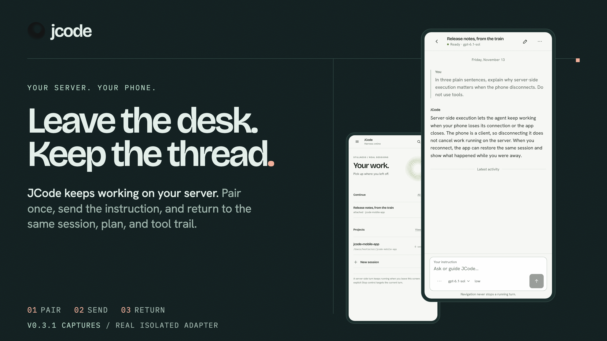
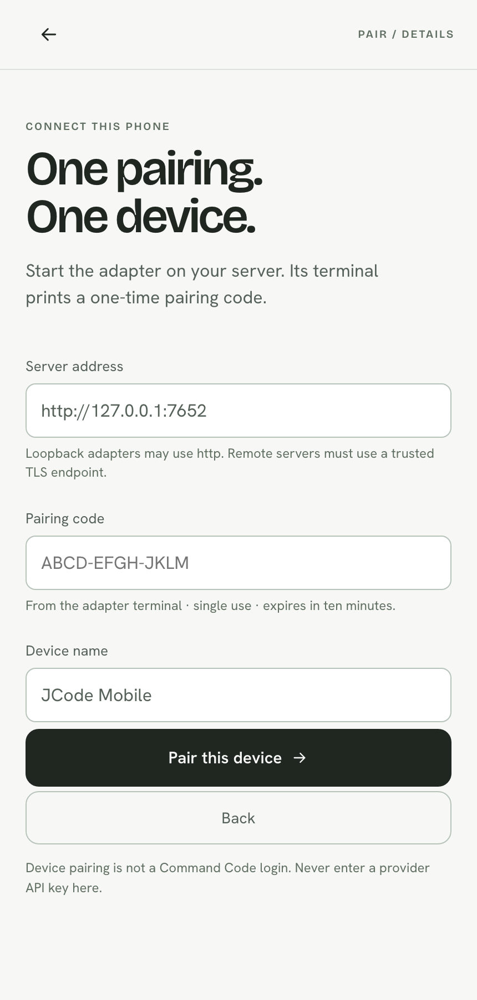
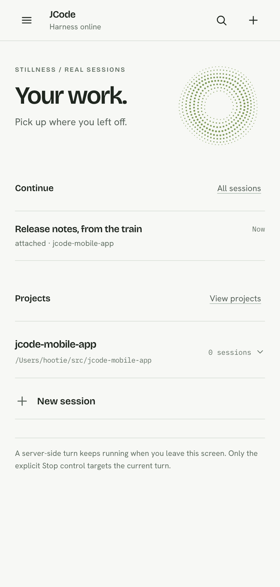
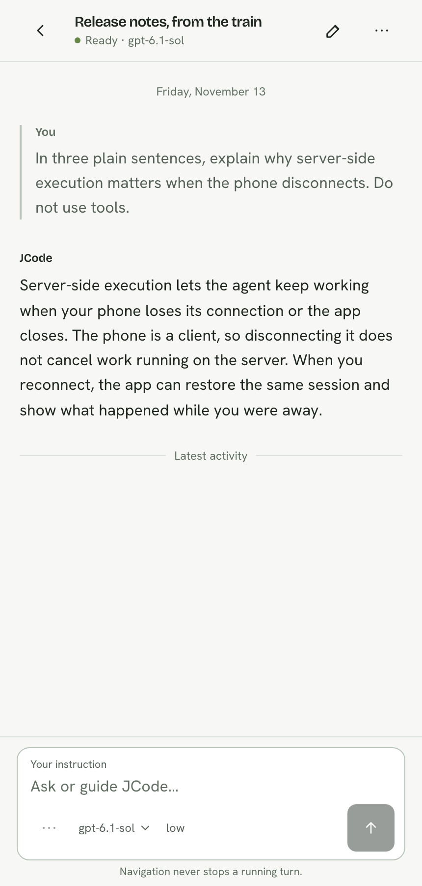
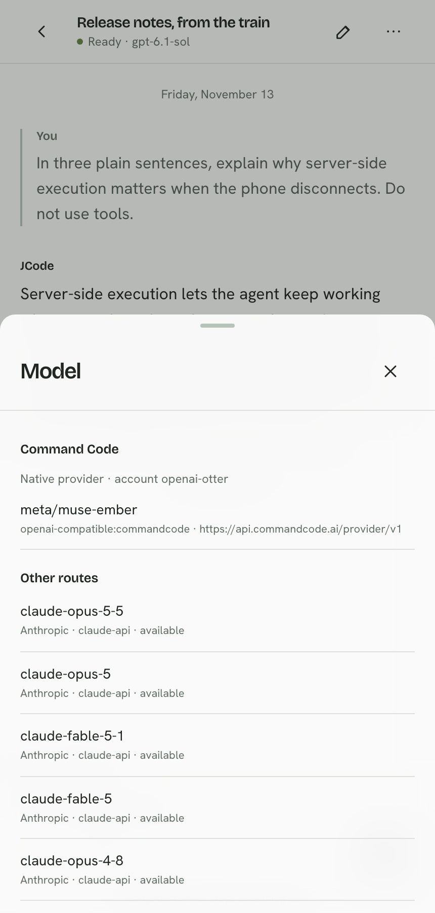
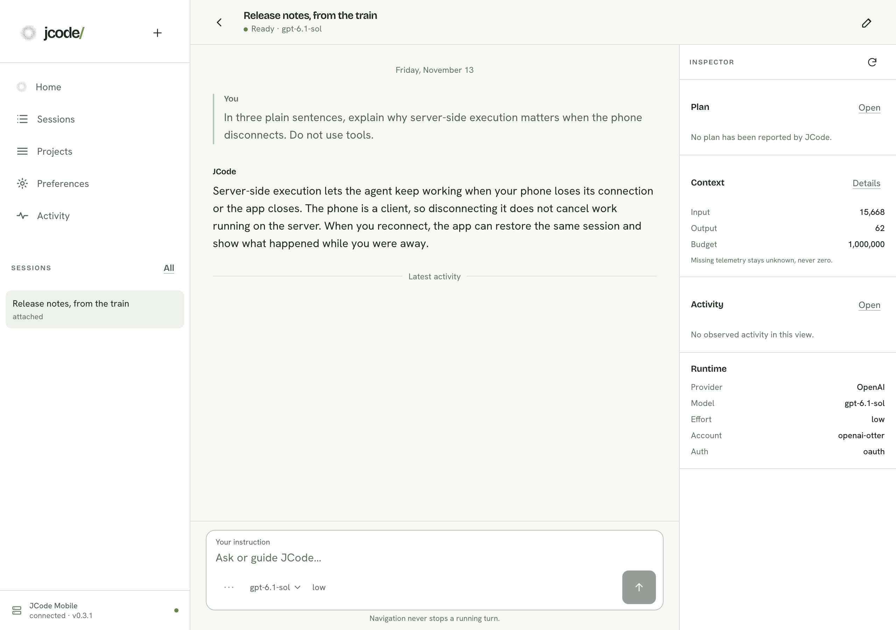

<p align="center">
  
</p>

<p align="center"><sub><code>JCODE MOBILE / STILLNESS 12 / 0.3.1</code></sub></p>

<h1 align="center">Leave the desk. Keep the thread.</h1>

<p align="center">
  <strong>Your server runs JCode. The phone is the return surface.</strong><br />
  <sub>A Tauri 2 client for <a href="https://github.com/1jehuang/jcode">JCode</a> on your own Linux server.</sub>
</p>

<p align="center">
  <a href="https://github.com/ddawnlll/jcode-mobile/releases/tag/v0.3.1"></a>
  <a href="https://github.com/ddawnlll/jcode-mobile/actions/workflows/check.yml"></a>
  <a href="docs/API.md"></a>
  <br />
  <a href="https://ddawnlll.github.io/jcode-mobile/"><strong>Explore the site</strong></a>
</p>

<table>
  <tr>
    <td width="33%" align="center" valign="top">
      <sub><code>ANDROID / 0.3.1 / 10.5 MiB</code></sub><br /><br />
      <a href="https://github.com/ddawnlll/jcode-mobile/releases/download/v0.3.1/jcode-mobile-0.3.1-android-release.apk"><strong>Download the APK</strong></a><br />
      <sub>Debug-signed sideload. No Play Store listing.</sub>
    </td>
    <td width="33%" align="center" valign="top">
      <sub><code>SERVER / JCODE + ADAPTER V2</code></sub><br /><br />
      <a href="docs/GETTING_STARTED.md"><strong>Run the adapter</strong></a><br />
      <sub>One pairing code. Ten minutes. Then a device token.</sub>
    </td>
    <td width="33%" align="center" valign="top">
      <sub><code>SOURCE / TAURI 2 + RUST</code></sub><br /><br />
      <a href="docs/DEVELOPMENT.md"><strong>Build from source</strong></a><br />
      <sub>Android, native Linux, and a browser verification surface.</sub>
    </td>
  </tr>
</table>

> **0.3.1 is a development preview.** It replaces the Expo client with the
> Stillness 12 Tauri client and the Rust Adapter v2. The Android APK is
> debug-signed for sideloading. The native Linux shell builds from source.
> There is no iOS artifact or Play Store listing.

## What 0.3.1 is

JCode Mobile is two processes:

1. **Adapter v2** is one Rust binary on your server. It speaks to JCode through
   the pinned `jcode-sdk` and harness API, keeps one SQLite journal, and exposes
   an authenticated mobile WebSocket.
2. **Stillness 12** is the Tauri 2 client. It paints a paired, cached, or
   reconnecting state without inventing work, and it restores the exact server
   and session you left.

0.3.1 is the reliability release for 0.3.0. An Android ARM audit on a real
emulator against the pinned JCode daemon reproduced and fixed nine defects,
including three that destroyed agent state — the authoritative snapshot lost
every tool card, a second new session re-attached and renamed the existing
session, and the composer locked forever after one completed turn. Pairing the
release build to a loopback adapter, the loopback-HTTP release policy, and the
composer and delivery-state reconciliation are all corrected and verified on
the emulator. No UI redesign ships in this release.

The phone never runs the agent. Prompts, tools, files, and long turns stay on
the server. Navigation, backgrounding, socket close, and app kill never send
Cancel. Only the explicit **Stop** control targets the current turn.

| Surface | State |
| --- | --- |
| Android | Tauri 2 APK, `arm64-v8a` and `armeabi-v7a`, minSdk 24 |
| Native Linux | Tauri 2 release binary, Secret Service credentials |
| Web | Verification surface only; browser token in `localStorage` |
| iOS | Not built on this Linux host; no IPA |

## One pairing

<p align="center">
  
</p>

Start the adapter. Its terminal prints a single-use pairing code for this run.
The code expires after ten minutes. Enter it once, and the adapter returns a
device token. The token is stored in Android Keystore or the Linux Secret
Service, never in SQLite, logs, or the URL.

## Your work, in reach

<table>
  <tr>
    <td width="50%" align="center" valign="top">
      <br />
      <sub><strong>HOME</strong><br />Harness online. Continue the session.</sub>
    </td>
    <td width="50%" align="center" valign="top">
      <br />
      <sub><strong>SESSION</strong><br />Read the answer. Keep the thread.</sub>
    </td>
  </tr>
</table>

The transcript is fenced by `session_id`, `epoch`, `seq`, `turn_id`, and
`operation_id`. A slow answer cannot overwrite newer work. A gap triggers a
fresh snapshot instead of a guessed patch. Drafts, reading positions, and pending
sends are scoped to the server and session.

## Command Code, in the route list

<p align="center">
  
</p>

The pinned JCode fork exposes Command Code as a native provider. The adapter
lists routes from `ListModels` and `GetRuntimeInfo`. It does not infer
entitlement from a catalog, invent a provider key, or proxy a credential.

## The desktop shell

<p align="center">
  
</p>

The same build runs as a three-pane Tauri window on Linux. The sidebar, central
session, and inspector read one shared connection. The inspector exposes only
what the server reported: plan, context, activity, runtime, and provider.

## Install the Android APK

```text
jcode-mobile-0.3.1-android-release.apk
11,016,925 bytes
SHA-256 03a6d808524461e12dca1370540eede2e040e179e9f116cec980effb180da562
package dev.jcode.stillness
versionCode 3001, versionName 0.3.1
minSdk 24, targetSdk 37, compileSdk 37
arm64-v8a + armeabi-v7a
APK Signature Scheme v2 and v3, Android Debug certificate
```

```sh
adb install -r jcode-mobile-0.3.1-android-release.apk
```

The package identifier is new. A clean install is expected. App data from the
Expo 0.2.2 package does not migrate.

## Run the server side

```sh
git clone https://github.com/ddawnlll/jcode-mobile.git
cd jcode-mobile
cargo build --release -p adapter-server --bin jcode-adapter-v2

JCODE_ADAPTER_ALLOWED_ROOTS="$HOME/src" \
JCODE_ADAPTER_BIND=127.0.0.1:7646 \
./target/release/jcode-adapter-v2
```

The adapter prints its pairing code and the roots it will expose. It discovers
the JCode harness socket from `JCODE_API_SOCKET` or the platform runtime
directory. Data lives in `~/.local/share/jcode-mobile-adapter-v2` unless
`JCODE_ADAPTER_DATA_DIR` is set.

For a remote phone, terminate TLS at a reverse proxy and keep the adapter on
loopback:

```caddyfile
dawnll.example.com {
    reverse_proxy 127.0.0.1:7646
}
```

Then enter `https://dawnll.example.com` in the app. The adapter does not ship a
TLS terminator, VPN client, or SSH client for the phone.

Full setup, environment variables, troubleshooting, and local staging:
[`docs/GETTING_STARTED.md`](docs/GETTING_STARTED.md).

## Build from source

```sh
bun install --frozen-lockfile
cd apps/stillness && bun install --frozen-lockfile && cd ../..

cargo test --workspace
cargo fmt --all -- --check
bun run typecheck
bun run lint
bun run test

cd apps/stillness && bun run build
cd ../..
bash scripts/build-android-release.sh   # JDK + Android SDK
bash scripts/build-tauri-linux.sh       # GTK 3 + WebKitGTK 4.1
```

The Android release script builds, zipaligns, signs, verifies, and writes a
`.sha256` beside the APK. The Linux script accepts a user-space `TAURI_SYSROOT`
when the host has no system GTK/WebKit development packages.

## What is verified

| Check | Result |
| --- | --- |
| Stillness typecheck and production bundle | PASS |
| Repository and Stillness lint | PASS, 0 errors and 0 warnings |
| Root typecheck, lint, Jest/RNTL | PASS, 14 suites / 139 tests |
| Adapter v2 Rust tests | PASS, 32 tests |
| Rust formatting | PASS |
| Real isolated JCode daemon + SDK handshake | PASS |
| Real Android release APK on ARM emulator | PASS |
| Credential restore across force-stop/relaunch | PASS |
| Explicit Stop targets one turn | PASS |
| Adapter restart and reconnect | PASS |
| Command Code-routed generation | PASS, real `gpt-6.1-sol` answer |
| Website build and browser matrix | PASS, 25 unit tests; Playwright matrix |
| Native Linux Tauri | PASS, release build and Xvfb launch |
| Secret Service keyring | PASS, round trip plus pairing and relaunch |
| Physical Android device | NOT_RUN |
| iOS | NOT_APPLICABLE on this Linux host |

The current evidence is [`docs/VERIFICATION.md`](docs/VERIFICATION.md) and
[`docs/evidence/v0.3.1/README.md`](docs/evidence/v0.3.1/README.md).

## Limits

- The Android APK is debug-signed and sideload-only. There is no Play Store
  release, release keystore, auto-update channel, or signed iOS build.
- The release APK is ARM-only. The Android runtime checks used the
  arm64-v8a emulator on macOS.
- Physical-device validation and a human screen-reader pass remain `NOT_RUN`.
- JCode's curated API exposes aggregate edit statistics, not a verified per-file
  diff. The Changes screen says so.
- Upstream cancellation is session-scoped. The adapter verifies the expected
  turn before stopping and reports `atomic_turn_scope: false`.
- Attachments and provider credentials are not implemented in the mobile
  composer.
- A human screen-reader pass and physical-device validation remain `NOT_RUN`.

## Documentation

| Read | Why |
| --- | --- |
| [Getting started](docs/GETTING_STARTED.md) | Adapter, TLS, pairing, Android, Linux, troubleshooting |
| [API](docs/API.md) | `/health`, `/v2/pair`, `/v2/ws`, envelopes, capabilities, events, errors |
| [Adapter contract](docs/ADAPTER_CONTRACT.md) | Source evidence, operation states, security boundaries |
| [Development](docs/DEVELOPMENT.md) | Repository layout, commands, tests, release builds |
| [Verification](docs/VERIFICATION.md) | PASS, PARTIAL, NOT_RUN, and BLOCKED with evidence |
| [Build state](docs/BUILD_STATE.md) | Versions, artifacts, checksums, resumption point |
| [Release notes](docs/V0_3_1_RELEASE_NOTES.md) | 0.3.1 scope and known limits |

---

<p align="center">
  <sub><strong>JCODE MOBILE</strong> / Stillness 12 / Work in orbit.</sub><br />
  <sub>An independent companion for <a href="https://github.com/1jehuang/jcode">JCode</a>. Not an official JCode release.</sub><br />
  <sub>JCode, Bricolage Grotesque, Hanken Grotesk, IBM Plex Mono, and Lucide keep their own licenses. See <a href="THIRD_PARTY_NOTICES.md">THIRD_PARTY_NOTICES.md</a>.</sub>
</p>
