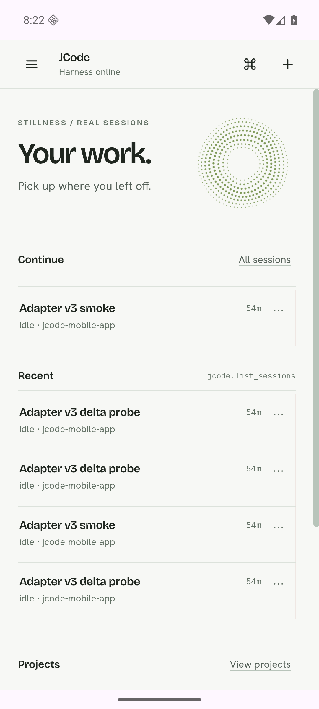
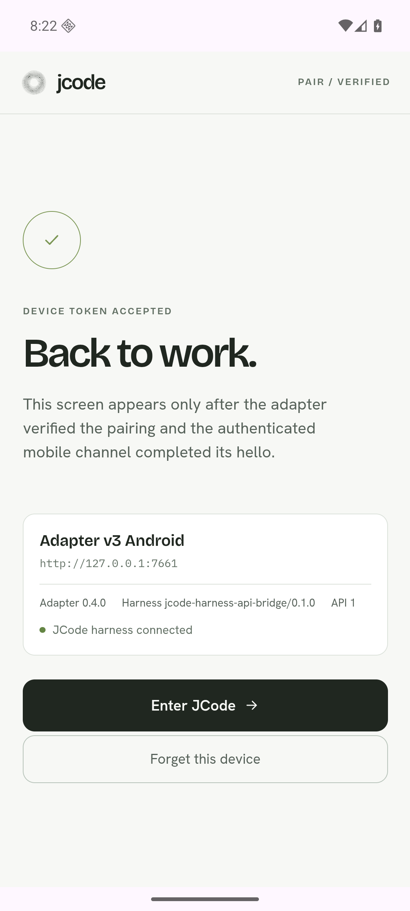
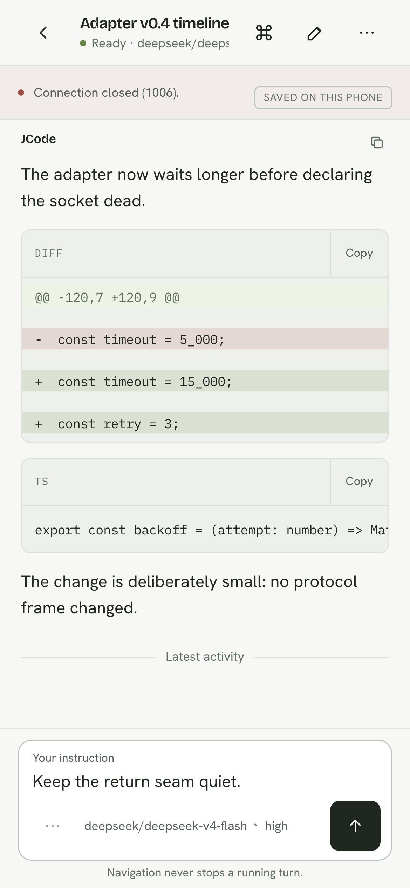

<p align="center">
  
</p>

<p align="center"><sub><code>JCODE MOBILE / STILLNESS 12 / 0.4.0</code></sub></p>

<h1 align="center">Leave the desk. Keep the thread.</h1>

<p align="center">
  <strong>Your server runs JCode. The phone is the return surface.</strong><br />
  <sub>A Tauri 2 client for <a href="https://github.com/1jehuang/jcode">JCode</a> on your own Linux server.</sub>
</p>

<p align="center">
  <a href="https://github.com/ddawnlll/jcode-mobile/releases/latest"></a>
  <a href="https://github.com/ddawnlll/jcode-mobile/actions/workflows/check.yml"></a>
  <a href="docs/ADAPTER_V3.md"></a>
  <br />
  <a href="https://ddawnlll.github.io/jcode-mobile/"><strong>Explore the site</strong></a>
</p>

<table>
  <tr>
    <td width="33%" align="center" valign="top">
      <sub><code>ANDROID / 0.4.0 / 12.1 MiB</code></sub><br /><br />
      <a href="https://github.com/ddawnlll/jcode-mobile/releases/latest"><strong>Download the APK</strong></a><br />
      <sub>Debug-signed sideload. No Play Store listing.</sub>
    </td>
    <td width="33%" align="center" valign="top">
      <sub><code>SERVER / JCODE + ADAPTER V3</code></sub><br /><br />
      <a href="docs/GETTING_STARTED.md"><strong>Run the adapter</strong></a><br />
      <sub>One pairing code. Then a device token.</sub>
    </td>
    <td width="33%" align="center" valign="top">
      <sub><code>SOURCE / TAURI 2 + RUST</code></sub><br /><br />
      <a href="docs/DEVELOPMENT.md"><strong>Build from source</strong></a><br />
      <sub>Android, native Linux, and a browser verification surface.</sub>
    </td>
  </tr>
</table>

> **0.4.0 is a development preview.** It ships Adapter v3, the Stillness 12
> gesture and motion system, and a native Android bridge. The Android APK is
> debug-signed for sideloading. The native Linux shell builds from source.
> There is no iOS artifact and no Play Store listing.

## What 0.4.0 is

JCode Mobile is two processes:

1. **Adapter v3** is one Rust binary on your server. It speaks to JCode through
   the pinned `jcode-sdk` and harness API, keeps a durable SQLite event journal,
   and exposes an authenticated mobile WebSocket. Protocol 3, minimum 2: a v2
   phone still pairs and never receives a v3 frame.
2. **Stillness 12** is the Tauri 2 client. It paints the cached session before
   the handshake, reconciles through journal replay or an authoritative
   snapshot, and restores the exact server and session you left.

0.4.0 adds a durable journal with cursor replay and per-device acknowledgement,
delta session sync with tombstones, authenticated diagnostics, validated inline
image attachments, and push registration with FCM HTTP v1 delivery when
operator credentials are configured. The client adds a finger-following drawer,
draggable sheets, swipe actions with undo, long-press menus, pull-to-refresh, an
interleaved conversation timeline, one-tap copy, a quick switcher, and a
snapping reasoning-effort slider. The Android shell adds notification channels,
WorkManager background health checks, sharesheet, pickers, downloads,
biometric app lock, edge-to-edge insets, and predictive back.

Nothing above is inferred from the browser surface: native Android evidence is
tracked separately in [`docs/ANDROID_NATIVE.md`](docs/ANDROID_NATIVE.md).

The phone never runs the agent. Prompts, tools, files, and long turns stay on
the server. Navigation, backgrounding, socket close, and app kill never send
Cancel. Only the explicit **Stop** control targets the current turn.

| Surface | State |
| --- | --- |
| Android | Tauri 2 APK, `arm64-v8a` and `armeabi-v7a`, minSdk 24 |
| Native Linux | Tauri 2 release binary, Secret Service credentials |
| Web | Verification surface only; browser token in `localStorage` |
| iOS | Not built on this host; no IPA |

## Verified on the release build

<p align="center">
  
  
</p>

The 0.4.0 release APK, installed on an API 36 arm64 emulator, paired to an
isolated staging Adapter v3 and showed `DEVICE TOKEN ACCEPTED`, `Adapter 0.4.0`,
and `JCode harness connected`; the session list came from the real staging
daemon. The second capture is a browser build showing the cache-first state:
`saved on this phone` while the socket is closed.

After an emulator restart the app restored the exact session with its history.
A real turn also completed on-device: the prompt reached the agent and a
generated reply rendered. The adb-typed prompt was truncated to `Repl`, and the
agent answered by asking about a REPL. That is a real accepted turn and reply,
not a fixture, but it is not a successful task completion.

| Check | Result |
| --- | --- |
| Adapter v3 Rust tests | PASS, 72 tests (28 core + 10 protocol + 17 server lib + 17 integration) |
| Rust formatting and clippy | PASS, `cargo fmt --check` and `cargo clippy -D warnings` |
| Real-daemon adapter smoke (real agent turn) | PASS, answer `OK`, 7 journal events, replay 0 duplicates, one accepted operation |
| Stillness browser e2e against a real daemon | PASS, 5 passed / 3 skipped with the perf spec; 4 passed / 3 skipped without it |
| Startup measurements (Chromium web target) | PASS, first screen 27 ms online, 60 ms cached with the socket blocked, 56 ms shell to paint |
| Android release APK static verification | PASS, versionCode 4000, minSdk 24, target 37, v2 + v3 signatures |
| Android emulator release build | PASS, API 36 arm64: installed as versionCode 4000, launched with no fatal crash, paired, restart restored the exact session with history, one real turn accepted and answered on device |
| Android Kotlin compile on this host | PASS, JDK 24, SDK 37, NDK 27.1 |
| Physical Android device | NOT_RUN |
| FCM delivery | PARTIAL, registration only; `not_configured`, no Firebase credentials |
| TalkBack / VoiceOver walkthrough | NOT_RUN |
| Battery, frame pacing, native cold start and memory | NOT_RUN |
| Process death and airplane mode | NOT_RUN |

The full matrix, commands, and captures are in
[`docs/evidence/v0.4.0/README.md`](docs/evidence/v0.4.0/README.md) and
[`docs/BUILD_STATE.md`](docs/BUILD_STATE.md).

## The transcript is fenced

The transcript is fenced by `session_id`, `epoch`, `seq`, `turn_id`, and
`operation_id`. A slow answer cannot overwrite newer work. A journal gap or
epoch mismatch triggers an authoritative snapshot instead of a guessed patch.
Drafts, reading positions, favorites, and pending sends are scoped to the
server and session.

## Command Code, in the route list

<p align="center">
  
</p>

The pinned JCode fork exposes Command Code as a native provider. The adapter
lists routes from `ListModels` and `GetRuntimeInfo`. It does not infer
entitlement from a catalog, invent a provider key, or proxy a credential.
Reasoning effort is sent as the discrete value the server accepts.

## The desktop shell

The same build runs as a three-pane Tauri window on Linux. The sidebar, central
session, and inspector read one shared connection. The inspector exposes only
what the server reported: plan, context, activity, runtime, and provider.

## Install the Android APK

```text
jcode-mobile-0.4.0-android-release.apk
12,693,953 bytes (12.1 MiB)
SHA-256 db6fadf9d305a958388859e50aa93490adc35907ba6e3cbe9f6e2f87d86ca531
package dev.jcode.stillness
versionCode 4000, versionName 0.4.0
minSdk 24, targetSdk 37, compileSdk 37
arm64-v8a + armeabi-v7a
APK Signature Scheme v2 and v3, Android Debug certificate
```

```sh
adb install -r jcode-mobile-0.4.0-android-release.apk
```

The package identifier and signing key are unchanged from 0.3.1, so the app
updates in place and keeps its device token. The APK and its `.sha256` are built
to `artifacts/` and attached to the GitHub release once it is published.

## Run the server side

```sh
git clone https://github.com/ddawnlll/jcode-mobile.git
cd jcode-mobile
cargo build --release -p adapter-server --bin jcode-adapter-v3

JCODE_ADAPTER_ALLOWED_ROOTS="$HOME/src" \
JCODE_ADAPTER_BIND=127.0.0.1:7646 \
./target/release/jcode-adapter-v3
```

`jcode-adapter-v2` is a rollback alias that runs the same versioned server, so
existing service units keep working. The adapter prints its pairing code and the
roots it will expose. It discovers the JCode harness socket from
`JCODE_API_SOCKET` or the platform runtime directory. Data lives in
`~/.local/share/jcode-mobile-adapter-v2` unless `JCODE_ADAPTER_DATA_DIR` is set;
the directory name is retained from v2 and its schema is extended in place.

For a remote phone, terminate TLS at a reverse proxy and keep the adapter on
loopback:

```caddyfile
dawnll.example.com {
    reverse_proxy 127.0.0.1:7646
}
```

Then enter `https://dawnll.example.com` in the app. The adapter does not ship a
TLS terminator, VPN client, or SSH client for the phone.

Full setup, environment variables, troubleshooting, and local staging:
[`docs/GETTING_STARTED.md`](docs/GETTING_STARTED.md). Upgrade and rollback:
[`docs/V0_4_0_MIGRATION.md`](docs/V0_4_0_MIGRATION.md).

## Build from source

```sh
bun install --frozen-lockfile
cd apps/stillness && bun install --frozen-lockfile && cd ../..

cargo test --workspace
cargo fmt --all -- --check
cargo clippy --workspace --all-targets -- -D warnings
bun run typecheck
bun run lint
bun run test

cd apps/stillness && bun run build
cd ../..
bash scripts/build-android-release.sh   # JDK + Android SDK
bash scripts/build-tauri-linux.sh       # GTK 3 + WebKitGTK 4.1
```

The Android release script builds, zipaligns, signs, verifies, and writes a
`.sha256` beside the APK. The Linux script accepts a user-space `TAURI_SYSROOT`
when the host has no system GTK/WebKit development packages.

## Limits

- The Android APK is debug-signed and sideload-only. There is no Play Store
  release, release keystore, auto-update channel, or signed iOS build.
- The release APK is ARM-only. The Android runtime checks used the arm64-v8a
  API 36 emulator on macOS. Physical-device validation is `NOT_RUN`.
- FCM delivery is `not_configured` without `JCODE_FCM_PROJECT_ID` and
  `JCODE_FCM_ACCESS_TOKEN`. Payloads contain no transcript content.
- The scheduled background check is an unauthenticated `GET /health`. It reports
  reachability, not authenticated session reconciliation.
- `sessions.delete` is refused because the daemon has no delete operation.
  Archive is the supported alternative.
- JCode's curated API exposes aggregate edit statistics, not a verified per-file
  diff. The Changes screen says so.
- Upstream cancellation is session-scoped. The adapter verifies the expected
  turn before stopping and reports `atomic_turn_scope: false`.
- The adapter journal stores event payloads with bounded retention. It is not an
  unbounded transcript archive; authoritative history comes from the daemon.
- Attachments accept four inline images per message, 4 MiB each. Provider
  credentials are not implemented in the mobile composer.
- A human screen-reader pass, battery measurement, frame pacing, and native
  cold-start measurements remain `NOT_RUN`.

## Documentation

| Read | Why |
| --- | --- |
| [Getting started](docs/GETTING_STARTED.md) | Adapter, TLS, pairing, Android, Linux, troubleshooting |
| [Adapter v3](docs/ADAPTER_V3.md) | Negotiation, journal, replay, delta sync, diagnostics, attachments, push |
| [Adapter contract](docs/ADAPTER_CONTRACT.md) | Source evidence, operation states, security boundaries |
| [Android native](docs/ANDROID_NATIVE.md) | Kotlin bridge, commands, permission and capability matrix |
| [Migration](docs/V0_4_0_MIGRATION.md) | 0.3.x → 0.4.0 adapter and phone upgrade, rollback |
| [Audit](docs/V0_4_0_AUDIT.md) | Battery, privacy, permissions, accessibility, startup |
| [Development](docs/DEVELOPMENT.md) | Repository layout, commands, tests, release builds |
| [Verification](docs/VERIFICATION.md) | The 0.3.1 matrix, kept as history; 0.4.0 evidence is in the index above |
| [Build state](docs/BUILD_STATE.md) | Versions, artifacts, checksums, resumption point |
| [Release notes](docs/V0_4_0_RELEASE_NOTES.md) | 0.4.0 scope and known limits |

Historical release notes remain in `docs/`, including
[0.3.1](docs/V0_3_1_RELEASE_NOTES.md) and
[0.3.0](docs/V0_3_0_RELEASE_NOTES.md).

---

<p align="center">
  <sub><strong>JCODE MOBILE</strong> / Stillness 12 / Work in orbit.</sub><br />
  <sub>An independent companion for <a href="https://github.com/1jehuang/jcode">JCode</a>. Not an official JCode release.</sub><br />
  <sub>JCode, Bricolage Grotesque, Hanken Grotesk, IBM Plex Mono, and Lucide keep their own licenses. See <a href="THIRD_PARTY_NOTICES.md">THIRD_PARTY_NOTICES.md</a>.</sub>
</p>
