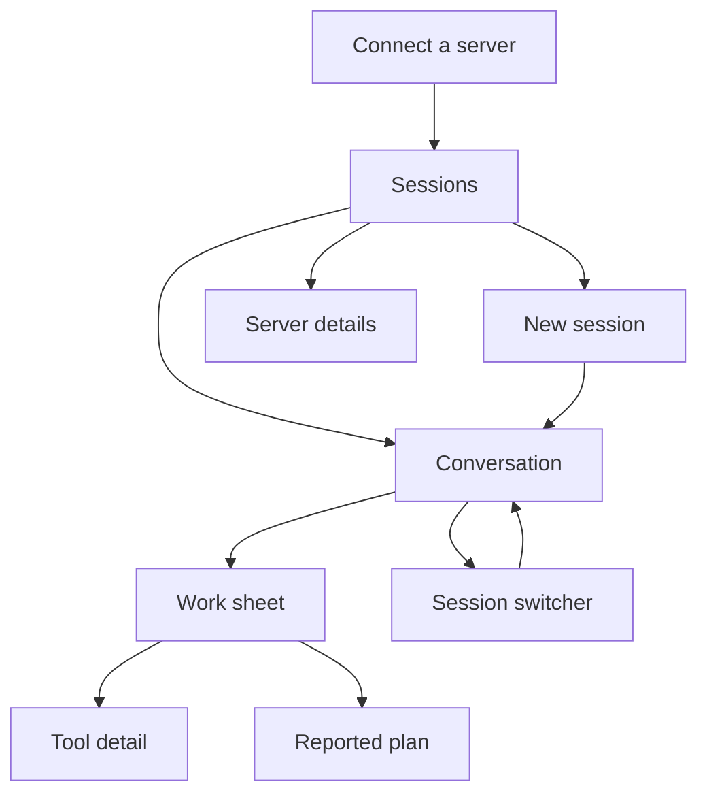
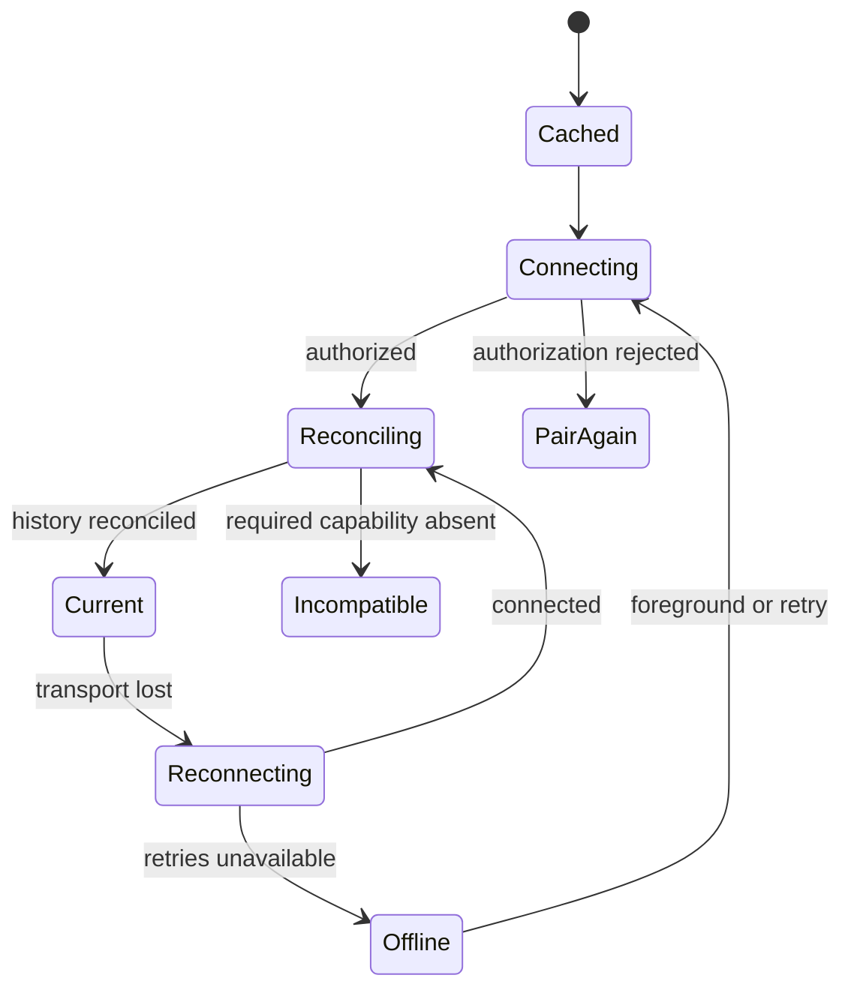

# JCode Mobile

Product and interaction specification · 1.0 · 8 November 2026

**A quiet place to return to work.** JCode runs on the user’s Linux VPS. This app is a remote client for reading, directing, and returning to those sessions. The intended implementation is React Native + TypeScript. This package contains design, fixture content, and exhibition HTML only.

## 1. The product decision

The experience starts with work, not infrastructure. Opening the app answers three questions, in order: **What needs me? What is happening? Where was I?** The answer is a short session list, a focused conversation, and an exact return point.

The app has one main destination, Sessions. Server management is a sheet and a secondary detail screen. Work details open from the conversation. There is no permanent dashboard, terminal emulator, code editor, analytics home, agent marketplace, or bottom bar full of future destinations.

The visual signature is the **return seam**: a fine horizontal boundary in a session marking the first content the user has not yet seen. It carries “Since you left” and, only when countable, a factual update count. The same boundary anchors the work-detail sheet. Its placement is derived from the local reading bookmark reconciled against authoritative history. It is never an animated progress bar.

### Visual reference index

Use the HTML for interactive behavior and the files below for exact resting-state reference. All image content is illustrative. The iOS references are 390 × 844; Android references are 412 × 892 logical units rendered one-to-one.

| Screen / state | Reference |
| --- | --- |
| S01 Sessions | [01-sessions-ios.png](assets/screens/01-sessions-ios.png) |
| S02 Conversation after return | [02-return-ios.png](assets/screens/02-return-ios.png) |
| S03 Work activity | [03-work-ios.png](assets/screens/03-work-ios.png) |
| S04 Tool detail | [11-tool-detail-ios.png](assets/screens/11-tool-detail-ios.png) |
| S05 Reported plan | [04-plan-ios.png](assets/screens/04-plan-ios.png) |
| S07 New session | [07-new-session-ios.png](assets/screens/07-new-session-ios.png) |
| S08 Connect on Android | [06-connect-android.png](assets/screens/06-connect-android.png) |
| S09 Server details | [12-server-ios.png](assets/screens/12-server-ios.png) |
| Offline on Android | [05-offline-android.png](assets/screens/05-offline-android.png) |
| Night conversation | [08-return-night-ios.png](assets/screens/08-return-night-ios.png) |
| Enlarged conversation text | [09-large-text-ios.png](assets/screens/09-large-text-ios.png) |
| Enlarged work sheet | [10-large-work-ios.png](assets/screens/10-large-work-ios.png) |
| Keyboard-aware geometry | [keyboard-anatomy.svg](assets/keyboard-anatomy.svg) |
| Process ownership | [continuity-map.svg](assets/continuity-map.svg) |

S06 uses the ordinary conversation composer for prose questions; it is deliberately not a separate permission screen. The Work sheet’s reveal/drag and message queue states are demonstrated in SHOWCASE.html. Read the state rules below before interpreting a screenshot as a component specification.

### Non-negotiable behavior

1. Dismissing the app, leaving a session, locking the phone, swiping the app away, and losing reception do not cancel the server turn.
2. Reopening returns to the same server and session. It paints a cached view, marks it as cached, reconnects, and reconciles before claiming that anything is current.
3. The agent continues only because the server accepted a continuation policy. A background phone socket is not the persistence mechanism.
4. The UI never invents completion percentages, elapsed job estimates, test results, file changes, approvals, or worker activity.
5. A request being written, parsed by a bridge, accepted by the agent, queued for a safe point, and incorporated are distinct states.
6. Daemon termination is different from phone disconnection. A saved transcript does not prove the former turn is still running.

## 2. Research boundary and release gates

Source snapshot: [`1jehuang/jcode@629cca346f71f6c051cf8570dbea35cd0b20d5a2`](https://github.com/1jehuang/jcode/tree/629cca346f71f6c051cf8570dbea35cd0b20d5a2). Exact evidence and line references are in SOURCE_NOTES.md. “Existing” below means source-verified at that snapshot, not tested against the user’s installed VPS.

| Surface | Source-verified fact | Consequence for this design |
| --- | --- | --- |
| Server sessions | One daemon owns many sessions; clients observe/request work | Session identity never depends on phone route or component lifetime |
| Continuation | Raw `subscribe.continue_on_disconnect` is opt-in and preserves running work and the live session | Mandatory negotiated capability before enabling remote execution |
| Raw remote gateway | `/ws` bridges raw `type`-tagged requests to the Unix daemon; it is disabled by default | Do not send harness `req` frames to this endpoint |
| Curated harness API | Has session inventory, archive/restore, peek, streaming, runtime metadata, and file reads | Preferred app-facing data vocabulary, after a supported remote adapter exists |
| Harness bridge | Current attach/create translation omits `continue_on_disconnect` | Unmodified bridge does not meet this product’s continuity promise |
| Permissions | Types exist, but the bridge does not advertise `permissions` and rejects responses | No approval inbox or Allow button in the base design |
| Reconnection | Authoritative history plus future events; not guaranteed replay of missed deltas | Reconcile snapshots; unread counts can become unavailable |
| Progress | Structured plans and background progress exist in specific API paths | Show reported counts; only show a percentage with a source-reported bounded task percentage |
| Push | Mobile-related server code exists; delivery/deployment/platform parity is not established by this review | Notification controls remain unavailable until end-to-end support is demonstrated |

### Chosen integration contract (proposed, not existing)

Use one authenticated WSS mobile endpoint on the VPS that exposes the curated API vocabulary, reuses the existing pairing/device authorization, and explicitly opts into remote continuation for every session attachment. It may extend the current gateway/bridge; it must not start one JCode process per phone, or build a second agent runtime. A small transport adapter is a backend prerequisite, not something this HTML implements.

Before enabling Send, the client must obtain an affirmative capability for disconnect continuation and pass the force-quit acceptance scenario in section 15. Missing capability opens a read-only connection screen: “This server needs mobile continuation support.” Action: “View setup details.” Cached reading remains available. Do not silently downgrade to a connection that kills the turn.

The adapter must also expose bounded history reads and correct event scoping. This is additional integration work where existing full-history APIs cannot meet the budgets. See SOURCE_NOTES.md for a precise list of additions and existing primitives to reuse. The coding agent should implement the native UI only against this explicit contract, or expose the unavailable states; never fake backend completion to match the artwork.

## 3. Who and what this serves

The primary user already has a VPS with JCode and works across a desktop and phone. They may run several sessions and need to send a direction, read a result, inspect a tool action, or stop a turn while away from a keyboard. They care about low memory use and immediate feedback. They do not need the phone to become a miniature workstation.

Primary tasks:

- Reopen a session and immediately understand what has changed.
- Send a new instruction or add one while a turn runs.
- Inspect the actual sequence of tools, reported tasks, and results.
- Start a session in a server directory; choose an available model when supported.
- Switch among sessions and servers without confusing drafts or destinations.
- Recover safely from transport loss, process death, and uncertain sends.

### Product vocabulary

| Concept | User-facing name | Rule |
| --- | --- | --- |
| Daemon/host profile | Server | Friendly label plus host in server details; never substitute server name for session identity |
| Persisted conversation/runtime | Session | Stable server-scoped identifier; title can change |
| Current model execution | Turn | Say “Stop this turn”; avoid “kill agent” |
| Ordered tool and status events | Work | “View work”; raw tool names remain available in details |
| Server-published todo/plan | Plan | Only display when reported |
| Message injected at safe point | Added instruction | “Queued for the next safe point” until confirmed incorporated |
| Lost phone transport | Reconnecting / Offline | Agent state becomes last-known, not stopped |
| No live turn | Ready | “Finished” belongs to a specific completed turn/result, not an eternal session |

## 4. Navigation and state ownership

This is a navigation map, not a proposed module tree. Tool detail and Plan replace the sheet’s content with an in-sheet back action; they do not stack another modal over it.

### Back behavior

- Android Back: dismiss keyboard first; dismiss top sheet next; pop detail next; return to Sessions next; let system back-to-home operate at root. Predictive Back uses platform integration. It must not trigger Cancel.
- iOS: edge-back returns to Sessions from Conversation; sheet drag dismisses only the sheet; keyboard follows the platform’s interactive dismissal. Do not add edge-swipe session switching.
- In either platform, tapping the session title opens a switcher with recent sessions and a visible “All sessions” row. It is a speed path, not the only navigation.
- Opening a session preserves list position. Returning restores the same list offset and search text. Session switches preserve independent transcript offsets, drafts, and expanded items.
- Deep links first resolve the exact server identity; an ambiguous host label never selects a server. A link cannot approve, cancel, or send by itself.

### Persistent client state

Persist after each meaningful change, not only in a background callback:

| Key | Scope | Persistence and restoration |
| --- | --- | --- |
| Paired credential | Server + device | Keychain/Keystore; never transcript database or logs |
| Last route | Server + session | Restore Conversation only when the session still exists; otherwise show Sessions with explanation |
| Draft | Server + session | Debounce 250 ms; force-write on navigation; never mix between sessions |
| Reading bookmark | Server + session + message identity | Persist when content is actually visible; maintain a fallback anchor/fingerprint when IDs are absent |
| Uncertain message record | Server + session + local message ID | Persist before sending; retain until authoritative reconciliation or explicit user dismissal |
| Transcript cache | Server + session | Bounded disk store, with server observation time and revision/fingerprint |
| UI preferences | Device | Appearance, text sizing, privacy preview; instant local apply |
| Expanded tool rows | Session | Local convenience; safe to discard under memory pressure |

No hidden job executor, service worker equivalent, phone-side agent loop, or constant wake lock.

## 5. Connection, execution, and delivery are separate state machines

### Connection state

| State | On-screen treatment | Controls |
| --- | --- | --- |
| Cached | Small persistent “Saved on this phone” line until connection progresses | Read and edit draft; sending disabled with explanation |
| Connecting | “Connecting to Studio VPS…” in the existing connection row | Read cached content; cancel connection attempt via server sheet |
| Reconciling | “Catching up…”; cached body remains in place | Read/edit; hold sends until attachment target and history agree |
| Current | Server label; no celebratory success banner | Full supported controls |
| Reconnecting | Static link-slash icon + “Reconnecting” and last confirmed time | Draft is editable; Stop and Send unavailable because their outcome cannot be verified |
| Offline | “Offline. Last checked at 14:32.” | Retry; save draft; read cached history |
| Pair again | “This phone is no longer authorized.” | Pair again; cached content remains according to privacy setting |
| Incompatible | “This server needs mobile continuation support.” | Setup details; cached reading |

Foreground retry intervals: 1, 2, 4, 8, 16, 30 seconds, with ±20% jitter and a 30-second cap. Use platform connectivity changes to retry once immediately. “Retry now” triggers one coalesced attempt, never a new retry loop. Stop timers and animations when the app backgrounds. On return, reconnect immediately and revalidate authorization. Do not keep a phone socket alive to preserve the agent.

### Execution state

Authoritative states include Ready, Working, Running tool, Queued instruction, Stopping, Stopped, and Error. Unknown values display “Status unavailable” plus the raw value in diagnostics. Missing freshness means “Last seen working”, even if a local spinner was previously showing Working.

`message_end` or `text_done` is not necessarily a terminal turn. Retain the work state until terminal `done`/`TurnDone` or an authoritative stopped/error state. A tool finishing is not the task finishing. A failed tool can be recoverable inside an otherwise running turn.

### Sending state

| State | Exact label | What it proves |
| --- | --- | --- |
| Local draft | Draft saved | Stored on this phone |
| Writing request | Sending… | Transport is being used |
| Bridge acknowledgment only | Sent to server | The remote transport parsed/accepted the frame; not yet agent acceptance |
| Agent acceptance | Accepted | JCode has accepted the message for the session |
| Soft interrupt queue confirmed | Queued for the next safe point | Will be incorporated at a server-selected safe point; no instant-preemption claim |
| Injection confirmed | Added to this turn | Matching queue identity was incorporated |
| Socket lost before certainty | Delivery unconfirmed | The user must inspect/reconcile before resending |
| Known rejection | Not sent | Keep full input; explain actual rejection and offer retry |

Only one new send per session may be unresolved at a time. Other sessions remain usable. The send button disables during transport acceptance, but a server-confirmed queued message does not block drafting the next one. Preserve local IDs for soft interrupts where supported.

**No automatic resend after uncertain delivery.** A request ID is not a durable idempotency key. The base JCode path does not establish cross-reconnect exactly-once sends. Reconcile history first. If a message can be unambiguously matched, mark Accepted; otherwise show “Check the conversation before sending again” with “Review message” and “Send again” inside a deliberate decision sheet. Never label heuristic text matching as certain.

## 6. Screen S01: Sessions

Purpose: find the next meaningful session without fetching every transcript.

Structure from top to bottom:

1. Platform status area.
2. 56-unit app bar: JCode mark + `jcode` wordmark left; server selector right. Selector includes a link icon and the friendly server name, maximum one line.
3. Page title “Your sessions”, one line where it fits, 40/44 display on roomy phones, 32/36 at compact heights or large text. Do not use a greeting that changes every visit.
4. Search field with visible “Search sessions” label and icon; collapsed to a 48-unit labeled search button only if needed at very short height.
5. Ordered groups: Needs you (only authoritative requests/status), Saved (explicitly saved sessions, when present), Working (fresh active statuses), Recent (everything else). A session appears in only one group. No empty group headings. Within each group, saved sessions first, then updated time descending. Freeze order under a finger/scroll; reorder only on refresh or when returning to the root.
6. Each row: title up to two lines (20/26 semibold); directory basename and server-reported status; trailing update time and chevron. Full row ≥88 units. Use separate lines instead of unreadable concatenated metadata. No progress rings.
7. Bottom action dock: “New session”, 48 high, 20-unit side gutters, 12 above system inset. This is the only primary action. No permanent tab bar.

Tap a row → restore its reading position immediately, then attach to its exact ID. Long press → native context menu: Rename when supported, Archive when safe/supported, Copy session ID. Each action also exists in the session’s overflow menu. Archive is reversible and is not Stop. Do not archive an active turn in the first release; explain “Stop or wait for this turn before archiving.”

Search filters loaded session titles, save labels, and directory text on device. The field says “Search loaded sessions” if the inventory is partial. Fetch inventory in pages of 50 only if the adapter supports a cursor; the existing limit-only API is not a cursor API. Otherwise load a bounded recent list and offer “Load more sessions” with an explicit increasing limit. Do not imply global full-text transcript search.

Empty state: heading “Start with one session.” Body “Choose a folder on your server and tell JCode what you want to do.” The primary “New session” dock stays in the same place. No mascot or starter-prompt carousel.

## 7. Screen S02: Conversation

Purpose: read actual output and direct the selected server session.

### Geometry

Reference logical frame: 390 × 844. See DESIGN.md for exact bands and reflow rules. Content uses 20-unit compact gutters. The route stack owns the top bar; composer and work dock are keyboard-aware bottom siblings, not absolutely positioned over a transcript. When the IME already includes the bottom system inset, do not add that safe-area inset again. The example band diagram is in `assets/keyboard-anatomy.svg`; actual keyboard height always comes from the platform.

- Top app bar: back action (48 hit target), session title switcher, overflow (48). Compact header title is one line. Expanded identity region below gives the full two-line title and remote directory when near the top.
- Transcript occupies all remaining space. Assistant prose is full-width, unboxed, left aligned. User messages are aligned to the trailing edge on a restrained raised surface with a maximum width of 86%; use 12-unit corners. Roles are readable in text or accessibility labels; no repeated avatars.
- Assistant body is 16/24. Paragraph gap 12. Consecutive messages by the same role group by time/turn without losing boundaries in accessibility navigation.
- Work dock, 48 high: leading status glyph, current observed action, expand chevron. A separate 48-unit Stop target sits at the trailing edge only during a live turn. The text area opens Work. Do not nest the Stop button inside the disclosure button.
- Composer: visible label “Message” while idle; “Add instruction” while working. Multi-line text input, 56 minimum/144 maximum, then internal text scrolling. Leading attachment button appears only with negotiated image support. Trailing Send target is 48. Send is never replaced by Stop.

### Reading behavior

Autofollow only if the user was within 80 logical units of the bottom and is not selecting text, opening a link, or dragging. Appending text while reading older messages never moves the viewport. A “New activity” button appears above the work dock; it returns to the latest unread boundary, not necessarily to the last token. The return seam is inserted at the first unseen committed message. If the unread anchor was compacted or removed, say “New activity since your last visit” without an exact count, preserve a nearby stable anchor, and do not manufacture a count from streamed token frames.

On first return, show the seam and the latest one or two meaningful committed items within view. If the user was reading far back, keep their original position and show the “New activity” button instead. Dismissing the seam marks only actually displayed/explicitly opened content as seen. Do not clear every unread session just because the app foregrounded.

### Streaming

Append visible text in coalesced updates, up to 10 UI updates/second by default; the text is not animated character by character. Freeze completed blocks and parse only the growing block. Render code as readable plain code while incomplete; finalize syntax highlighting once the block closes. Handle `text_replace`, suffix replacement, and retry rollback by replacing the affected provisional content, never appending duplicate paragraphs. “Retrying the provider…” is status text, not a second assistant response.

Reasoning traces, if actually provided, are collapsed behind a labeled disclosure; do not synthesize thoughts or use them to guess remaining duration. Keep hidden traces out of the session-list preview.

### Long content and code

- Tables transform to labeled stacked rows on narrow screens; retain a horizontal table view as an explicit “View table” action when comparison requires it.
- Code wraps at the screen width by default with a “Wrap” switch. A raw/nonwrapping mode has horizontal scrolling only within the code block. File paths are monospaced but can wrap at path separators; no middle truncation in a copying/detail view.
- Copy code has a 48-unit effective target, in-place “Copied” feedback, and no celebratory toast. Copy failure shows a local explanation.
- Tool output is collapsed to one semantic line. Preview at most 24 lines or 8 KiB. An explicit expansion requests a bounded larger window; indicate omitted bytes/lines when known.
- External links use the system browser after normal tap; malicious schemes never launch. The conversation does not execute HTML returned by an agent.

### Input

Return inserts a newline on mobile. Send is explicit. External keyboard uses Cmd/Ctrl+Enter to send; never send on plain Return while an IME is composing. Preserve selection and draft during stream updates. Voice input is the OS keyboard dictation facility, not a separate JCode capability. Attachments, if enabled, are images only until a file-upload contract exists; no decorative paperclip suggesting arbitrary uploads.

## 8. Screens S03–S05: Work, tool detail, and plan

### S03 Work sheet

Open by tapping the work dock or the return seam’s “View updates” action. A single bottom sheet starts at approximately 64% available height, with an accessible heading “Session work”. Native platform safe areas and large text can make it full-screen. Surface is opaque; a translucent dim scrim is used, never background blur.

Top: drag affordance and 48-unit Close action. Under it: current server-reported state and last observation time. Then two text tabs, “Activity” and “Plan”. Do not show Plan when no plan exists; instead keep one Activity view and a low-emphasis “No plan was reported” line if the user explicitly looked for a plan.

Activity rows are an ordered reading list with action verb, actual tool name in secondary detail, and state glyph. A slim continuous spine connects related rows and stops at a return seam. The spine encodes event order, not percent complete. A row can read “Read connection manager”, “Updated session cache”, or “Running reconnect tests” only when that meaning is supported by actual tool input/result. Otherwise show raw “read”, “edit”, or “bash” and a safe summary of the parameters. Do not generate another LLM summary in the mobile client.

Tap a row → S04. “Stop this turn” is a tertiary action at the bottom when running; it affects only this session. If workers continue independently, state that fact in the stop confirmation/result when the server provides it; do not invent a stop-all-workers command.

### S04 Tool detail

Replaces sheet content, retaining back-to-Activity and Close. Show tool name, source-reported start/end time when available, parameters, result, and error. Parameters/results are read-only, copyable, and chunked. Do not label an `edit` input as a Git diff. A side-by-side before/after excerpt can be presented only when both texts exist; use a unified readable excerpt at phone widths. Changed-file counts are source-reported edit statistics, not Git working-tree status.

If `session_files` is supported, an explicit “Read current file” action opens a bounded read-only file detail. Tell the user that this is the current server file, while tool output describes an earlier action. Do not turn this into a file manager or editor. Images require an accessible label and lazy full-resolution fetch; offscreen images release decoded memory.

### S05 Plan

Display actual server todo/plan state. A completed item has a check + label; current item a square/work glyph + text state; blocked item a lock + “Blocked” and actual reason. The count reads “2 of 5 reported steps complete”. It describes the current plan only and may change if the plan changes. No percentage bar, ETA, “almost done”, or conversion to overall task success. Missing total → list items without a total. Each item expands source-provided detail. Plan is read-only in the first release.

## 9. Screen S06: Replying and decisions

The base product uses the ordinary composer for agent questions. An assistant asking a question in prose is not a permission object. A plain question can be emphasized in a transcript using normal typography; do not automatically convert it into buttons with invented values. A canned example in the showcase is clearly a scripted demonstration of a normal follow-up message.

If a future server advertises a working `permissions` capability and sends a real request with stable request ID, add an inline decision region and a “Needs you” item. The detailed decision sheet must show the exact session/server, action, described consequence, and requested parameters, with primary “Allow once”, secondary “Deny”, and a visible Close action. Do not add “Always allow” unless supported. Revalidate the outstanding request before submit. A request resolved on desktop becomes “Resolved on another device”, not another opportunity to approve. No decisions in lock-screen push actions. This extension is not enabled in the pinned-source showcase.

## 10. Screen S07: New session

A focused sheet with title “New session”. Visible labels: Server (read-only current profile), Folder on server (absolute path), and Instruction. Use the last successfully used directory on this server, not the phone’s path. A recent-folder list is local history, labeled “Recent folders”; it is not a remote filesystem browser. Default model comes from the server; an optional model row opens a live/cached server catalog with freshness text. No hardcoded provider roster or default billing claim.

Primary action “Start session”. Validate folder nonempty and absolute before sending. Server validates existence/access. Do not clear the input on rejection. Create/attach must finish before sending the initial instruction to its exact returned session ID. An empty created session can remain in the list; do not duplicate it on retry. Starting while offline is unavailable; draft can be saved locally.

## 11. Screens S08–S09: Connect and server details

### Connect

First-run headline “Bring your server.” One sentence: “Pair this phone with JCode running on your VPS.” The first decision is “Scan pairing code” or “Enter connection details”. Camera permission is requested only after Scan. Paste a pairing deep link is an equal fallback. Do not ask for a cloud subscription, provider key, shell password, or root access.

Manual fields: Server address, pairing code, Device name. Allow paste into the whole pairing-code field and appropriate autofill; six-digit visual grouping must not create six separate focus traps. The five-minute expiry comes from the source pairing policy, but do not display an exact remaining timer unless the invite includes its creation/expiry time. Error: “That pairing code is invalid or expired. Generate a new code on your server.” Keep the host/name fields.

Show the exact scheme/host/port before exchanging credentials. A pairing deep link is untrusted until reviewed; it never auto-sends a code to an arbitrary host. The chosen production path is TLS (`wss`/`https`), with platform certificate validation, or a separately designed authenticated private tunnel. The current JCode raw gateway is plain TCP/WebSocket and does not itself supply TLS. Do not silently open a public unencrypted gateway. A Tailscale deployment can be documented as a network prerequisite; this design does not implement a VPN or SSH client.

The setup details view may show the source-verified `/remote on`, `/remote pair`, and `jcode pair` commands as copyable instructions with their context, not as executed actions. It must explain when a compatible mobile adapter is also required. The app does not provision, restart, or upgrade the VPS in the first release.

### Server details

Server name and host, current connection state, observed JCode version, last successful contact, and capabilities. Separate “Connection”, “This phone”, and “Appearance” groups. Appearance: System / Light / Night. Notification row: “Not available on this server” until verified. Device privacy: hide content in app-switcher snapshots; notification previews off by default if notifications later exist.

“Disconnect this phone” closes transport and retains profile/cache; it does not stop jobs. “Forget server” removes credential, drafts, and cached content for that server after a specific confirmation; it does not claim to revoke the remote device token. Source has server-side revoke logic but no verified phone-facing revoke endpoint in this review. Remote revocation is a separate administrative action until supported.

Multiple servers are profiles, not simultaneously loaded universes. Selecting another server detaches the current view without Cancel, saves draft/anchor, then loads that server’s cached inventory. A persistent profile identifier namespaces every local key. No session can inherit another server’s credential or draft.

## 12. Error and empty-state inventory

| Trigger | Heading/body | Action and persistence |
| --- | --- | --- |
| No sessions | “Start with one session.” | New session; no fake sample sessions in the actual app |
| No matching loaded session | “No matching sessions.” | Clear search; preserve query until user acts |
| No cached conversation offline | “This session isn’t saved on this phone yet.” | Retry when online; do not show a blank transcript as current |
| Transport loss | “Reconnecting. Last checked at 14:32.” | Read cache/edit draft; no claim that work stopped |
| Server unavailable | “Can’t reach Studio VPS.” | Retry / Connection details; preserve all local state |
| Authorization rejected | “Pair this phone again.” | Re-pair; no endless retry spinner |
| Session missing | “This session is no longer available on the server.” | Back to Sessions; offer cached read-only copy if present |
| Daemon/runtime replaced and interrupted | “The server session was interrupted.” | Read saved history; explicit Continue only when server offers a valid recovery path |
| Message uncertain | “Delivery unconfirmed.” | Review message; never silently resend |
| Output truncated | “Only the first 24 lines are shown.” | Load more, with source length when known |
| Tool failed | Exact tool error in its row/detail | Parent turn can remain running |
| Provider retry/rollback | “Retrying the provider…” | Replace provisional content; keep prior committed messages |
| Memory pressure | No intrusive alert | Release previews and inactive buffers; reload those details on demand |
| Unsupported request | “This action isn’t supported by this server.” | Hide the action after capability refresh; keep user input |
| Stale plan/status | “Last reported at 14:32.” | Do not animate or extrapolate |

## 13. Accessibility and platform behavior

Use native input, scrolling, focus, menus, text selection, keyboard, and navigation primitives wherever practical. Shared visual identity does not mean recreating iOS controls on Android.

- All actions have ≥48 × 48 logical-unit targets on both platforms, a deliberately comfortable common target that clears the 44-point iOS convention and Android’s 48-dp recommendation.
- Support 200% text scaling without clipped controls, hidden Send, or forced horizontal page scrolling. At larger text, secondary metadata moves to a new line and sheets become full-screen. No fixed-height row containing multiline text.
- Screen-reader order: header/session identity, connection notice, transcript groups, new-activity action, work dock, composer. Provide heading navigation by turn and tool group. Do not read every token; announce completed meaningful chunks, tools, and terminal status politely, with an opt-in live reading mode.
- A modal sheet traps focus and returns it to its trigger. Closing an activity sheet never refocuses the composer and unexpectedly opens the keyboard.
- Status always has text plus shape; color is supplementary. Check the showcase in grayscale.
- Reduced Motion uses ≤100-ms crossfades and instant anchor restoration; no traveling sheets, scale changes, parallax, or decorative loops. Haptic feedback respects platform settings.
- App-switcher snapshot privacy is a platform implementation requirement, not a visual blur running continuously in the app.
- RTL mirrors navigation and layout while keeping code, paths, IDs, and numbers appropriately LTR. No manually spaced labels.

## 14. Performance is part of the experience

These are **proposed acceptance budgets**, not measured React Native or JCode results. Measure a release build on a 4-GB Android reference phone and a supported midrange iPhone; record device/OS/build, network, and scenario. Do not quote the JCode Rust process benchmarks as mobile client performance.

| Operation | Target | Measurement boundary |
| --- | --- | --- |
| Input echo / press response | p95 ≤50 ms; no >100-ms typing stall | Native input event to visible response; provider/network excluded |
| Warm cached route paint | p95 ≤150 ms | Tap to readable cached content |
| Cold cached first content | p95 ≤600 ms | Process start to readable cached Sessions/last session; connection may continue |
| Normal navigation / sheet | 180–280 ms, interruptible | Input acknowledgment immediate; animation never blocks input |
| Foreground live update | Visible within ≤150 ms after arrival, excluding slow parse/network | Frame received to coalesced visible text |
| Rendering | Target 60 fps on 60-Hz hardware; p95 frame ≤16.7 ms for navigation | Do not require 120 Hz or hold a high-refresh lock |
| Android memory | Idle PSS ≤120 MiB; long-thread scenario ≤180 MiB; image/detail transient ≤220 MiB | Provisional release gate; include RN/native/UI memory, exclude JCode VPS |
| iOS memory | Resident/physical footprint ≤160 MiB normal, ≤220 MiB transient | Provisional; use platform footprint tooling, not a JS heap number |
| Mobile adapter VPS overhead | Incremental idle ≤32 MiB, active ≤64 MiB | Above existing daemon baseline; proposed budget, must profile |
| Background client traffic | No polling, persistent websocket requirement, or animation timer | After OS transition settles; push is a separate optional facility |
| Local cache | 32 MiB text by default, images separately capped at 32 MiB | LRU per server/session; user can clear; never evict an unresolved send or draft |

Implementation guidance at the design boundary:

1. Use a virtualized transcript and a virtualized session list. Mount approximately the visible screen plus a small buffer; keep stable keys. Load 50 session summaries and roughly 60 recent committed transcript messages initially, subject to actual adapter bounds. A 10,000-message fixture must not mount 10,000 rows.
2. Keep one selected-session event stream and one low-frequency inventory path, preferably multiplexed through the mobile adapter. Never attach to every session to populate a list. Do not fetch all histories on startup.
3. Refresh inventory on foreground/server switch/manual refresh and at most every 30 seconds while Sessions is visible if no change events exist. Pause under background and offline states. Show freshness text instead of pretending a background list is live.
4. Coalesce incoming deltas with a maximum 100-ms wait; flush at message/tool/turn boundaries. Put a size cap on pending text; backpressure/catch-up from history is better than an unbounded queue.
5. Completed messages are immutable render units. Do not reparse the whole transcript on each token. Do not run syntax highlighting or diff computation for offscreen/collapsed code.
6. Keep the active decoded text window bounded; persist/evict older content and inactive sessions. Avoid simultaneous giant raw JSON, parsed trees, markdown ASTs, and attributed text copies. Full-history bridges need a bounded adapter path before meeting these targets.
7. Use transform/opacity for transitions; native UI-thread motion for gestures. No blur shaders, continuous canvas, Lottie mascot, animated gradients, per-token fade, or looping status pulse. No fetch dependency on third-party font/CDN availability.
8. Bundle the licensed fonts. For the app, subset at build time only to supported script coverage with fallback and license compliance; Turkish and German glyphs must remain. The handoff includes full source fonts and showcase subsets.
9. Release high-resolution images when offscreen, cap decode size to the display viewport, and load full resolution on explicit request. A transcript thumbnail must not decode an 8K image eagerly.
10. Local draft input stays responsive while the network is slow or the stream bursts. Provider response time is never disguised as an app benchmark.

### Performance validation scenarios

| Fixture | Action | Required outcome |
| --- | --- | --- |
| 10,000 messages, 300 code blocks, 100 large tool results | Open, stream 100 deltas/s, scroll older text, type | Bounded mounted rows; no caret jump; old reading anchor holds; memory plateaus |
| 100 sessions | Open list, search, switch 10 times | No eager history fanout; no duplicate attachments; inactive buffers evict |
| 1-MiB tool result | Expand/collapse repeatedly | Bounded preview and chunk fetch; stable memory after cleanup |
| 3% loss / 600-ms RTT / 128-kbps link | Send, disconnect mid-acceptance, reconnect | Honest uncertain delivery; no double-send; draft remains |
| Rapid open/close and system memory pressure | Force quit during live turn; reopen | Same server/session; runtime continues remotely; UI recovers from history |
| App backgrounded for 30 minutes | Inspect device/network traces | No animation/polling timer; server execution is independent |

## 15. Acceptance scenarios for the implementation agent

These specify behavior worth testing, not screenshot-only component mirrors.

| ID | Given / when | Pass condition |
| --- | --- | --- |
| A01 | Start a long tool on VPS; force-quit the phone; wait past reconnect grace; reopen | Same session ID, remote tool continued and finalized; no implicit Cancel; source-verified continuation flag was set |
| A02 | Leave Conversation for Sessions while a turn runs | Turn continues; list row becomes last-known/refreshes honestly; no history duplication on return |
| A03 | Lock phone, lose all network, then return after work completes | Cache paints first; status marked stale; one reconciliation produces final history and correct terminal state |
| A04 | Daemon is killed while phone is closed | Reopen does not say “still running”; shows saved history and source-backed interruption/recovery path |
| A05 | Connection dies after request write but before acceptance | Local message becomes Delivery unconfirmed; no automatic resend or silent loss |
| A06 | A late `done` arrives from an older turn/runtime | Current turn remains Working; stale event is fenced by identity or adapter-normalized equivalent |
| A07 | Add guidance during a tool run | Guidance is queued; tool continues; matching injection event marks it added once |
| A08 | User scrolls upward during a burst | Viewport and selected text stay fixed; New activity affordance appears |
| A09 | Provider retries and retracts provisional output | Old provisional block is replaced, not duplicated; prior committed messages remain |
| A10 | Switch server while typing in a session | Draft persists under original server/session; destination cannot inherit it |
| A11 | Keyboard opens at 200% text size | Composer, Send, and dismiss/navigation remain reachable; sheet can fill screen |
| A12 | Server advertises no plan, permissions, files, or push | No fabricated plan percentage, approval controls, file browser, or notification toggle |
| A13 | VoiceOver/TalkBack opens Work | Focus enters sheet, activity rows have names/states, Close restores trigger focus |
| A14 | Android Back / iOS edge-back during a turn | Navigation or keyboard dismissal only; no cancellation request |
| A15 | Pair token revoked; reconnect attempted | Specific Pair again state; credentials never printed into diagnostics |
| A16 | Archive an idle session, then undo/restore | Session list updates after acknowledgment; transcript remains; no job-stop semantics |
| A17 | Open an unsupported or expired decision link | Resolve current server state; no automatic approval or stale decision submission |
| A18 | User taps Stop | Only current turn targeted; immediate Stopping feedback; Stopped only after server terminal confirmation |

## 16. Handoff sequence

First implement the server capability/continuation proof and a thin client state adapter; keep UI read-only until A01/A03/A04/A05/A06 pass. Then build one vertical slice: Sessions → Conversation → draft/send → disconnect/reconcile. Apply the locked tokens before adding Work details, new sessions, and server management. Validate input, memory, and accessibility before polishing motion. Finally match the reference captures at logical reference sizes and reflow at compact and large-text sizes.

Do not introduce routes or dependencies solely because they are fashionable. Do not ship the exhibition controls. Do not replace the typography, palette, return seam, or composition with a starter-kit theme. If platform constraints require an adjustment, record the exact behavior and update DESIGN.md and the corresponding reference image together.
