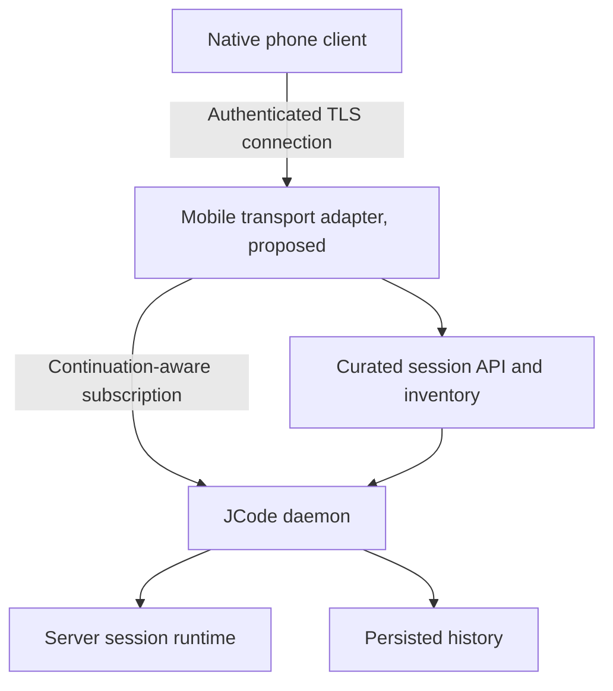

# Source and integration notes

8 November 2026 · design research, not a runtime audit

## 1. Pinned inputs

JCode was read through GitHub at **`629cca346f71f6c051cf8570dbea35cd0b20d5a2`**, the `master` head returned during this research (commit timestamp 8 November 2026, 10:10:54 UTC). The installed VPS version was not inspected. Every JCode link below is pinned to this snapshot.

The supplied design resources were read as design references:

- [frontend-design-deslop](https://github.com/samber/cc-skills/blob/main/skills/frontend-design-deslop/SKILL.md), including its theory, discovery, divergence, artifact classification, typography, OKLCH, layout, components, motion, iconography, dark-mode, accessibility, design-file schema, and slop-audit references. The skill blob returned during retrieval was `3df00b63c9b558041fc9ee1b5552df8b01fd7c7b`.
- [Hallmark](https://github.com/Nutlope/hallmark/tree/407fa689f4a276f2fd389208d271d0fef08f5058), README and core skill. Used for its critique of generic structure, clear product imagery, and one-idea-per-screen discipline. This is a custom mobile design exhibition, not a full Hallmark marketing-page generation run; no Hallmark theme or stock imagery was used.
- [Linear Mobile](https://linear.app/mobile): companion scope and reachable creation workflows.
- [Things](https://culturedcode.com/things/features/): compact-to-detailed continuity and restrained disclosure.
- [Android predictive Back](https://developer.android.com/guide/navigation/custom-back/predictive-back-gesture), [Android accessible targets](https://developer.android.com/guide/topics/ui/accessibility/views/apps-views), [Apple motion](https://developer.apple.com/design/human-interface-guidelines/motion), and [Apple background execution](https://developer.apple.com/documentation/uikit/about-the-background-execution-sequence): platform behavior constraints. These are current primary documentation references, not a claim of native-device validation.

## 2. What source actually establishes

| Claim | Pinned source | Design implication / confidence boundary |
| --- | --- | --- |
| JCode is a server with independent clients and many server-owned sessions | [SERVER_ARCHITECTURE.md](https://github.com/1jehuang/jcode/blob/629cca346f71f6c051cf8570dbea35cd0b20d5a2/docs/SERVER_ARCHITECTURE.md#L9), [SESSION_RUNTIME_OWNERSHIP.md](https://github.com/1jehuang/jcode/blob/629cca346f71f6c051cf8570dbea35cd0b20d5a2/docs/SESSION_RUNTIME_OWNERSHIP.md#L1) | The app owns views, drafts, and cache; the daemon owns execution. One runtime per session within a server process is enforced; not a distributed storage guarantee |
| Raw `subscribe` has explicit disconnect continuation, default false | [wire.rs, Subscribe](https://github.com/1jehuang/jcode/blob/629cca346f71f6c051cf8570dbea35cd0b20d5a2/crates/jcode-protocol/src/wire.rs#L145) | Remote continuation must be deliberately enabled; simply opening a websocket does not guarantee it |
| Continuation preserves live sessions/turns after transport loss and does not survive daemon termination | [wire.rs #L189](https://github.com/1jehuang/jcode/blob/629cca346f71f6c051cf8570dbea35cd0b20d5a2/crates/jcode-protocol/src/wire.rs#L189), [client_disconnect_cleanup.rs #L178](https://github.com/1jehuang/jcode/blob/629cca346f71f6c051cf8570dbea35cd0b20d5a2/crates/jcode-app-core/src/server/client_disconnect_cleanup.rs#L178), [client_lifecycle.rs #L3300](https://github.com/1jehuang/jcode/blob/629cca346f71f6c051cf8570dbea35cd0b20d5a2/crates/jcode-app-core/src/server/client_lifecycle.rs#L3300) | No phone background job needed to keep the agent working; daemon-death copy must remain distinct |
| Reattach uses persisted history and future events, not guaranteed missed-delta replay | [wire.rs #L189](https://github.com/1jehuang/jcode/blob/629cca346f71f6c051cf8570dbea35cd0b20d5a2/crates/jcode-protocol/src/wire.rs#L189) | Reconcile authoritative snapshots; do not count token deltas as unread messages |
| Identity-aware wire clients can negotiate runtime generation and monotonic turn identity | [wire/events.rs #L75](https://github.com/1jehuang/jcode/blob/629cca346f71f6c051cf8570dbea35cd0b20d5a2/crates/jcode-protocol/src/wire/events.rs#L75), [runtime ownership](https://github.com/1jehuang/jcode/blob/629cca346f71f6c051cf8570dbea35cd0b20d5a2/docs/SESSION_RUNTIME_OWNERSHIP.md#L53) | A stale terminal event must not complete a newer turn. Request IDs are not turn IDs |
| History prefix optimization exists on the raw protocol | [Subscribe.history_base](https://github.com/1jehuang/jcode/blob/629cca346f71f6c051cf8570dbea35cd0b20d5a2/crates/jcode-protocol/src/wire.rs#L176), [History.messages_base_count](https://github.com/1jehuang/jcode/blob/629cca346f71f6c051cf8570dbea35cd0b20d5a2/crates/jcode-protocol/src/wire/events.rs#L597) | A matching prefix can avoid full retransmission; no match means replacement/reconciliation, not blind concatenation |
| Remote gateway is raw WebSocket to the daemon’s JSON-line protocol, on `/ws`, default port 7643, disabled by default | [gateway.rs #L1](https://github.com/1jehuang/jcode/blob/629cca346f71f6c051cf8570dbea35cd0b20d5a2/crates/jcode-base/src/gateway.rs#L1), [GatewayConfig #L43](https://github.com/1jehuang/jcode/blob/629cca346f71f6c051cf8570dbea35cd0b20d5a2/crates/jcode-base/src/gateway.rs#L43) | This is not an app-ready curated API endpoint. The source listener is TCP; TLS/tunnel deployment is additional work |
| Header bearer auth is preferred; unknown/revoked token rejects upgrade with 401 | [gateway/auth.rs #L27](https://github.com/1jehuang/jcode/blob/629cca346f71f6c051cf8570dbea35cd0b20d5a2/crates/jcode-base/src/gateway/auth.rs#L27), [auth.rs #L123](https://github.com/1jehuang/jcode/blob/629cca346f71f6c051cf8570dbea35cd0b20d5a2/crates/jcode-base/src/gateway/auth.rs#L123) | Prefer secure header credential handling; differentiate re-pair from network retries. No token-in-URL design |
| Pairing is POST `/pair` with code/device ID/name; invite codes last five minutes | [gateway.rs #L459](https://github.com/1jehuang/jcode/blob/629cca346f71f6c051cf8570dbea35cd0b20d5a2/crates/jcode-base/src/gateway.rs#L459), [gateway/control.rs #L248](https://github.com/1jehuang/jcode/blob/629cca346f71f6c051cf8570dbea35cd0b20d5a2/crates/jcode-base/src/gateway/control.rs#L248) | Design one pasteable code field and explicit host review; elapsed expiry is unknown without timestamp |
| Pairing invite has a `jcode://pair?host=…&port=…&code=…` link | [gateway/control.rs #L275](https://github.com/1jehuang/jcode/blob/629cca346f71f6c051cf8570dbea35cd0b20d5a2/crates/jcode-base/src/gateway/control.rs#L275) | Deep-link import is possible; QR scanning/rendering is client work, not evidence of a working scanner in this proposed app |
| Curated API uses `req`, events use `ev`, and Hello negotiates a version/capability list | [harness requests.rs #L30](https://github.com/1jehuang/jcode/blob/629cca346f71f6c051cf8570dbea35cd0b20d5a2/crates/jcode-harness-api/src/requests.rs#L30), [events.rs #L5](https://github.com/1jehuang/jcode/blob/629cca346f71f6c051cf8570dbea35cd0b20d5a2/crates/jcode-harness-api/src/events.rs#L5) | The app should use a negotiated contract, not guess features from a version string |
| Inventory has titles, directory, saved/archived status, timestamps, runtime status, optional edit stats and worker relationships | [SessionInfo #L480](https://github.com/1jehuang/jcode/blob/629cca346f71f6c051cf8570dbea35cd0b20d5a2/crates/jcode-harness-api/src/events.rs#L480) | Session rows can be cheap; unknown optional values must remain absent. `user_connected` is not “agent is generating” |
| ListSessions supports a limit; PeekSession reads an unattached session’s tail | [requests.rs #L44](https://github.com/1jehuang/jcode/blob/629cca346f71f6c051cf8570dbea35cd0b20d5a2/crates/jcode-harness-api/src/requests.rs#L44), [requests.rs #L139](https://github.com/1jehuang/jcode/blob/629cca346f71f6c051cf8570dbea35cd0b20d5a2/crates/jcode-harness-api/src/requests.rs#L139) | Avoid attaching all sessions for previews. Limit is not pagination cursor; global search requires more work |
| Curated API has create, attach, archive, restore, soft interrupt, cancel, model/runtime info, and bounded file reads | [requests.rs](https://github.com/1jehuang/jcode/blob/629cca346f71f6c051cf8570dbea35cd0b20d5a2/crates/jcode-harness-api/src/requests.rs) | Reuse primitives but revalidate actual capability/path availability. No arbitrary mobile filesystem write/editor is implied |
| Agent-level MessageAccepted is distinct from bridge Ok | [events.rs #L293](https://github.com/1jehuang/jcode/blob/629cca346f71f6c051cf8570dbea35cd0b20d5a2/crates/jcode-harness-api/src/events.rs#L293) | Do not show “Accepted” on transport/bridge acknowledgment |
| Soft-interrupt injection has caller IDs on supported versions | [wire.rs #L75](https://github.com/1jehuang/jcode/blob/629cca346f71f6c051cf8570dbea35cd0b20d5a2/crates/jcode-protocol/src/wire.rs#L75), [events.rs #L380](https://github.com/1jehuang/jcode/blob/629cca346f71f6c051cf8570dbea35cd0b20d5a2/crates/jcode-protocol/src/wire/events.rs#L380) | Queued/injected state can be honest; caller ID is not a general durable idempotency guarantee |
| Tool execution, retries, text replacement, plan, stop reason, and terminal events are structured | [wire/events.rs](https://github.com/1jehuang/jcode/blob/629cca346f71f6c051cf8570dbea35cd0b20d5a2/crates/jcode-protocol/src/wire/events.rs), [harness events.rs](https://github.com/1jehuang/jcode/blob/629cca346f71f6c051cf8570dbea35cd0b20d5a2/crates/jcode-harness-api/src/events.rs) | Distinguish provisional from committed output and tool completion from turn completion |
| Generic progress can be optional/bounded task progress, not overall project certainty | [BackgroundProgress events](https://github.com/1jehuang/jcode/blob/629cca346f71f6c051cf8570dbea35cd0b20d5a2/crates/jcode-harness-api/src/events.rs#L270) | Main UI uses factual states/plan counts. A percentage, if used later, must identify its source task |
| Permissions types do not mean the current bridge implements permissions | [translate.rs #L1371](https://github.com/1jehuang/jcode/blob/629cca346f71f6c051cf8570dbea35cd0b20d5a2/crates/jcode-harness-api-server/src/translate.rs#L1371), [hello capability set #L376](https://github.com/1jehuang/jcode/blob/629cca346f71f6c051cf8570dbea35cd0b20d5a2/crates/jcode-harness-api-server/src/lib.rs#L376) | Base product excludes approval buttons. Treat future support as a capability-gated extension |
| The current harness bridge uses Unix transport and its attach translation omits continuation | [bridge daemon](https://github.com/1jehuang/jcode/blob/629cca346f71f6c051cf8570dbea35cd0b20d5a2/crates/jcode-harness-api-server/src/lib.rs#L246), [translate.rs #L578](https://github.com/1jehuang/jcode/blob/629cca346f71f6c051cf8570dbea35cd0b20d5a2/crates/jcode-harness-api-server/src/translate.rs#L578) | Wrapping the unmodified bridge in a websocket is insufficient to meet force-quit continuation |
| `user_response` is rendered answer Markdown, not a user-answer request | [tool/user_response.rs #L25](https://github.com/1jehuang/jcode/blob/629cca346f71f6c051cf8570dbea35cd0b20d5a2/crates/jcode-app-core/src/tool/user_response.rs#L25) | Never build a consent dialog or answer picker simply because this tool appears |
| Mobile UI lives in another repo; the old Swift client was retired on 6 November 2026 | [IOS_APP.md](https://github.com/1jehuang/jcode/blob/629cca346f71f6c051cf8570dbea35cd0b20d5a2/docs/IOS_APP.md) | This is a new RN design, not a claim that the retired iOS app implements it |
| Cloud transcript continuation is a separate account/entitlement flow and copies limited transcript state | [MOBILE_CLOUD_CONTINUATION.md](https://github.com/1jehuang/jcode/blob/629cca346f71f6c051cf8570dbea35cd0b20d5a2/docs/MOBILE_CLOUD_CONTINUATION.md) | Direct VPS access in this design does not require or silently invoke JCode Cloud transfer |

The design review also read the multi-session architecture, safety-system document, soft-interrupt design, client-state handling, SDK client, gateway authorization, and connection lifecycle. Some architecture documents describe intentions or older paths; executable source is the authority when they differ. The safety-system design document alone is not sufficient evidence of mobile permission support.

## 3. The exact continuation requirement

At attachment, the daemon-facing raw Subscribe must include `continue_on_disconnect: true`. It should negotiate `supports_turn_identity: true`, identify the client instance, and target the intended session. The server’s documented default for continuation is false. Detaching from a screen or terminating transport must not dispatch `cancel`, `clear`, `rewind`, or another destructive session mutation.

The lifecycle code retains the active turn owner after EOF when continuation is enabled, rather than tying it to the transport. That covers abrupt phone closure/network failure; it cannot rely on a graceful “I’m leaving” frame. Reattach receives history plus future events; all missed tool-token detail may not be reconstructible. Transport-owned stdin prompts are explicitly cleared on disconnection in the lifecycle path, so the UI must not promise to replay an old interactive process-input prompt after reconnect. Ordinary conversation and a revalidated recovery path remain available.

The shared daemon has its own idle/shutdown behavior and the VPS can restart. A service manager and durable server operation are deployment concerns. Mobile reconnection cannot turn a killed process into an uninterrupted turn. The acceptance test must observe remote execution, not just a reassuring cached spinner.

## 4. Chosen mobile adapter boundary

This section is a proposed integration specification for the implementation agent. It is not a claim that any named endpoint below already exists.

The adapter is a narrow compatibility and transport layer. It must not duplicate the agent engine, store another canonical transcript, call model providers from the phone, or launch a process per viewed session. Prefer extending the existing server/bridge rather than adding an unrelated heavyweight web stack.

Required contract, with distinctions between reuse and new work:

| Contract | Existing primitive | Required additional integration |
| --- | --- | --- |
| Pair and authenticate a device | Gateway code exchange/device registry | Secure remote deployment and shared authorization on app-facing transport |
| Negotiate version and capabilities | Harness Hello/HelloOk | A positive mobile-continuation capability backed by real subscription behavior; define additive capabilities without pretending the proposed string is already upstream |
| List sessions without disturbing them | ListSessions/SessionInfo | Expose over authenticated mobile transport; bound response size; supply truthful freshness |
| Attach exact session | Subscribe target/AttachSession | Set continuation on every attachment; preserve identity/fencing; never create a session as an implicit substitute for a missing target |
| Create a new session | CreateSession | Server directory validation and returned target ID before first send |
| Initial/reconnect history | History, raw history prefix optimization | Bounded recent-window API if necessary; snapshot identity/base and safe replacement rules; do not claim a generic event cursor already exists |
| Future work events | Streaming raw or translated API events | Fence obsolete runtime/turn output and normalize session attribution; preserve ordering around the snapshot boundary |
| Send acceptance | MessageAccepted plus request-level reply | Per-session pending-send correlation; expose ambiguity rather than invent exactly-once guarantees |
| Add guidance | SoftInterrupt + supported caller IDs | Queue/injection confirmation and filtered cancel only where supported |
| Work/plan | Tool events, todo/plan snapshots | Preserve source attribution, bounded output payloads; no mobile-generated plan inference |
| Model selection | RuntimeInfo/ListModels/structured route support | Cache with freshness; return actual rejection/unavailability |
| Archive / restore | Harness archive/restore | Acknowledge before reconciling list; prohibit conflating archive with stop |
| Files | ReadFile/session_files | Bounded read-only current-file access, permissions and symlink/path handling delegated to server policy |
| Push | Related mobile push code exists | Separately prove provisioning, platform delivery, deep-link resolution and privacy behavior; exclude from base availability |
| Structured permissions | Declared API types, inactive bridge path | Separately implement/verify permissions capability; do not expose until working |

If the team chooses direct raw `/ws` for an early vertical slice, that is an implementation alternative with a narrower feature set: continuation and streaming can be built from verified wire fields, but curated inventory/archival/files are not magically available on that socket. Mark unsupported screens unavailable or implement the explicit adapter. Never mix `req` and `type` protocols and hope the server guesses.

### Ordering and cache reconciliation

1. Subscribe to events before attaching so bootstrap events are not lost.
2. Bind the stream to the exact server and session; accept an authoritative attachment boundary before assigning events to a new runtime.
3. Keep provisional live output separate from committed history. Do not append a full snapshot onto an existing full transcript.
4. Apply a history delta only if its advertised base matches the local base. Otherwise replace the committed segment from authoritative history and restore the nearest stable reading anchor.
5. Buffer only a bounded amount of events during bootstrap. Merge only events after the accepted boundary and belonging to the current runtime/turn. Older terminal events cannot retire new work.
6. If stable persisted message IDs are unavailable, store a local anchor using a verified transcript prefix/fingerprint and message index; call counts unavailable after compaction/rewrite rather than fabricating a match.
7. Correctly handle replacement/retry rollback so a retracted response never becomes a second final answer.

### Status projection for the worker

Do not turn the example strings in API comments into an exhaustive enum. At this pin, the bridge’s attach snapshot explicitly emits `processing` or `idle`, while its authoritative activity updates emit `running` or `idle` ([translation](https://github.com/1jehuang/jcode/blob/629cca346f71f6c051cf8570dbea35cd0b20d5a2/crates/jcode-harness-api-server/src/translate.rs#L1906)). Normalize these deliberately:

| Evidence | Visible state | Priority and limitation |
| --- | --- | --- |
| Fresh attached `processing`, or fresh activity `running` | Working | Refine with a current tool’s factual name when one is executing |
| Fresh activity `idle`, with no newer turn/tool state | Ready | A stored result or old `done` is not enough to override a newer active turn |
| Current tool execution event, no matching completion yet | Running tool | A disconnect makes it last-known until reconciled |
| Confirmed soft-interrupt queue entry | Queued for the next safe point | Only matching incorporation changes it to Added |
| Current turn’s interruption/stop terminal | Stopped | Do not call a transport EOF a stopped turn |
| Current turn’s terminal error | Error | A nonterminal tool error remains scoped to that tool |
| Unknown string, missing freshness, or contradictory unscoped signals | Status unavailable / Last seen… | Preserve raw evidence in diagnostics; never guess a percentage or Ready |

Swarm lifecycle status and `user_connected` are separate metadata and cannot replace this projection. The activity snapshot must be fenced against newer events, as the current bridge itself does using an activity version. A mobile adapter must preserve that invariant rather than letting a slower history response resurrect old work.

### Things deliberately not promised

- Indefinite execution across daemon death, VPS reboot, or user-defined server timeouts.
- Replay of every missed token or interactive stdin request.
- Durable idempotency for arbitrary raw messages across reconnect.
- A global percentage or ETA for a coding task.
- Working mobile approval actions from an enum definition.
- FCM/APNs delivery, lock-screen actions, or a push wake channel for this proposed client.
- Cloud transfer of files/processes/credentials when opening a direct VPS session.
- SSH terminal management, sudo setup, server provisioning, or automatic deployment.
- Git repository diff/status from generic edit statistics or a tool’s old/new text.

## 5. Art and fixture provenance

All conversations, paths, timestamps, tool results, titles, event counts, and model labels shown in SHOWCASE.html are **explicit design fixtures**, chosen to exercise the specification. They are not claimed measurements, live VPS output, or a JCode capability demonstration. The return seam’s count comes from the fixture event list. Time advances only through explicitly scripted exhibition actions; no fake progress percentage exists.

JCode’s existing ring mark is copied from [assets/brand/jcode-mark.svg](https://github.com/1jehuang/jcode/blob/629cca346f71f6c051cf8570dbea35cd0b20d5a2/assets/brand/jcode-mark.svg). It is not a redesign of the upstream brand. See the accompanying attribution/license material.

Fonts: [Bricolage Grotesque](https://github.com/google/fonts/tree/main/ofl/bricolagegrotesque), [Hanken Grotesk](https://github.com/google/fonts/tree/main/ofl/hankengrotesk), [IBM Plex Mono](https://github.com/google/fonts/tree/main/ofl/ibmplexmono), each with its supplied SIL Open Font License. Full TTF files support the implementation worker; the exhibition embeds smaller subsets retaining Latin Extended characters used by Turkish/German.

UI icon geometry is drawn from a consistent customized Lucide line set under its ISC license, at 1.65-unit stroke. The upstream JCode mark is the only brand illustration. There are no generated raster illustrations or uncredited stock photographs.

## 6. Verification boundary

This deliverable verifies source assumptions and the HTML design exhibition, not a running React Native app or the user’s VPS. Measured HTML render/layout checks belong in the appended review record. Mobile memory, battery use, native IME/back behavior, screen-reader output, TLS deployment, continuation integration, and push delivery require the separate implementation and physical-device checks specified in PRODUCT_SPEC.md. Do not convert the proposed budgets or mockup labels into performance claims.

### Exhibition verification record

The final exhibition passed 27 scripted behavior/layout checks and an additional sheet-drag check. Eight widths from 320 to 1920 CSS pixels were checked. Axe-core 4.10.3 reported no violations in the four tested Light/Night/Offline/Work states under WCAG A/AA tags through 2.2. Chromium reported no script errors or external HTTP(S) requests in those flows. Twelve reference captures and both explanatory SVGs were reviewed. This verifies the exhibition only; it does not establish the proposed mobile performance budgets or VPS behavior.
