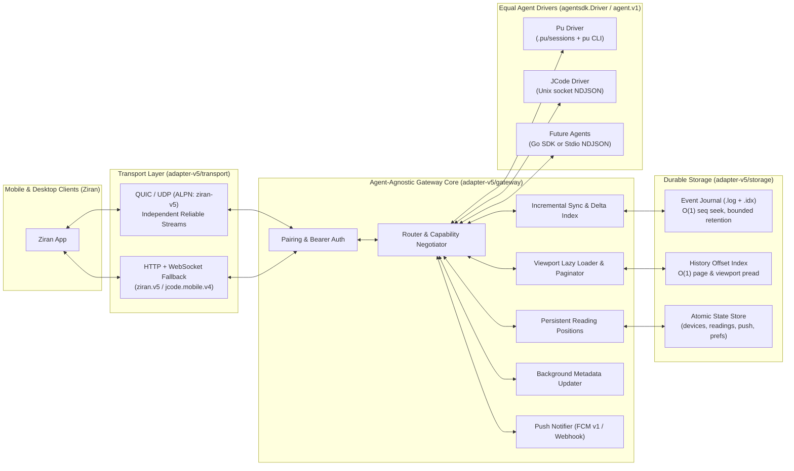

# Ziran Adapter v5 — Architecture & Wire Protocol Specification

> **Wu wei:** minimal dependencies, minimal abstractions, zero unnecessary work.
> One independent Go binary serving Ziran (and any future client) over QUIC/UDP with WebSocket fallback, speaking to **Pu**, **JCode**, and future agents as equal backends through a minimal versioned driver contract (`agent.v1`).

---

## 1. Design Principles

1. **Agent-agnostic core:** The gateway never hardcodes JCode or Pu semantics in its routing, storage, sync, or transport layers. Every backend registers via `agentsdk.Driver` and advertises explicit capabilities.
2. **Pu stays pure:** Pu's repository and core loop carry **zero** gateway, QUIC, WebSocket, or HTTP dependencies. The `pu` driver integrates from the outside via Pu's append-only `.pu/sessions/<id>/events.jsonl` store, `~/.pu/models.toml`, and the `pu` CLI.
3. **JCode fidelity preserved:** The `jcode` driver speaks JCode's native Unix socket NDJSON protocol with `continue_on_disconnect: true`, preserving live steering, permissions, plan, swarm, model/effort switching, and session management.
4. **No head-of-line blocking:** QUIC over UDP separates control RPCs, per-session live streams, history/viewport pagination, and background metadata onto independent reliable streams. WebSocket over HTTP/TLS provides seamless fallback behind restrictive NATs/firewalls.
5. **Bounded everywhere:** Fixed-capacity per-client/per-session queues with explicit `backpressure` errors, `O(1)` byte-offset history & event indices (never loading whole transcripts into RAM), and bounded journal retention with honest `gap: true` reporting.

---

## 2. System Architecture



---

## 3. Transport & Stream Multiplexing

### 3.1 QUIC over UDP (Primary)
- **ALPN:** `ziran-v5`
- **Framing on every stream:** `[uint32 big-endian payload_len][uint8 flags][payload bytes]`
  - `flags & 0x01 == 0`: UTF-8 JSON `Envelope`
  - `flags & 0x01 == 1`: raw binary chunk (for future attachments)
  - Hard frame cap: `4 MiB` (rejects oversized frames before allocation).
- **Stream roles (first 1-byte stream type header on open):**
  - `0x01` **Control (client-initiated bidi):** `hello`, `server.info`, `backends.list`, `sessions.list`, `sessions.delta`, `sessions.page`, `sessions.create`, `reading.set`, `reading.get`, `push.register`, `push.preferences`, `models.list`, `models.set`.
  - `0x02` **Session Live (client-initiated bidi, one per open thread):** `sessions.subscribe`, `events.replay`, `operations.dispatch`, `operations.cancel`, `tool.permission_response`, plus real-time `session.event` frames. A slow or verbose thread never stalls control RPCs or another thread.
  - `0x03` **History / Viewport (client-initiated bidi, ephemeral or pooled):** `history.page`, `history.viewport` — large transcript reads never block live token deltas.
  - `0x04` **Metadata Push (server-initiated uni):** coalesced `sessions.delta` / `metadata.updated` notifications for background list refreshes.

### 3.2 WebSocket Fallback
- Endpoint: `/ws` (HTTP/1.1 upgrade), plus `/health` and `/pair`.
- Negotiated subprotocols: `ziran.v5` (preferred) and `jcode.mobile.v4` (backwards compatibility for existing Ziran 0.7.3 builds).
- Auth: `Authorization: Bearer <token>` header or `token.<bearer>` WebSocket subprotocol.
- Carries the exact same JSON `Envelope` structure over a single multiplexed connection with bounded outbound send queue (capacity 256 frames; drops/signals `backpressure` rather than growing heap).

---

## 4. Wire Protocol v5 (`ziran.v5`)

### 4.1 Envelope
```json
{
  "v": 5,
  "kind": "request | response | event",
  "id": "req-1",
  "reply_to": "req-1",
  "backend_id": "pu | jcode | ...",
  "session_id": "pu:sess-01",
  "operation_id": "op-1",
  "epoch": "ep-1",
  "seq": 42,
  "type": "history.viewport",
  "payload": {}
}
```
Session IDs are globally scoped as `<backend_id>:<native_id>` inside the gateway so Pu, JCode, and future agents can never collide, while clients treat `session_id` as an opaque string.

### 4.2 Core Operations
| Message Type | Purpose |
| --- | --- |
| `hello` | Authenticate (on QUIC), negotiate protocol version (`min_v..max_v`), return server + per-backend capabilities |
| `backends.list` | List registered agent backends, health, version, and `agent.v1` capabilities |
| `sessions.list` / `sessions.delta` | Full list or incremental delta since `since_revision` (returns `sessions`, `removed`, `revision`, `full`) |
| `sessions.page` | Cursor-paginated session listing (`cursor`, `limit`, `backend_id`, `sort`) for 200+ threads |
| `sessions.create` / `sessions.rename` / `sessions.archive` / `sessions.restore` | Session lifecycle routed to target backend (or default backend) |
| `sessions.subscribe` / `sessions.unsubscribe` | Attach to live session stream with `after_seq` for immediate durable replay |
| `events.replay` | Explicit durable replay (`session_id`, `after_seq`, `limit`) returning `events`, `floor_seq`, `latest_seq`, `gap`, `has_more` |
| `history.page` | `O(1)` indexed history pagination (`session_id`, `before_index`, `after_index`, `limit`, `max_bytes`) |
| `history.viewport` | Viewport-driven lazy loading (`session_id`, `start_index`, `end_index`, `overscan`, `preview_chars`): returns full content for `[start-overscan .. end+overscan]` and lightweight stubs (`index`, `role`, `byte_len`, `preview`) outside it |
| `reading.set` / `reading.get` | Persist & restore per-device reading position (`session_id`, `message_index`, `scroll_offset_px`, `last_read_seq`, `updated_at_ms`) |
| `operations.dispatch` / `operations.cancel` | Send/steer prompt (idempotent via `operation_id`, optional `expected_turn_id`) or cancel active turn |
| `models.list` / `models.set` / `reasoning.set` | Capability-gated model & effort controls |
| `tool.permission_response` | Capability-gated tool approval (`allow_once`, `deny`) |
| `push.register` / `push.preferences` / `push.status` | Device push token registration & privacy-safe turn/failure/approval alerts |

---

## 5. Minimal Versioned Agent Protocol (`agent.v1`) & SDK

Package `adapter-v5/agentsdk` has **zero external dependencies** (Go stdlib only).

```go
const ProtocolVersion = "agent.v1"

type Capabilities struct {
    Streaming       bool `json:"streaming"`
    Steering        bool `json:"steering"`
    Cancel          bool `json:"cancel"`
    Permissions     bool `json:"permissions"`
    Models          bool `json:"models"`
    ReasoningEffort bool `json:"reasoning_effort"`
    Plan            bool `json:"plan"`
    Swarm           bool `json:"swarm"`
    HistoryIndex    bool `json:"history_index"`
    SessionsManage  bool `json:"sessions_manage"`
    Checkpoints     bool `json:"checkpoints"`
}
```

Every backend implements `agentsdk.Driver`:
- `ID() string`, `Info(ctx) (BackendInfo, error)`, `Capabilities() Capabilities`
- `ListSessions(ctx) ([]Session, error)`
- `GetHistory(ctx, sessionID, offset, limit) (HistoryPage, error)`
- `CreateSession(ctx, req) (Session, error)`
- `SendTurn(ctx, req, emit EventSink) (TurnResult, error)`
- `CancelTurn(ctx, sessionID) error`
- Optional capability extensions via clean small interfaces (`ModelDriver`, `PermissionDriver`, `SessionManageDriver`) — drivers that don't support a feature don't implement dummy methods; the gateway returns `unsupported_capability` automatically.
- `agentsdk.StdioDriver` lets any external agent written in Rust, Python, TypeScript, or C plug in over stdin/stdout NDJSON speaking `agent.v1`.

---

## 6. Storage & Memory Model

- **Durable Event Journal (`storage.Journal`):**
  - Per-session append-only `events.log` + `events.idx` (8-byte little-endian `uint64` file offset per sequence number).
  - Seeking to `after_seq` is `O(1)` (`Seek((seq - floor) * 8)`).
  - Bounded retention (default 4,000 events/session); compacting advances `floor_seq` so clients requesting older cursors receive `gap: true` and reconcile honestly.
  - Crash recovery trims any partial trailing record on open (same invariant as Pu's `events.jsonl`).
- **Indexed History (`storage.HistoryIndex`):**
  - Caches byte offsets of messages per session transcript (`history.idx`), enabling `O(1)` `history.page` and `history.viewport` reads with bounded memory even on 10,000-message threads.
- **Persistent Reading Positions & Device State (`storage.StateStore`):**
  - Atomic `write temp -> fsync -> rename` persistence for paired devices, reading positions, push registrations, and session metadata overrides.

---

## 7. Benchmark Plan (v5 vs v4)

We measure and record in `docs/ADAPTER_V5_BENCHMARKS.md`:
1. **Memory (RSS / Heap):** idle and under 250 sessions + 10,000 journaled events.
2. **Latency (p50 / p99):** QUIC vs WebSocket RPC round-trip, indexed `history.page` / `history.viewport` on a 1,000-message thread, and `events.replay` of 500 events.
3. **Network usage (bytes on wire):** full snapshot (v4 style) vs `history.viewport` + `sessions.delta` + `sessions.page` (v5).
4. **Recovery time:** disconnect + reconnect + durable replay catch-up (`after_seq`) and crash-restart journal recovery.
