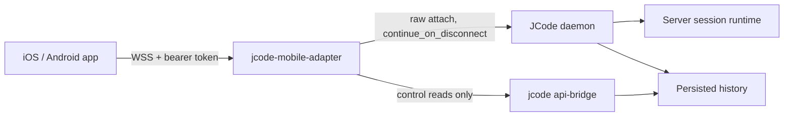

# Development

This is the contributor guide for JCode Mobile. It covers the stack, the transport contract, the test surfaces, and the commands that are actually verified on this repository.

Read [`GETTING_STARTED.md`](GETTING_STARTED.md) if you only want to run the app. Read [`ADAPTER_CONTRACT.md`](ADAPTER_CONTRACT.md) for the wire-level evidence behind the adapter.

## First, identify the host

Do not guess the toolchain. Run:

```sh
bash scripts/check-platform.sh
```

It prints the kernel, distro, Bun and JCode versions, and the commands supported on that machine.

| Host | Native iOS | Native Android | Web and Playwright |
| --- | --- | --- | --- |
| macOS with full Xcode 26.1+ | Yes | With SDK and JDK | Yes |
| Debian or Ubuntu VPS | No | With SDK and JDK | Yes, the primary CI target |
| Other Linux | No | With SDK and JDK | Yes |
| Windows | No | No | WSL2 only |

## Stack

| Layer | Choice |
| --- | --- |
| App | React Native 0.88.1, React 19.3.0, Expo SDK 58 |
| Language | TypeScript 6.0, strict |
| State | Zustand selector store plus a controller that survives screen unmounts |
| Navigation | React Navigation native stack |
| Persistence | expo-sqlite with scoped migrations, Keychain or Keystore for tokens |
| Adapter | TypeScript on Bun 1.4.4, WebSocket plus Unix daemon socket |
| Tests | Jest and React Native Testing Library, Bun test for the adapter, Playwright for the web target |
| Runtime | Bun 1.4.4 is the only supported JavaScript host. There is one `bun.lock`. |

## Non-negotiable invariants

These are product correctness rules, not style preferences. A change that breaks one is a regression even if the screen looks right.

1. Never map navigation, unmount, background, socket close, or app kill to Cancel, Clear, or Rewind. Only the explicit Stop control targets the current turn, and it sends `cancel` for that session only.
2. Every session attachment carries `continue_on_disconnect: true`. Continuation is set during attach, never in a final goodbye frame.
3. Reopening restores the exact server and session. A missing target shows an honest recovery state. Never create a replacement session implicitly.
4. Cached content paints first and is labelled as saved on this phone. Only an authoritative history or runtime reconciliation may claim Current or Ready.
5. Sending states are distinct: Draft saved, Sending, Sent to server (bridge ACK), Accepted (agent). Lost after write is Delivery unconfirmed. Never auto-resend.
6. Fence stale output with `attachment_id`, `turn_id`, and `session_id`. A slow response cannot overwrite newer live state.
7. Daemon death is not phone absence. Show saved history and a source-backed interruption state.
8. Unknown capability or status stays unknown. No invented percentages, approvals, push toggles, or progress. Folder browsing exists only through the authenticated, root-scoped picker.
9. Design tokens come from `src/design/tokens.ts` only. Fonts are bundled locally. Keep the return seam, 48-unit targets, 20/24 gutters, 12/24 radii, and no app drop shadows.
10. Scope every draft, bookmark, cache, pending send, and reading position by server and session.

## Architecture



The adapter has no agent engine, no second canonical transcript, and no provider calls. It reuses the daemon runtime, persisted history, the curated bridge for control reads, and JCode's own `devices.json` pairing registry.

The session transport is the raw daemon socket. The curated bridge is never used to attach. It supplies inventory, archive and restore, peek, todo state, and file reads.

### Attach lifecycle

1. The phone authenticates with a device token in the WebSocket header.
2. The adapter resolves the requested `target_session_id` and opens a daemon attachment with `continue_on_disconnect: true`.
3. The attachment emits a normalized `attachment_id` and a monotonic `turn_id`.
4. History is bounded by message count and bytes, with `base_index` and a tail fingerprint.
5. The phone reconciles cached history against that authoritative window. Only then may it show Current.
6. Frames from an older attachment are dropped by identity, not by arrival order.

The adapter serves `/pair`, `/health`, and `/ws`. Browser clients offer the `jcode-v1` and `token.<bearer>` subprotocols because browsers cannot set an `Authorization` header on a WebSocket. Native clients keep the header.

### Delivery states

`Sending` means the frame is in the phone's outbox. `Sent to server` means the adapter accepted and wrote the frame. `Accepted` means the daemon `ack` identified agent acceptance. `Delivery unconfirmed` means the connection was lost after a write with no authoritative acceptance. The last state is never auto-resent. The user sees `Send again` or `Dismiss record`.

### Identity fencing

The daemon tag in use has no wire-level turn identity. The adapter adds `attachment_id` and a monotonic `turn_id` per attachment. The client also fences by `session_id`. A late terminal frame from a previous turn cannot complete newer work.

### Capability negotiation

Controls are gated by negotiated capabilities. For example, `mobile_continuation` must be present before the app can claim continuation. `permissions` is not advertised, so there is no approval UI. `push` is not advertised, so the app says it is not available on this server. Plan content only appears when the server reported todos.

## Repository layout

```text
src/design/          locked tokens, theme families, typography, controls, icons
src/core/protocol/   validated frames, normalization, identity fencing
src/core/connection/ transport, attachment lifecycle, reconnect, correlation
src/core/persistence/ credentials, SQLite migrations, scoped caches
src/core/state/      selector store and session controller
src/features/        sessions, conversation, work, connect, new session, server
src/shell/           app root and native stack
integration/jcode-adapter/
                     authenticated mobile adapter and contract tests
e2e/                 Playwright setup, seeding, and mobile UI specs
scripts/             staging, e2e, platform checks, builds, web serving
docs/                contract, verification, build state, guides, media
```

`src/shell/` is intentionally not `src/app/` because Expo tooling treats that as an Expo Router routes directory.

## Commands

```sh
bun install --frozen-lockfile
bun run check          # typecheck, lint, Jest
bun run typecheck
bun run lint
bun run test
bun run adapter:test   # Bun contract tests
bun run e2e            # Playwright against isolated staging
bun run web            # Expo web dev server
bun run web:export     # static web build
bun run web:serve      # serve dist/web with COOP/COEP
bun run ios            # native iOS dev build
bun run android        # native Android dev build
bun run adapter        # adapter against the local daemon
bash scripts/check-platform.sh
```

Release builds:

```sh
bash scripts/build-android-release.sh
bash scripts/build-ios-simulator.sh
```

`bun install` runs a small `expo-modules-jsi@58.0.22` compatibility patch. It is idempotent and needed for Xcode 26.1 with Swift 6.2 sendability checks. See [`TOOLCHAIN.md`](TOOLCHAIN.md).

Typecheck and lint run as `bun --bun`, so package shebangs cannot silently fall back to Node. The release scripts prepend `scripts/bun-shims` and set `NODE_BINARY`. `plugins/withBunGradle` rewrites the React Native Gradle plugin's default `node` calls to `bun --bun` during prebuild. A native build still needs its own JDK and Android SDK.

## What to run before claiming a change works

Run the checks the host supports. Report a check as NOT_RUN rather than implying it passed.

| Change | Required checks |
| --- | --- |
| Any TypeScript or UI change | `bun run typecheck`, `bun run lint`, `bun run test` |
| Adapter or protocol change | Above plus `bun run adapter:test` |
| UI, web target, or adapter change | Above plus `bun run e2e` |
| iOS native change | `bun run ios` on macOS with full Xcode |
| Android native change | `bun run android` with SDK 36 and JDK 17 |
| Release sign-off | `bash scripts/build-ios-simulator.sh`, `bash scripts/build-android-release.sh` |

The current evidence matrix is [`VERIFICATION.md`](VERIFICATION.md). The current build and artifact state is [`BUILD_STATE.md`](BUILD_STATE.md).

## Web target

The web target exists for UI verification, not as a second product surface. It runs the same screens through `react-native-web`.

```sh
CI=1 bunx --bun expo export -p web --output-dir dist/web
bun --bun scripts/serve-web.mjs dist/web
```

Key details:

- `metro.config.js` adds `wasm` to asset extensions because expo-sqlite's web driver needs it.
- The page must be cross-origin isolated. `scripts/serve-web.mjs` and the adapter send COOP and COEP headers. A plain static host will not work.
- `src/core/persistence/credentials.web.ts` stores tokens in `localStorage`. That is preview and test storage, not a keystore. Never call it secure.
- `src/core/dev/e2e-seed.web.ts` is gated by the build-time `EXPO_PUBLIC_E2E=1` constant and is inert in a normal export. It refuses non-loopback hosts.
- The adapter serves a web build only when `JCODE_ADAPTER_WEB_DIR` is set.
- Browser origins are allowed when loopback, or when listed in `JCODE_ADAPTER_ALLOWED_ORIGINS`.

## End-to-end tests

`bun run e2e` uses an isolated staging daemon and adapter. It never touches the production daemon on the user's socket or the live adapter on 7644.

| Piece | Value |
| --- | --- |
| Staging daemon | `.staging/jcode`, created by `scripts/e2e-prepare.sh` |
| Adapter | Port 7645 |
| Web build and server | `.staging/e2e/web`, port 8091 |
| Playwright projects | iPhone 14 and Pixel 7, plus a 320-wide compact project |
| Artifacts | `.staging/e2e/`, gitignored |

`scripts/run-e2e.sh` adds the rootless Linux Chromium library path only when `~/playwright-deps` exists, so the same command is safe on macOS.

## Adapter development

The adapter lives in `integration/jcode-adapter/`. Its configuration is in `src/config.ts`, the HTTP and WebSocket surface in `src/server.ts`, the daemon attachment in `src/attachment.ts`, and the bridge control reads in `src/bridge.ts`.

Local run against the production daemon:

```sh
JCODE_ADAPTER_PORT=7644 bun integration/jcode-adapter/src/main.ts
```

Local run against isolated staging:

```sh
bash scripts/staging-up.sh
bash scripts/staging-adapter.sh
```

Contract tests cover ACK and ingestion, continuation, index and byte bounds, split UTF-8, retry rollback, the v0.2.0 additive operations, and delivery ambiguity. Run them with `bun run adapter:test`.

Adapter rules:

- Every session attachment uses the raw daemon socket with `continue_on_disconnect: true`.
- The adapter never exposes a query-string bearer token.
- A non-loopback bind without TLS is refused unless `JCODE_ADAPTER_ALLOW_INSECURE_BIND=1` is explicitly set for an isolated development run.
- The folder picker is restricted to `JCODE_ADAPTER_ROOTS`.
- Logs redact tokens, pairing codes, and transcript content.
- `JCODE_ADAPTER_FAULT=drop_after_send` is test-only and off by default.

## Native builds

Requirements: Xcode 26.1 or newer for iOS, JDK 17 and Android SDK 36 for Android, and Bun 1.4.4.

```sh
bun run ios --device "iPhone 17 Pro"
bun run android
```

Android uses `softwareKeyboardLayoutMode: 'resize'`. The conversation screen applies its measured keyboard inset only on iOS, so the composer is not padded twice.

The bundle identifier is provisional (`com.jcodemobile.app`). Change it before producing signed distribution builds. The current Android APK is debug-signed for sideloading and is not a store artifact.

## Design system

`src/design/tokens.ts` is the only source for color, spacing, radius, type, and motion tokens. `src/design/themes.json` holds 11 theme families and 22 Light plus Night palettes. Tidal is the default family.

Fonts are bundled locally: Bricolage Grotesque, Hanken Grotesk, and IBM Plex Mono. Icons are Lucide-based. Do not add app drop shadows, ad hoc colors, or new radii.

Screens must keep 48-unit targets, 20 or 24-unit gutters, 12 or 24-unit radii, and the return seam. Large text, Night mode, and narrow widths are first-class test surfaces.

## Accessibility

- Every control has an accessible name and role.
- Messages are announced as `You said` and `jcode said`.
- The composer is labelled.
- 200 percent text must reflow without clipping the composer or Send.
- Reduced motion is honored on animated surfaces.
- Manual VoiceOver and TalkBack passes are still NOT_RUN. Do not claim them.

## Contributing

1. Run `bash scripts/check-platform.sh`.
2. Read the invariants above before changing connection or conversation behavior.
3. Keep changes scoped. Do not touch the production daemon or the live adapter.
4. Add a regression test for every correctness fix. Pure logic belongs in Jest. Adapter protocol behavior belongs in `bun run adapter:test`. Visible flows belong in Playwright.
5. Run the checks your host supports.
6. Report NOT_RUN checks explicitly in the pull request.

Never commit tokens, pairing codes, staging state, build output, `.staging/`, or production transcripts.

## Documentation map

| Document | Purpose |
| --- | --- |
| [`GETTING_STARTED.md`](GETTING_STARTED.md) | Install, pair, send, leave, return, troubleshoot |
| [`DEVELOPMENT.md`](DEVELOPMENT.md) | This guide |
| [`ADAPTER_CONTRACT.md`](ADAPTER_CONTRACT.md) | Wire contract and source evidence |
| [`VERIFICATION.md`](VERIFICATION.md) | PASS, PARTIAL, NOT_RUN, BLOCKED matrix |
| [`BUILD_STATE.md`](BUILD_STATE.md) | Versions, artifacts, checksums, resumption point |
| [`TOOLCHAIN.md`](TOOLCHAIN.md) | Bun, Xcode, Android SDK, and patch details |
| [`DESIGN_DECISIONS.md`](DESIGN_DECISIONS.md) | Product and interaction decisions |
| [`REVIEW_FIXES.md`](REVIEW_FIXES.md) | Finding-by-finding review response |

## Independent project

JCode Mobile is an independent companion, not an official JCode release. The JCode mark, Bricolage Grotesque, Hanken Grotesk, IBM Plex Mono, and Lucide icons keep their own licenses. See [`THIRD_PARTY_NOTICES.md`](../THIRD_PARTY_NOTICES.md).
