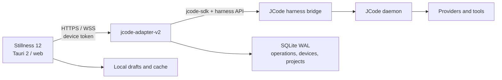

# Development

JCode Mobile 0.3.0 is a Rust adapter plus a Tauri 2 client. The phone is a
client. The daemon owns execution.

Read [`GETTING_STARTED.md`](GETTING_STARTED.md) to run it. Read
[`API.md`](API.md) for the wire reference. This guide is for changing the
repository.

## Identify the host

Do not guess the toolchain. Run:

```sh
bash scripts/check-platform.sh
```

It prints the kernel, distro, Bun and JCode versions, and the commands the host
supports.

| Host | Native Linux | Native Android | Web and Playwright |
| --- | --- | --- | --- |
| Debian/Ubuntu VPS | With GTK/WebKit or a user-space sysroot | With Android SDK and JDK 21 | Yes, primary CI target |
| macOS | Yes | With SDK and JDK | Yes |
| Other Linux | With distro GTK/WebKit packages | With SDK and JDK | Yes |
| Windows | No | No | WSL2 only |

The current release was built on Debian 13 with OpenJDK 21, Android SDK 37, NDK
27.1, and Rust stable.

## Stack

| Layer | Choice |
| --- | --- |
| Server adapter | Rust 2024, Tokio, Axum, rusqlite WAL |
| JCode link | `jcode-sdk` pinned to `0abff12c7f2b55ec03b38a42dedbcd5f4eff13f8` |
| Client | Stillness 12, React 19, TypeScript 6, Vite 7 |
| Native shell | Tauri 2 |
| Android | Tauri Android, minSdk 24, package `dev.jcode.stillness` |
| Credentials | Android Keystore, Linux Secret Service, browser `localStorage` for preview only |
| Tooling | Bun 1.4.4, Cargo, Playwright, Jest/RNTL for the legacy app |

The root Expo/React Native app under `src/` is the 0.2.x client. It remains for
history and legacy tests. The 0.3.0 product is `crates/adapter-*` plus
`apps/stillness`.

## Repository layout

```text
crates/adapter-protocol/  versioned v2 envelopes, payloads, events, errors
crates/adapter-core/      config, SQLite, auth, paths, JCode SDK link
crates/adapter-server/    Axum routes, WebSocket, dispatch, event pump
apps/stillness/           Stillness 12 web UI and Tauri shell
apps/stillness/e2e/       real-stack Playwright specs
apps/stillness/src-tauri/ desktop and Android shell, Keystore bridge
integration/jcode-adapter/ legacy 0.2.x TypeScript adapter
src/                      legacy Expo/React Native client
scripts/                  staging, e2e, Android/Linux builds, marketing media
docs/                     setup, API, contract, verification, evidence
design/references/        unchanged Stillness 12 reference
```

## Invariants

1. Navigation, unmount, background, socket close, and app kill never send
   Cancel, Clear, or Rewind. Only the explicit Stop control targets the current
   turn.
2. The adapter never auto-resends an ambiguous operation. `dispatching`,
   `accepted`, `rejected`, `unknown`, and `observed_in_history` are distinct.
3. A snapshot is authoritative only for the epoch and sequence it carries.
   Older events are ignored. A gap forces a snapshot.
4. The client does not invent progress, approvals, push support, token
   percentages, or file diffs. Missing telemetry stays unknown.
5. The file browser is root-scoped. Project paths are canonical, and traversal,
   NUL bytes, protected names, and escaping symlinks are rejected.
6. Provider credentials never enter the adapter, the phone, SQLite, logs, or the
   URL. Command Code stays in JCode's domain.
7. The web target is a verification surface. Its token is in `localStorage`, not
   a keystore.
8. The cache and every draft, pending operation, and reading position are
   scoped by server and session.

## Architecture



The adapter does not implement an agent. It converts SDK and harness events into
the mobile v2 contract, journals operations, and fans out session events.

### Request lifecycle

1. The client sends `operations.reserve` with a client-generated
   `operation_id`.
2. The adapter persists the operation as `staged`, then `reserved`.
3. `operations.dispatch` marks it `dispatching` and writes to JCode.
4. An authoritative `MessageAccepted` marks it `accepted`.
5. A five-second timeout marks it `unknown`.
6. A transcript match promotes `accepted` or `unknown` to
   `observed_in_history`.
7. Duplicate reserve and dispatch calls return the existing operation.

### Session lifecycle

1. `sessions.subscribe` binds the connection to one session.
2. The adapter builds a snapshot from `list_sessions`, bounded
   `peek_session`, runtime, plan, and usage.
3. The snapshot carries `epoch`, `last_seq`, `revision`, and `stale`.
4. `session.event` frames carry `session_id`, `epoch`, `seq`, and optional
   `turn_id` and `operation_id`.
5. A `needs_reconcile` event or a sequence gap requires a new snapshot.

## Commands

```sh
bun install --frozen-lockfile
cargo test --workspace
cargo fmt --all -- --check

bun run typecheck
bun run lint
bun run test

cd apps/stillness
bun install --frozen-lockfile
bun run build
bun run dev          # Vite on 127.0.0.1:5173
cd ../..
```

Release builds:

```sh
bash scripts/build-android-release.sh
bash scripts/build-tauri-linux.sh
```

The Android wrapper is `scripts/build-android-release.sh`, which delegates to
`scripts/build-stillness-android.sh`. It detects JDK 21/17 and the SDK, installs
missing Rust Android targets, builds the web bundle, runs
`tauri android build`, zipaligns, signs, verifies, and writes
`artifacts/jcode-mobile-0.3.0-android-release.apk.sha256`.

The legacy Expo build is `scripts/build-expo-android-release.sh`. It is not the
0.3.0 artifact.

## Host setup

### Android

The build needs:

- JDK 21 or 17
- Android SDK with a platform and build-tools
- NDK
- Rust targets `aarch64-linux-android` and `armv7-linux-androideabi`
- `apps/stillness/src-tauri/gen/android` (committed) and a local
  `local.properties` with `sdk.dir=...`

The generated Gradle project contains a local patch for the Tauri CLI path. It
is recorded in `scripts/patches/tauri-android-cli-path.patch`. Do not replace
the file with an unpatched `tauri android init` output without re-applying the
patch.

### Native Linux

`scripts/build-tauri-linux.sh` uses system GTK 3 and WebKitGTK 4.1 when present.
On a host without development packages and without sudo, set `TAURI_SYSROOT` to
a user-space prefix:

```sh
TAURI_SYSROOT="$HOME/tauri-sysroot" bash scripts/build-tauri-linux.sh
```

The script exports `PKG_CONFIG_PATH`, `LIBRARY_PATH`, and `LD_LIBRARY_PATH`.
Runtime launch under Xvfb may need a user-namespace overlay for WebKit helper
processes. That is test-host setup, not application code.

## Local staging

Start an isolated daemon and harness bridge:

```sh
JCODE_STAGING_DIR="$PWD/.staging/jcode-mobile" \
JCODE_BIN="$HOME/projects/jcode-fork/target/release/jcode" \
bash scripts/staging-up.sh
```

Start the adapter against it using the paths printed by the script. The real
stack Playwright runner does both:

```sh
bash scripts/stillness-e2e.sh
```

The staging scripts never use the production daemon, its socket, or its
sessions. Do not point a staging adapter at a production `JCODE_HOME`.

## Tests

| Surface | Command | Notes |
| --- | --- | --- |
| Rust adapter | `cargo test --workspace` | 30 tests |
| Rust formatting | `cargo fmt --all -- --check` | |
| Root typecheck | `bun run typecheck` | Legacy app and scripts |
| Root lint | `bun run lint` | Generated/vendor paths ignored |
| Legacy unit/RNTL | `bun run test` | 14 suites / 139 tests |
| Stillness build | `cd apps/stillness && bun run build` | `tsc --noEmit` plus Vite |
| Stillness lint | `./node_modules/.bin/eslint apps/stillness/src` | |
| Real-stack Playwright | `bash scripts/stillness-e2e.sh` | Isolated daemon and adapter |

A change to the adapter or protocol requires the Rust tests and the real-stack
Playwright run. A change to the Stillness UI requires the Stillness build and
the Playwright run. Report anything not run as `NOT_RUN`.

## Android runtime checks

```sh
bash scripts/build-android-release.sh
adb install -r artifacts/jcode-mobile-0.3.0-android-release.apk
adb shell am start -n dev.jcode.stillness/.MainActivity
```

The release APK contains ARM ABIs only. For an x86_64 emulator, build a debug
x86_64 APK from the same source:

```sh
cd apps/stillness
bunx tauri android build --apk --target x86_64 --debug
```

Pairing against a local adapter needs `adb reverse tcp:7646 tcp:7646`. The
release APK allows cleartext only for loopback. A remote phone must use the TLS
hostname.

## Web preview

```sh
cd apps/stillness
bun run build
cd ../..
JCODE_ADAPTER_WEB_DIR="$PWD/apps/stillness/dist" \
JCODE_ADAPTER_BIND=127.0.0.1:7646 \
./target/release/jcode-adapter-v2
```

A browser cannot set `Authorization` on a WebSocket. It offers
`jcode.mobile.v2` plus `token.<bearer>` as subprotocols. The adapter accepts the
subprotocol form. This is not a secure credential store.

## Markup and design

Stillness uses the CSS variables and components in
`apps/stillness/src/styles.css`, with fonts bundled under
`apps/stillness/public/fonts`. Do not add remote fonts, stock imagery, or a
second design system. The UI is light-first, with reduced motion supported as a
first-class setting.

The legacy Expo design tokens under `src/design/` apply only to the 0.2.x app.
They are not the 0.3.0 Stillness theme.

## Release checklist

1. `cargo test --workspace`
2. `cargo fmt --all -- --check`
3. `bun run typecheck`
4. `bun run lint`
5. `bun run test`
6. `cd apps/stillness && bun run build`
7. `bash scripts/stillness-e2e.sh`
8. `bun run marketing:test` when the website or README media changed
9. `bash scripts/build-android-release.sh`
10. Verify the APK label, package, version, ABIs, zipalign, and v2/v3
   signatures.
11. `bash scripts/build-tauri-linux.sh`
12. Update [`VERIFICATION.md`](VERIFICATION.md),
    [`BUILD_STATE.md`](BUILD_STATE.md), and
    [`evidence/v0.3.0/README.md`](evidence/v0.3.0/README.md).

## Documentation map

| Document | Purpose |
| --- | --- |
| [`GETTING_STARTED.md`](GETTING_STARTED.md) | Adapter, TLS, pairing, Android, Linux, troubleshooting |
| [`API.md`](API.md) | Endpoints, envelopes, requests, events, errors |
| [`ADAPTER_CONTRACT.md`](ADAPTER_CONTRACT.md) | Source evidence and non-goals |
| [`VERIFICATION.md`](VERIFICATION.md) | PASS, PARTIAL, NOT_RUN, BLOCKED |
| [`BUILD_STATE.md`](BUILD_STATE.md) | Versions, artifacts, checksums |
| [`V0_3_0_ADAPTER_V2_STILLNESS_V12.md`](V0_3_0_ADAPTER_V2_STILLNESS_V12.md) | Original design contract |
| [`evidence/v0.3.0/README.md`](evidence/v0.3.0/README.md) | Observed evidence |

## Independent project

JCode Mobile is an independent companion, not an official JCode release. The
JCode mark, Bricolage Grotesque, Hanken Grotesk, IBM Plex Mono, and Lucide
icons keep their own licenses. See [`THIRD_PARTY_NOTICES.md`](../THIRD_PARTY_NOTICES.md).
