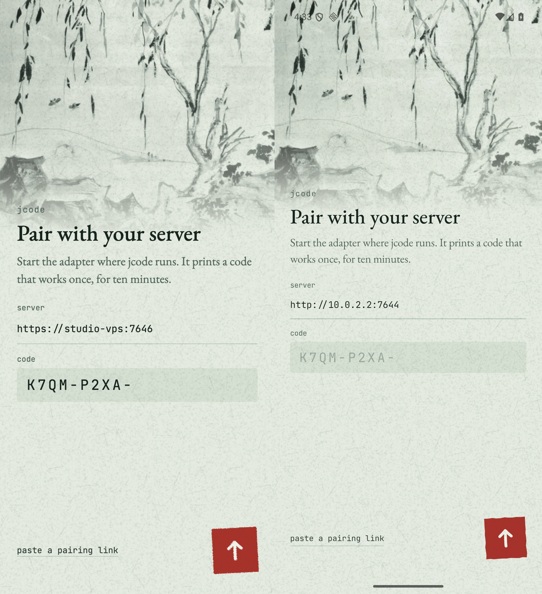
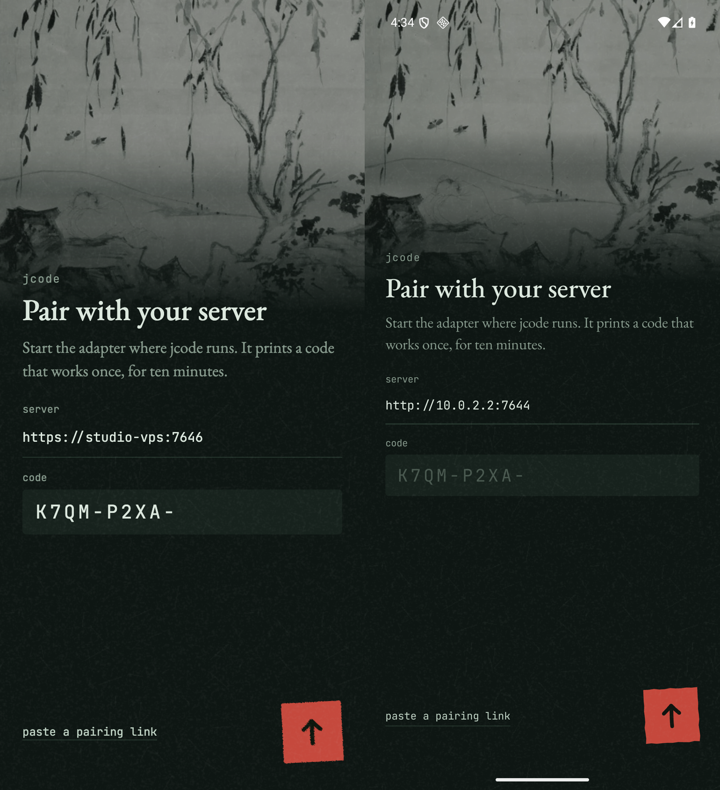
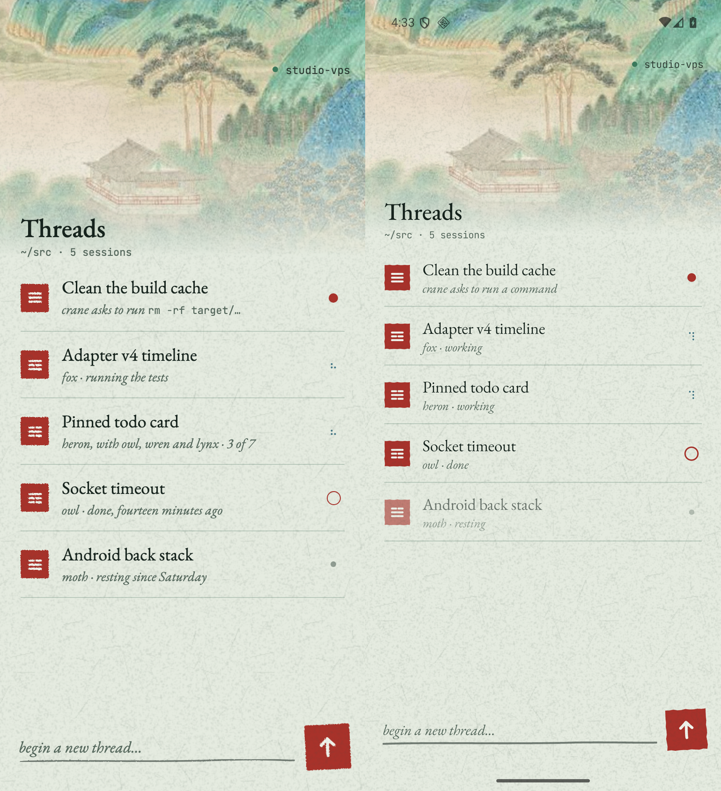
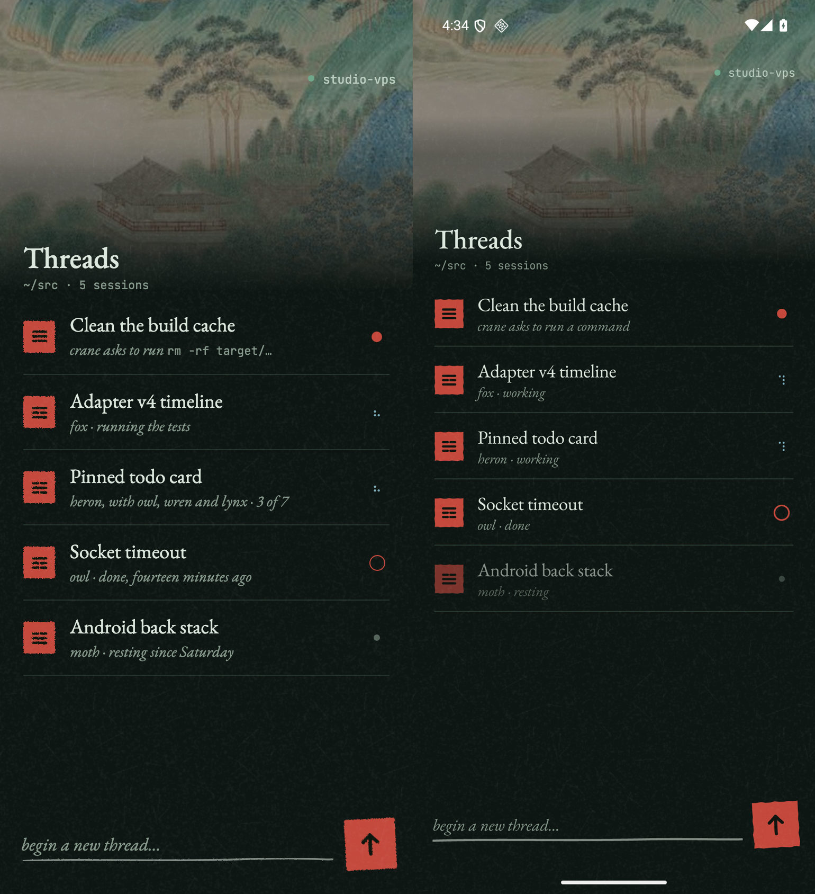
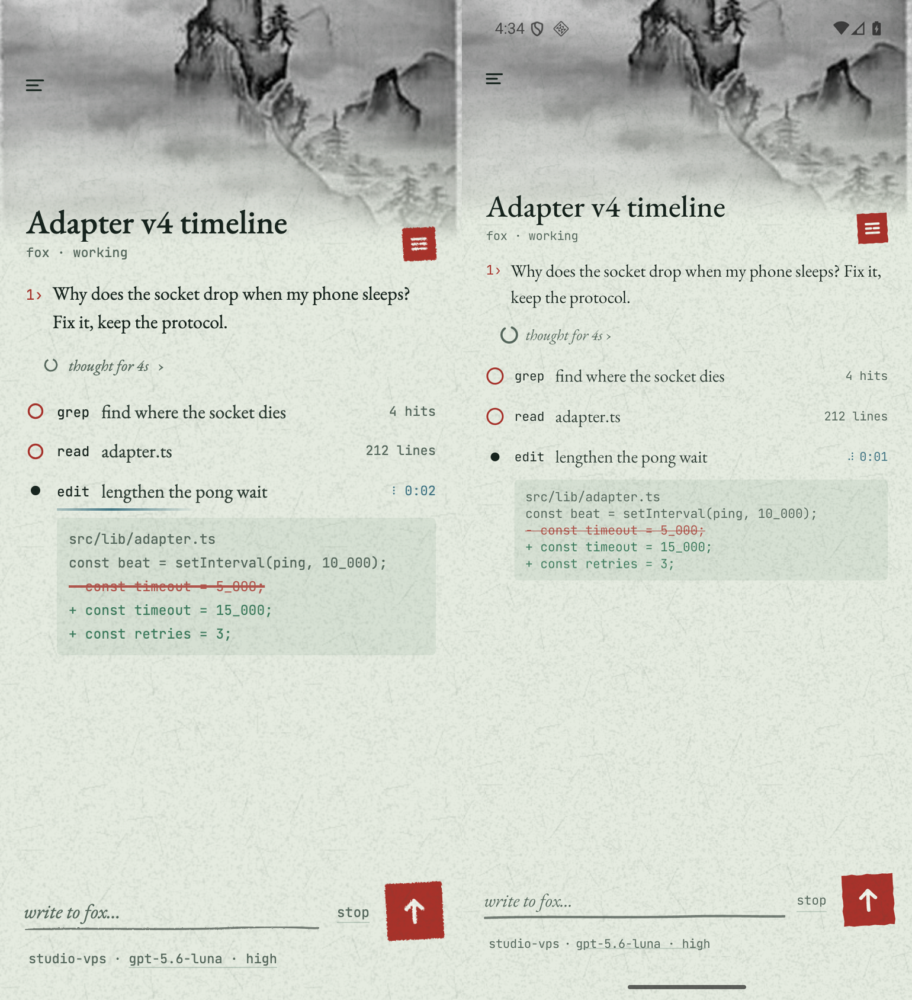
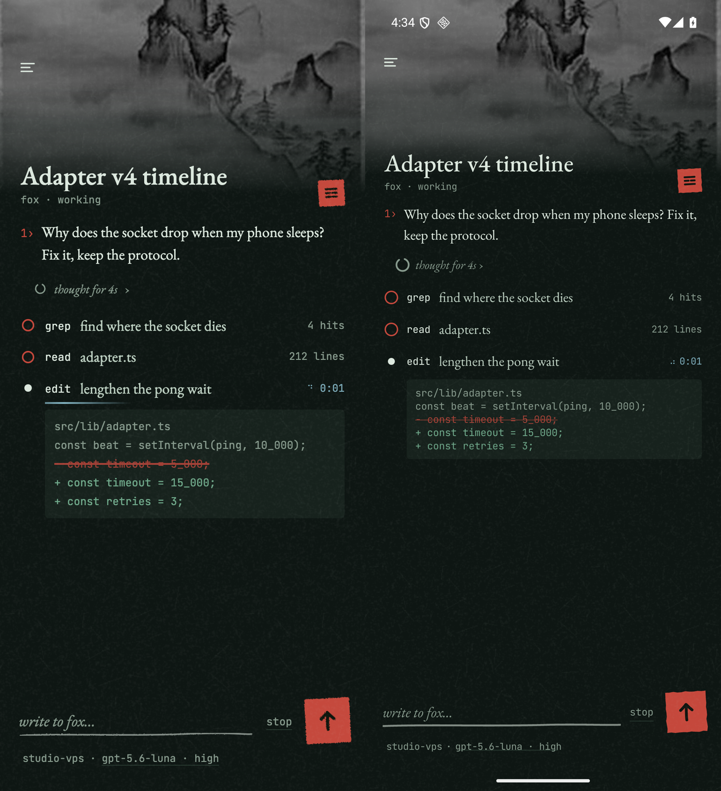
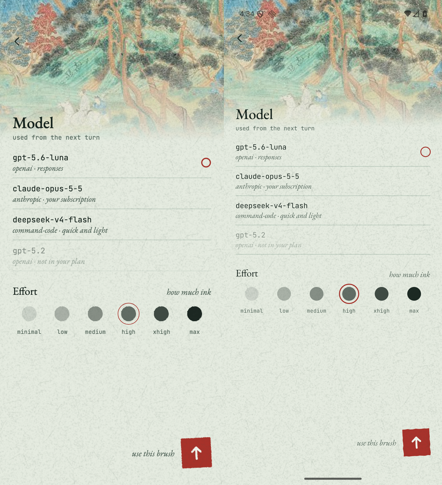
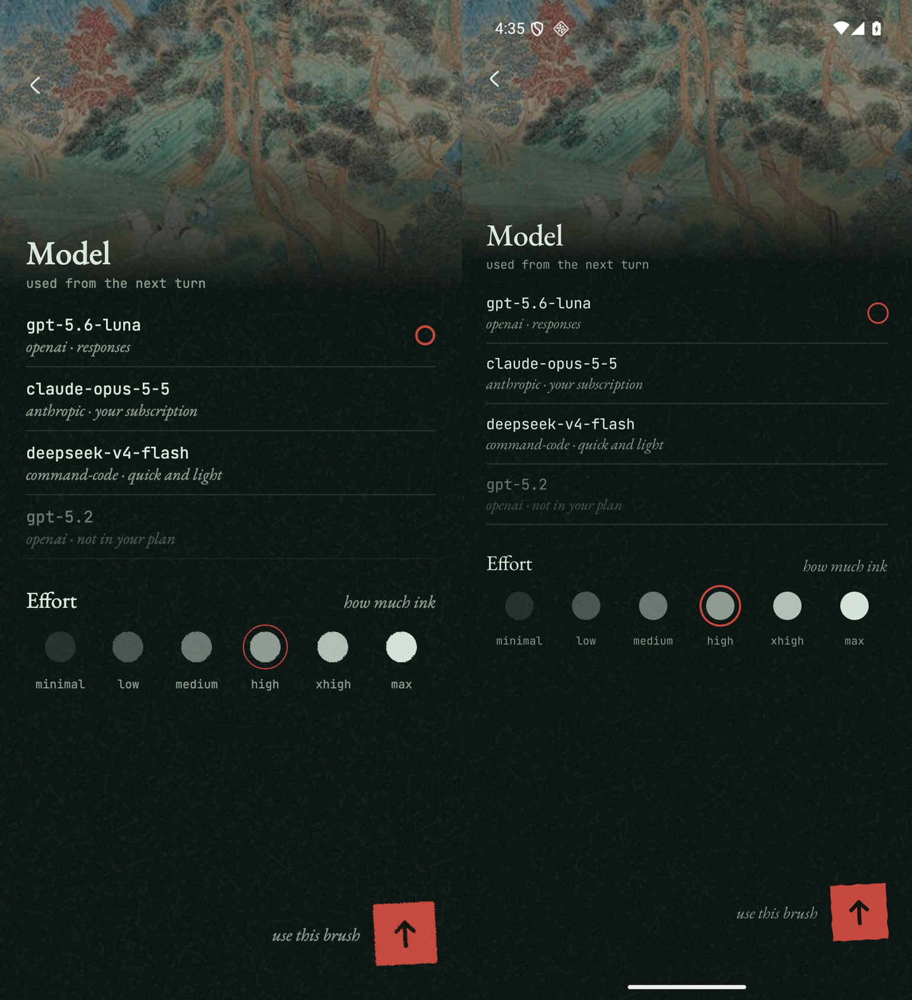
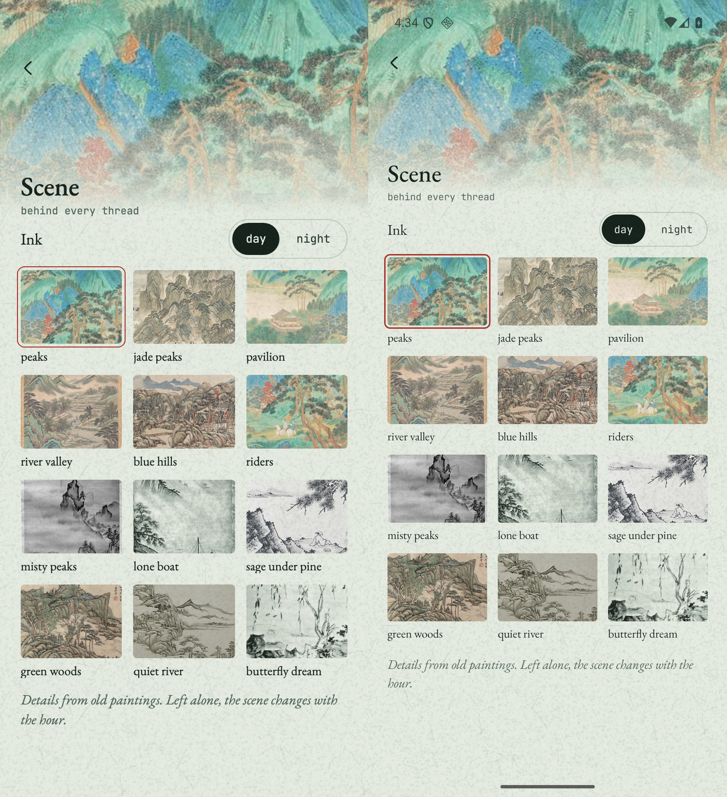
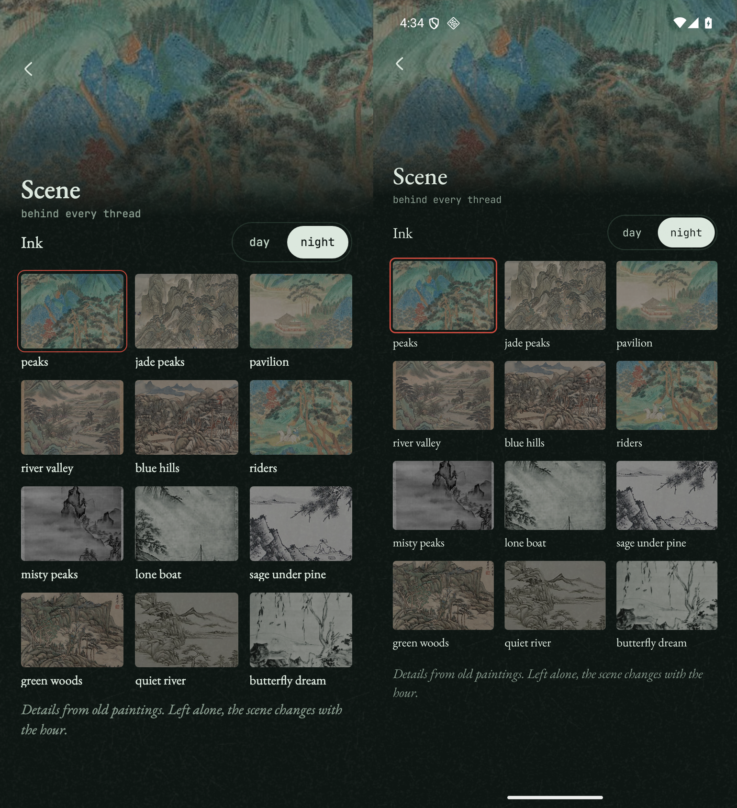

# Ziran 0.7.1 — Side-by-side verification evidence

Left pane: `design/wu-wei/` HTML boards recorded in Chromium at `390x844` (`deviceScaleFactor: 2`).
Right pane: Ziran Android `0.7.1` (`dev.ziran.android`) on `emulator-5554` (`1080x2400`, API 36, Metal host GPU, gesture nav).

## Side-by-side motion (1x and 0.25x)

| # | Flow | 1x | 0.25x | Match / remaining differences |
| --- | --- | --- | --- | --- |
| 1 | Start → pairing → threads | [1x](motion-1x/flow1_start_pair.mp4) | [0.25x](motion-025x/flow1_start_pair.mp4) | Matches: ink drop from Pair seal, staggered row rises, and send seal stamp; app pairs via deep-link intent rather than manual tap. |
| 2 | Open a thread | [1x](motion-1x/flow2_open_thread.mp4) | [0.25x](motion-025x/flow2_open_thread.mp4) | Matches: 900 ms ink drop from tapped row with leaving-page dim/scale and thread seal stamp; live turn stays idle until triggered. |
| 3 | Back + predictive back | [1x](motion-1x/flow3_back.mp4) | [0.25x](motion-025x/flow3_back.mp4) | Matches: 1:1 edge shrink to 90%, 30 dp rounded corners, cancel settle (320 ms), commit slide (300 ms), and 420 ms back slide with -22% parallax; uses Android SystemUI edge-back pill instead of a duplicate app chip. |
| 4 | Model and Scenes pickers | [1x](motion-1x/flow4_pickers.mp4) | [0.25x](motion-025x/flow4_pickers.mp4) | Matches: top-down 800 ms unroll behind 6 dp ink rod, self-drawing selection ring, effort ring, and 700 ms roll-up on back for both pickers. |
| 5 | Live turn | [1x](motion-1x/flow5_live_turn.mp4) | [0.25x](motion-025x/flow5_live_turn.mp4) | Matches: thinking bar grow/stream/fold, grep/read/edit/bash ink dot → flowing hairline → red ring, unfolding diff and test lines, and word-by-word answer stream; FreeType text weight is slightly lighter than macOS CoreText. |
| 6 | Composer, IME, queued message | [1x](motion-1x/flow6_composer_queued.mp4) | [0.25x](motion-025x/flow6_composer_queued.mp4) | Matches: composer rides Android IME frame by frame while painting stays still, fast input keeps all characters, and queued message rises in with `queued` tag; board has no native software keyboard. |
| 7 | Threads list gestures | [1x](motion-1x/flow7_threads_gestures.mp4) | [0.25x](motion-025x/flow7_threads_gestures.mp4) | Matches: swipe-left archive wash, collapse, 4.6 s undo bar + restore, long-press lift + action sheet + scrim dismiss, and pull-to-refresh ink ring; sheet labels `"Open"` instead of `"Open in a new window"`. |
| 8 | Scene and day/night switch | [1x](motion-1x/flow8_scene_theme.mp4) | [0.25x](motion-025x/flow8_scene_theme.mp4) | Matches: 1.2 s painting cross-fade, 34 s drift, and 600 ms colour + `nightFactor` ease on painting, grain, and thumbnails in both directions. |
| 9 | Reduced motion (`scale 0`) | [1x](motion-1x/flow9_reduced_motion.mp4) | [0.25x](motion-025x/flow9_reduced_motion.mp4) | Matches: navigation transitions become 120 ms fades with no ink drop, rod, or slide while swipe-to-archive still tracks the finger 1:1; board preview still draws a dark ripple dot on click. |

## Day and Night screens (Board left, App right)

| Screen | Day | Night |
| --- | --- | --- |
| Start |  |  |
| Threads |  |  |
| Live thread |  |  |
| Model |  |  |
| Scenes |  |  |
