# Ziran 0.7.2 — Side-by-side verification evidence

Left pane: `design/wu-wei/` HTML boards recorded in Chromium at `390x844`.
Right pane: Ziran Android `0.7.2` (`dev.ziran.android`) on `emulator-5554` (`1080x2400`, API 35, host GPU, gesture nav).

## Video flows (1x and 0.25x)

| Flow | 1x | 0.25x | What was checked |
| --- | --- | --- | --- |
| Live pairing flows | [1x](motion-1x/pairing_flows.mp4) | [0.25x](motion-025x/pairing_flows.mp4) | Unreachable server (`7699`) -> `"can't reach this address yet"` in `ink3`; reachable server (`7654`) -> green dot + adapter/protocol/jcode line; wrong code (`AAAA-BBBB-CCCC`) -> Pair seal stamps in, dots ease back, adapter error fades in in `ink`, underline turns indigo, code stays in field; right code (`K7QM-P2XA-9R4L`) -> 3-stage dots fill in indigo -> `Threads`. |
| Plan 21 s live loop | [1x](motion-1x/plan_loop.mp4) | [0.25x](motion-025x/plan_loop.mp4) | Side-by-side `Plan.dc.html` (left) and `PlanScreen` (right): flock painting, segmented bar, vertical thread line, trigram seals (`heron`, `owl`, `wren`, `lynx`), and 1 s tabular-figure elapsed clock ticking without row jump. |

## Day and Night screens (Board left, App right)

| Screen | Day | Night |
| --- | --- | --- |
| Start | 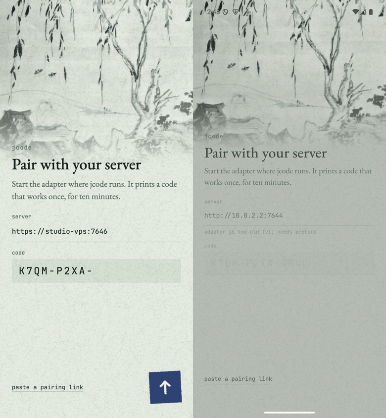 | 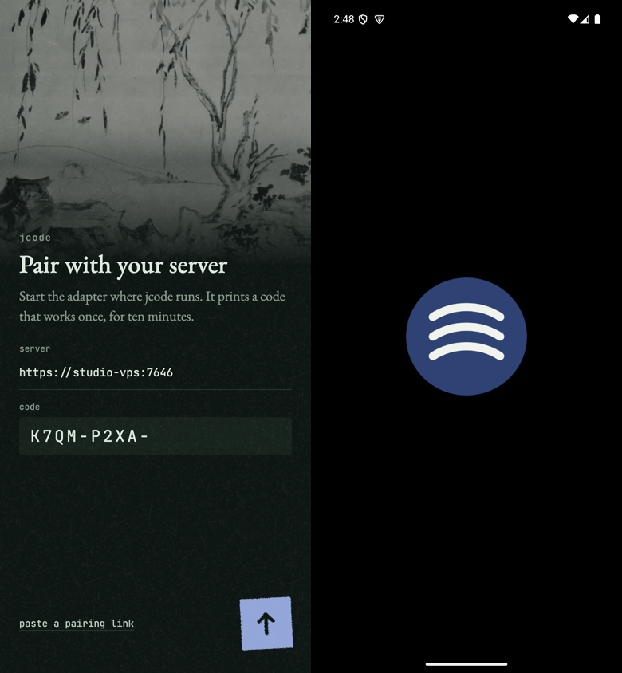 |
| Threads | 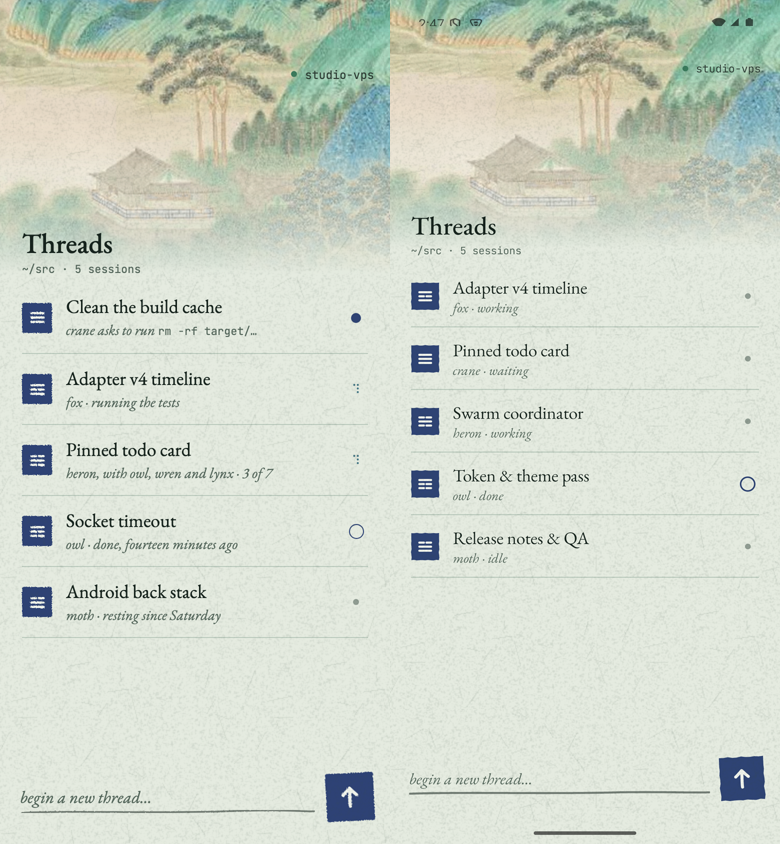 | 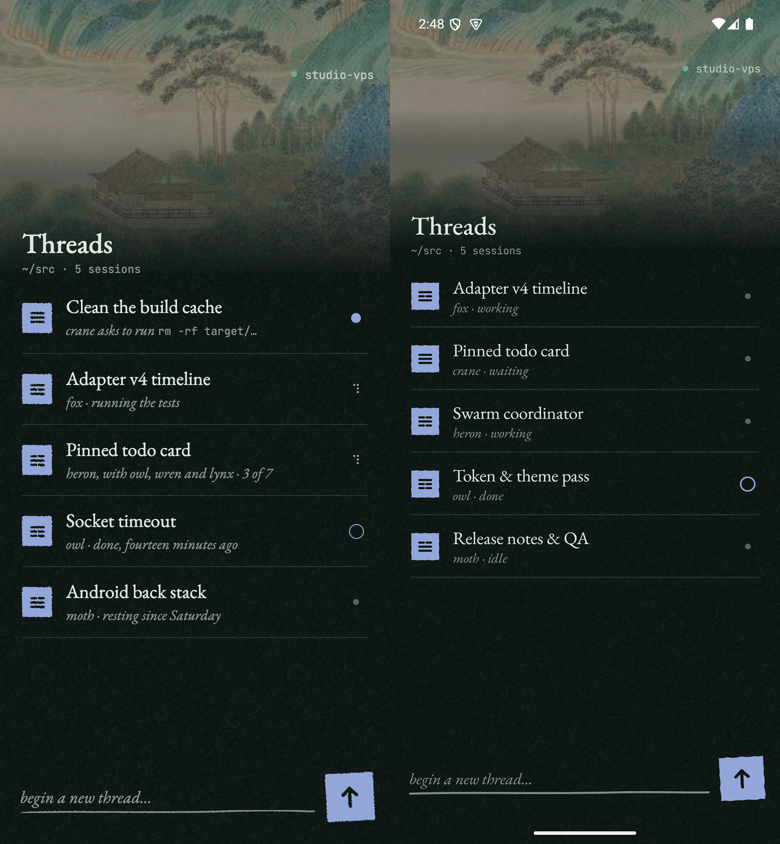 |
| Thread (58 dp header dots + Plan icon) | 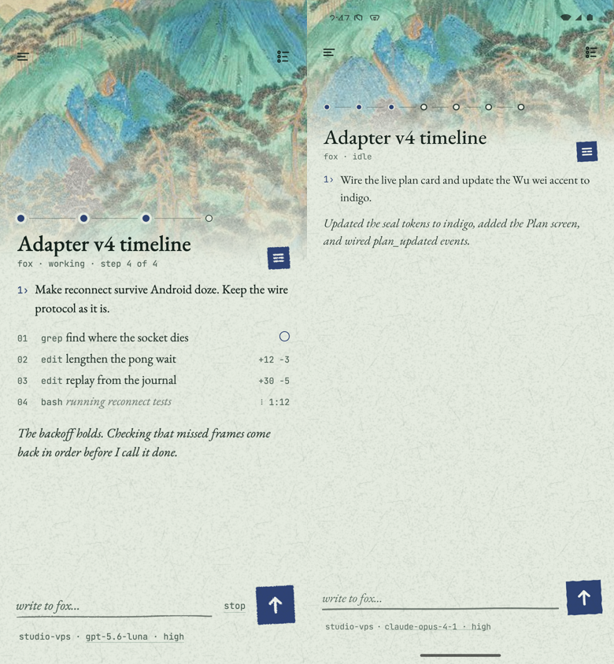 | 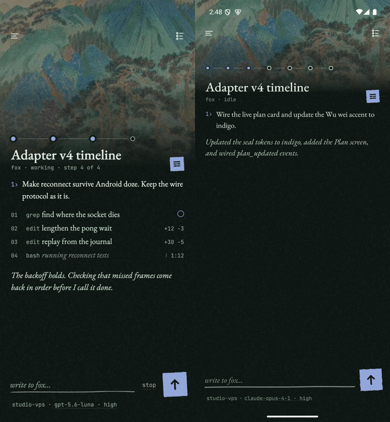 |
| Plan | 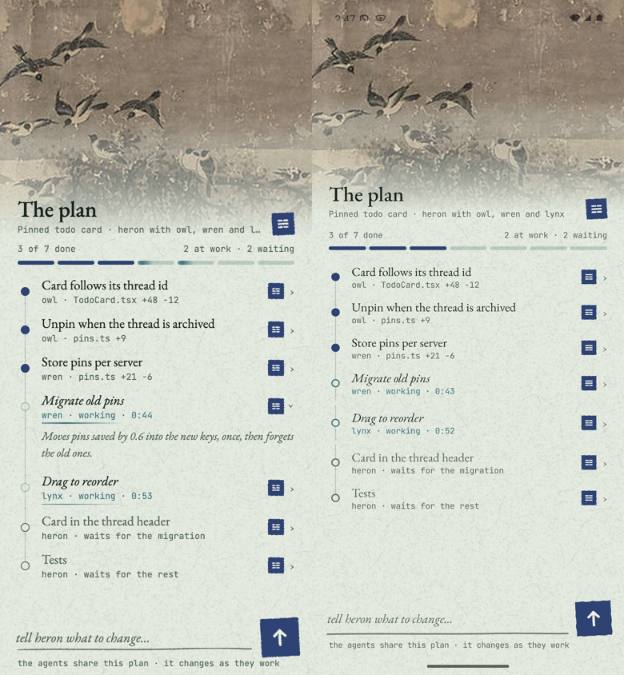 | 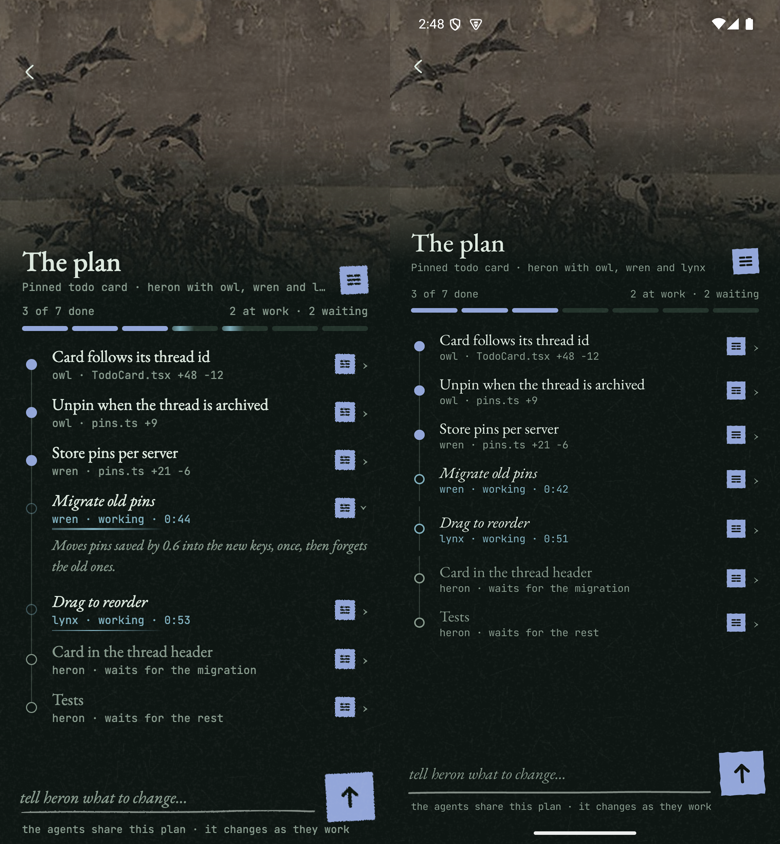 |
| Model | 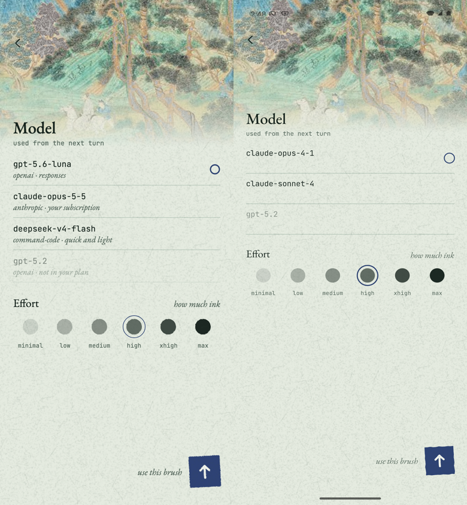 | 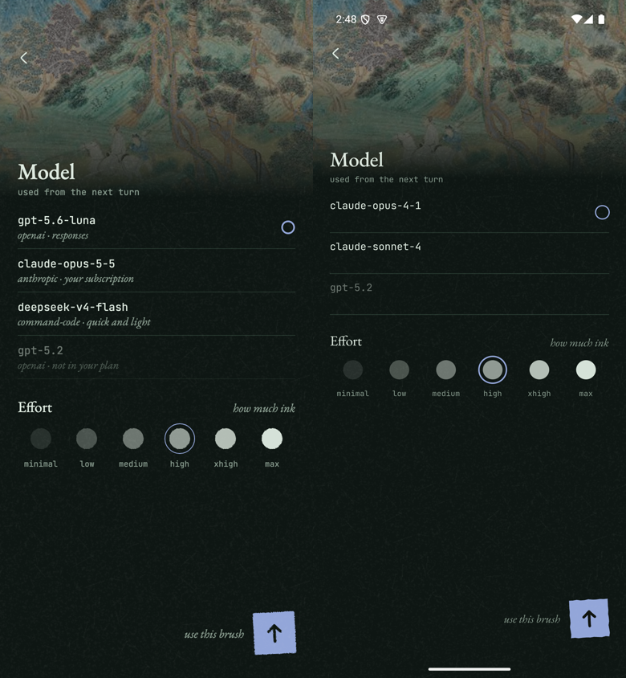 |
| Scenes (recoloured paintings) | 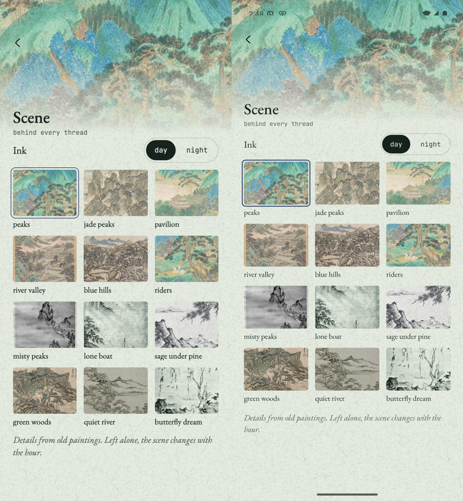 | 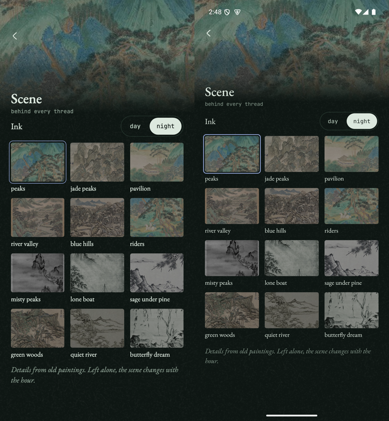 |

## Launcher icon

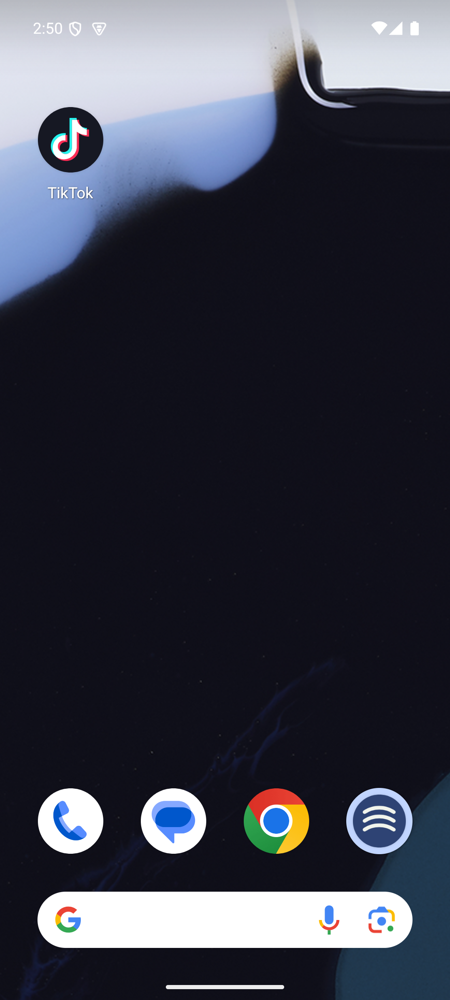
